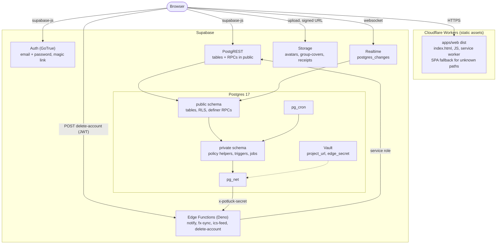
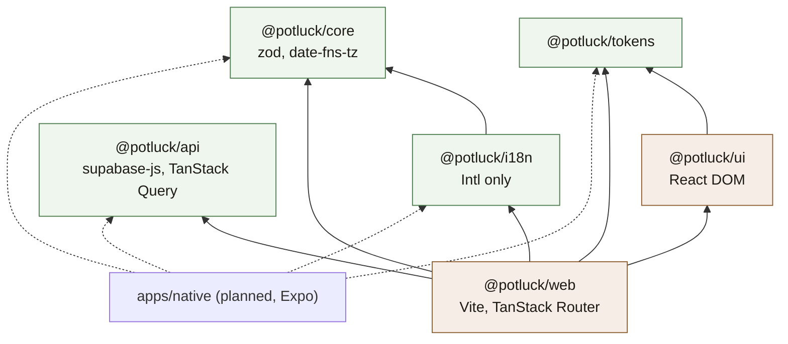
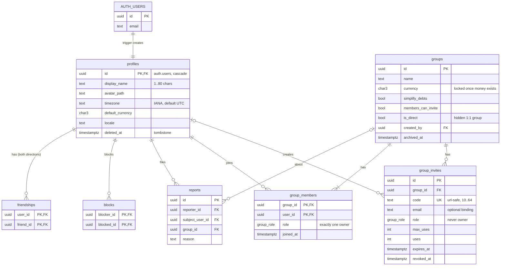
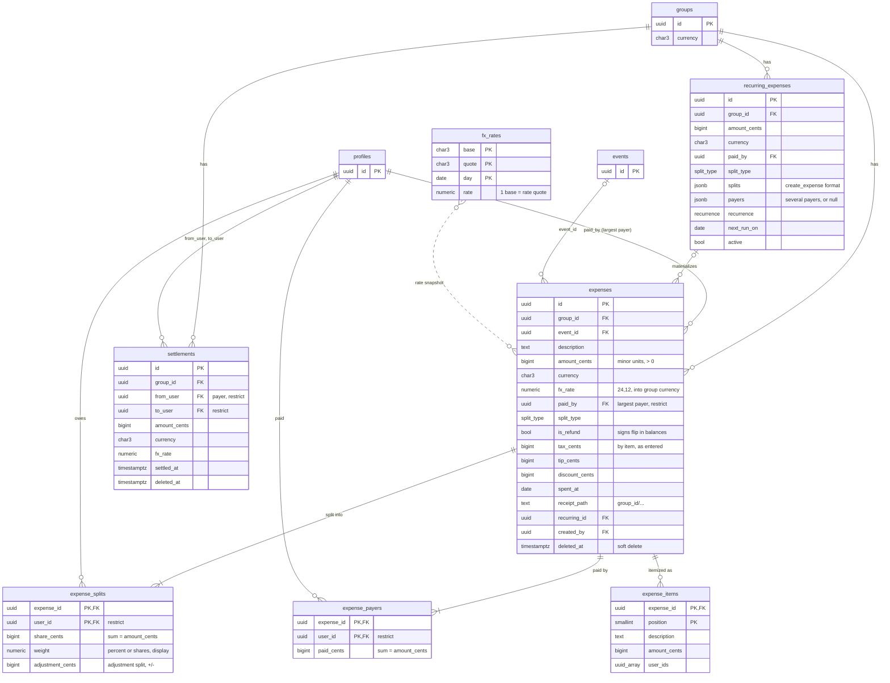
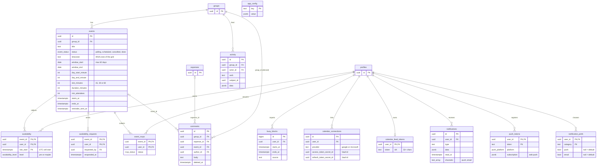

# Architecture

Potluck is a static web app (installable PWA) backed entirely by Supabase. There is no application server: the client talks to Supabase directly and Postgres Row Level Security is the authorization layer.

## System context

Who talks to Potluck and what Potluck talks to.

## Containers

There is no application server. The browser loads static files from Cloudflare and then talks to Supabase directly with the publishable key and the user's JWT.

## Packages

A native app (Expo) is planned. Everything below the screens is shared:

| Package           | Purpose                                                                                                                    | Platform     |
| ----------------- | -------------------------------------------------------------------------------------------------------------------------- | ------------ |
| `packages/core`   | split math, rounding, debt simplification, slot ranking and heat levels, recurrence dates, role checks, validation schemas | any (no DOM) |
| `packages/api`    | typed Supabase client, generated DB types, TanStack Query options                                                          | any (no DOM) |
| `packages/tokens` | design tokens as TS                                                                                                        | any          |
| `packages/i18n`   | strings, money/date formatting via `Intl`                                                                                  | any          |
| `packages/ui`     | web React components                                                                                                       | web          |
| `apps/web`        | web screens and routing                                                                                                    | web          |

### Package dependencies

Arrows point from a package to what it imports. Shared packages never import `@potluck/ui`, `@potluck/web` or `react-dom`; ESLint (`no-restricted-imports`, `no-restricted-globals` for `window`, `document`, `localStorage`) and a DOM-free `lib` in their tsconfig enforce it.

`packages/api` does not depend on `core`: it only knows the database types. Packages export TypeScript source (`"exports": { ".": "./src/index.ts" }`), so there is no build step between them; Vite and Vitest compile them on the fly.

## Ground rules

- Money is stored as integer minor units (`bigint` cents). Never floats.
- Every multi-row write (expense + splits, settle up, accept invite, lock event) goes through a `security definer` RPC that re-checks membership, so it is atomic and the same for every client.
- Timestamps are `timestamptz` (UTC). Clients render in the viewer's timezone (`profiles.timezone`).
- Migrations are additive. Native clients lag behind, so an RPC that needs a breaking change gets a `_v2` name instead.
- RLS is on for every table in `public`. Every policy has pgTAP coverage in `supabase/tests/`.
- Views use `security_invoker = true`.
- Helper functions used inside policies are `security definer`, `stable`, `set search_path = ''`, and live in a `private` schema so they are not exposed over the API.

## Schema (public)

The ER diagrams below are drawn from the migrations and split in three so they stay readable. Columns are trimmed to keys and the ones that matter for behavior; the lists after the diagrams have the rest. `profiles` and `groups` appear in more than one diagram.

### Diagram: identity, social and groups

### Diagram: money

The `group_balances` view (`security_invoker`) sums `expenses`, `expense_payers`, `expense_splits` and `settlements` into `(group_id, user_id, net_cents)`.

### Diagram: plans, feed and platform

### Enums

- `group_role`: `owner`, `admin`, `member`
- `split_type`: `equal`, `exact`, `percent`, `shares`, `adjustment`, `itemized`
- `event_status`: `polling`, `scheduled`, `cancelled`, `done`
- `availability_level`: `yes`, `maybe`
- `rsvp_status`: `going`, `maybe`, `declined`
- `push_platform`: `web`, `ios`, `android`
- `recurrence`: `weekly`, `monthly`, `yearly`

### Identity and social

- `profiles`: `id uuid pk → auth.users on delete cascade`, `display_name text not null`, `avatar_path text`, `timezone text default 'UTC'`, `default_currency char(3) default 'USD'`, `locale text default 'en'`, `deleted_at timestamptz`, timestamps. Created by trigger on `auth.users` insert.
- `friendships`: `(user_id, friend_id)` pk, `created_at`. Stored both directions. Created when two users share a group or by accepting a friend invite.
- `blocks`: `(blocker_id, blocked_id)` pk.
- `reports`: `id`, `reporter_id`, `subject_user_id?`, `group_id?`, `reason text`, `created_at`.

### Groups

- `groups`: `id`, `name text not null`, `emoji text`, `color text`, `cover_path text`, `currency char(3) not null default 'USD'`, `simplify_debts bool default true`, `members_can_invite bool default true`, `is_direct bool default false` (a hidden 2-person group used for 1:1 expenses between friends), `created_by`, timestamps, `archived_at`, `default_split jsonb` (where new expenses start, `{split_type: equal | percent | shares, splits: [{user_id, weight}]}`; written only by `set_default_split`).
- `group_members`: `(group_id, user_id)` pk, `role group_role not null default 'member'`, `joined_at`. Exactly one `owner` per group (partial unique index).
- `group_invites`: `id`, `group_id`, `code text unique` (url-safe, 10+ chars), `email text?`, `role group_role default 'member'` (cannot be owner), `max_uses int?`, `uses int default 0`, `expires_at timestamptz?`, `created_by`, `revoked_at`.

### Money

- `expenses`: `id`, `group_id not null`, `event_id?`, `description text not null`, `amount_cents bigint > 0`, `currency char(3)`, `fx_rate numeric(24,12) default 1` (rate into the group currency, snapshotted at creation), `paid_by uuid` (whoever paid the most, ties to the smaller id; kept for older clients), `split_type`, `category text`, `notes text`, `spent_at date default current_date`, `receipt_path text`, `recurring_id?`, `created_by`, timestamps, `deleted_at` (soft delete, restorable), `is_refund bool default false` (money coming back: the payers received it), `tax_cents`, `tip_cents`, `discount_cents` (by-item expenses, as entered).
- `expense_splits`: `(expense_id, user_id)` pk, `share_cents bigint not null`, `weight numeric` (percent or share count, for display), `adjustment_cents bigint` (adjustment splits). Constraint (deferred, via trigger): splits sum to `amount_cents`.
- `expense_payers`: `(expense_id, user_id)` pk, `paid_cents bigint > 0`, in the expense currency. Every expense has at least one row (backfilled from `paid_by`; a trigger keeps a single payer in step with `paid_by` and `amount_cents`, so writers that only know `paid_by` stay correct). Constraint (deferred, via trigger): payers sum to `amount_cents` (`payers_sum_mismatch`). Members read; writes only through the expense RPCs.
- `expense_items`: `(expense_id, position)` pk, `description`, `amount_cents`, `user_ids uuid[]`. A by-item bill as entered, so editing reopens it; the shares stay in `expense_splits`. Members read; written and dropped by `save_expense` together with the split.
- `recurring_expenses`: template rows (`group_id`, `description`, `amount_cents`, `currency`, `paid_by`, `payers jsonb` (null when one person pays), `split_type`, `splits jsonb`, `recurrence`, `next_run_on date`, `active bool`). A `pg_cron` job materializes due rows into `expenses` daily.
- `settlements`: `id`, `group_id`, `from_user`, `to_user`, `amount_cents > 0`, `currency`, `fx_rate`, `note`, `settled_at`, `created_by`, `deleted_at`.
- `fx_rates`: `(base, quote, day)` pk, `rate numeric(24,12)`, index on `(quote, day desc)` for the currency picker. Filled by the `fx-sync` edge function (Frankfurter API, free, no key), which stores cross rates with 12 decimals so weak currencies (IDR, KRW) keep at least 8 significant digits.
- View `group_balances` (`security_invoker`): `group_id`, `user_id`, `net_cents` (positive = is owed), in group currency.

### Plans

- `events`: `id`, `group_id`, `title`, `description`, `location`, `emoji`, `status event_status default 'polling'`, `window_start date`, `window_end date`, `day_start_minute int default 480`, `day_end_minute int default 1320`, `slot_minutes int default 30`, `duration_minutes int default 120`, `min_attendees int default 2`, `starts_at timestamptz?`, `ends_at timestamptz?`, `rsvp_deadline timestamptz?`, `created_by`, timestamps.
- `availability`: `(event_id, user_id, slot_start)` pk, `level availability_level`.
- `availability_requests`: `(event_id, user_id)` pk, `requested_by`, `requested_at`, `responded_at`.
- `event_rsvps`: `(event_id, user_id)` pk, `status rsvp_status`, `updated_at`.
- `calendar_connections`: `user_id`, `provider ('google'|'microsoft')`, encrypted tokens in Vault, `last_synced_at`. Feature-flagged off until OAuth credentials exist.
- `busy_blocks`: `(user_id, starts_at, ends_at, source)`; imported busy time, shown as hatched cells on the availability grid.

### Feed, notifications, platform

- `activity`: `id`, `group_id`, `actor_id`, `verb text` (`expense.created`, `settlement.created`, `member.joined`, `event.scheduled`, ...), `subject_id uuid`, `data jsonb`, `created_at`. Written by triggers.
- `comments`: `id`, `expense_id?`, `event_id?`, `author_id`, `body`, `created_at`, `deleted_at`.
- `notifications`: `id`, `user_id`, `type text`, `data jsonb`, `read_at`, `created_at`, `channels text[]` (where it went besides the inbox: `push`, `email`; set by a trigger).
- `notification_prefs`: `(user_id, category)` pk, `push bool?`, `email bool?` (null = the category default), `updated_at`. Only settings someone changed; categories and their defaults live in `private.notification_categories`, the type to category map in `private.notification_types` ([ADR 11](adr/0011-notification-prefs-and-email.md)).
- `push_tokens`: `(user_id, token)` pk, `platform push_platform`, `subscription jsonb` (web push), `last_seen_at`.
- `app_config`: `key text pk`, `value jsonb` (feature flags, `min_client_version` per platform). Readable by everyone.
- `calendar_feed_tokens`: `user_id pk`, `token text unique` (32+ chars), `created_at`. The only credential for the `ics-feed` URL. Owners can read their row; nobody writes it directly.

## Roles

| Permission                                          | Owner | Admin                          | Member                  |
| --------------------------------------------------- | ----- | ------------------------------ | ----------------------- |
| Add/edit own expenses, availability, RSVP, comments | yes   | yes                            | yes                     |
| Create events, request availability                 | yes   | yes                            | yes                     |
| Lock / cancel an event                              | yes   | yes                            | creator only            |
| Edit/delete others' expenses                        | yes   | yes                            | no                      |
| Create invites                                      | yes   | yes                            | if `members_can_invite` |
| Create admin invites                                | yes   | no                             | no                      |
| Remove members, change roles                        | yes   | admins can manage members only | no                      |
| Edit group settings                                 | yes   | yes                            | no                      |
| Delete group, transfer ownership                    | yes   | no                             | no                      |

A member cannot leave or be removed while their `net_cents` in that group is non-zero. "Own" expenses are the ones you created or paid (any part of). Any member may save the group's default split.

`create_invite` is the source of truth for admin invites: only the owner can mint them, and `can()` in `packages/core/src/roles` applies the same rule.

## RPCs

| Function                                                                                                          | Notes                                                                                                                                                                           |
| ----------------------------------------------------------------------------------------------------------------- | ------------------------------------------------------------------------------------------------------------------------------------------------------------------------------- |
| `create_group(name, emoji, color, currency)`                                                                      | creator becomes owner                                                                                                                                                           |
| `create_invite(group_id, role, max_uses, expires_at, email)` → invite                                             |                                                                                                                                                                                 |
| `invite_preview(code)` → group name, emoji, member count, first names                                             | callable by `anon`, for the join page                                                                                                                                           |
| `accept_invite(code)` → group_id                                                                                  | validates expiry/uses/revoked, adds member, creates friendships                                                                                                                 |
| `set_member_role(group_id, user_id, role)` / `remove_member` / `leave_group` / `transfer_ownership`               | role checks per table above                                                                                                                                                     |
| `get_or_create_direct_group(friend_id)` → group_id                                                                | 1:1 expenses                                                                                                                                                                    |
| `create_expense(payload jsonb)` / `update_expense(id, payload jsonb)`                                             | validates splits sum, membership, fx snapshot; ignores the v2 keys                                                                                                              |
| `create_expense_v2(payload jsonb)` / `update_expense_v2(id, payload jsonb)`                                       | v1 plus `payers`, `is_refund`, `items` with `tax_cents` / `tip_cents` / `discount_cents` ([ADR 12](adr/0012-several-payers-refunds-and-stored-items.md))                        |
| `set_default_split(group_id, split jsonb)` → jsonb                                                                | any member; `null` clears; logged as `group.default_split`                                                                                                                      |
| `delete_expense(id)` / `restore_expense(id)`                                                                      | soft delete                                                                                                                                                                     |
| `settle_up(group_id, to_user, amount_cents, currency, note)`                                                      |                                                                                                                                                                                 |
| `simplified_debts(group_id)` → rows `(from_user, to_user, amount_cents)`                                          | greedy max-creditor/max-debtor, tie-break by user id                                                                                                                            |
| `set_availability(event_id, slots jsonb)`                                                                         | replaces caller's rows for that event, marks request responded                                                                                                                  |
| `request_availability(event_id, user_ids uuid[])`                                                                 | creates notifications                                                                                                                                                           |
| `best_slots(event_id, limit int default 5)` → `starts_at, ends_at, yes_count, maybe_count, score, missing uuid[]` | score = yes + 0.5 * maybe, a person counts only if available for every slot in the duration, filtered by `min_attendees`, ordered by score desc then earliest                   |
| `schedule_event(event_id, starts_at)` / `cancel_event(event_id)`                                                  |                                                                                                                                                                                 |
| `my_timeline(from, to)`                                                                                           | upcoming events across all my groups with my RSVP and request state                                                                                                             |
| `delete_my_account()`                                                                                             | anonymizes profile (tombstone name), removes PII, deletes auth user via edge function                                                                                           |
| `calendar_feed_token(rotate bool default false)` → text                                                           | returns (and creates on first call) the caller's `.ics` feed token; `rotate` issues a new one and breaks old subscriptions                                                      |
| `my_notification_prefs()` → rows `(category, push, email, push_allowed, email_allowed)`                           | every notification setting with the caller's effective value, in display order                                                                                                  |
| `set_notification_pref(category, push?, email?)`                                                                  | changes one setting; a null channel is left as it is                                                                                                                            |
| `email_unsubscribe(token, action default 'unsubscribe')` → `{ category, email, subscribed, restored }`            | callable by `anon`: the signed token from an email is the credential. `preview` changes nothing, `unsubscribe`, `undo` restores what the unsubscribe changed; `email` is masked |
| `email_outbox_report(batch, delivered, error?, rejected?)`                                                        | service role only: `notify` reports each email batch (sent, or back to pending with backoff, failed after 5 attempts)                                                           |

## Database implementation notes

The schema lives in `supabase/migrations`, pgTAP tests in `supabase/tests` (`pnpm db:test`), demo data in `supabase/seed.sql`. This section records what the migrations do beyond (or differently from) the tables above.

Functions are redefined by later migrations (`settle_up` has three versions). The live definition of every table, policy and function is in [`supabase/schema/current.sql`](../supabase/schema/current.sql), generated by `pnpm gen:schema` and checked in CI; [`agent-map.json`](agent-map.json) lists each RPC with its arguments, grants, error codes and the newest migration that defines it (`definedIn`).

### Errors

Every RPC raises `message = <stable snake_case code>`, `detail = <readable English>`, `errcode = <sqlstate>`. PostgREST returns the code as `message` and the English text as `details`; clients translate the code.

SQLSTATEs:

- `42501`: not signed in, or not allowed.
- `PT404`: not found. PostgREST answers 404. Migrations before `20261105200000_not_found_as_404.sql` show `P0002` (HTTP 500); that migration rewrote every body, so never copy `P0002` from an old file. pgTAP (`01_schema.test.sql`) and `apps/web/src/lib/server-codes.test.ts` fail on it.
- `22023`: invalid input.
- `23514`: business rule.

Where the wording lives (`errorMessage` in `apps/web/src/lib/errors.ts`): the screen's scope first (`expenses.errors.<code>` in `packages/i18n/src/en/money.ts`, `events.errors.<code>` in `en/plans.ts`), then the auth codes, then `errors.codes.<code>` in `en/shell.ts`, then the generic message. `server-codes.test.ts` fails when a code raised in any migration has no wording on any screen or is missing from this list. `docs/agent-map.json` (`errorCodes`) shows, per code, its SQLSTATEs, the functions that raise it and the keys that translate it.

Codes:

- Session and membership: `not_authenticated`, `account_deleted`, `not_a_member`, `not_allowed`, `blocked` (joining a group, or opening a 1:1 tab, across a block in either direction).
- Groups and roles: `group_name_required`, `invalid_currency`, `group_currency_locked`, `group_owner_required`, `group_archived` (any write into an archived group: expenses, recurring expenses, payments, plans, availability, comments, RSVPs), `group_has_balances` (deleting a group while anyone, former members included, has a non-zero balance), `member_not_found`, `member_has_balance`, `owner_must_transfer`, `already_owner`, `cannot_change_owner`, `cannot_remove_owner`, `use_transfer_ownership`, `use_leave_group`.
- 1:1 tabs: `invalid_friend`, `not_a_friend`.
- Invites: `direct_group`, `invalid_role`, `invalid_max_uses`, `invalid_expiry`, `invite_not_found`, `invite_expired`, `invite_used_up`, `invite_revoked`, `invite_wrong_email`.
- Expenses: `invalid_payload`, `group_required`, `description_required`, `invalid_amount`, `invalid_receipt_path`, `payer_not_in_group`, `fx_rate_unavailable`, `expense_not_found`, `expense_deleted`, `event_not_in_group` (linking an expense to a plan in another group), `split_member_not_in_group` (moving money of someone who left), `invalid_payers`, `payers_sum_mismatch` (what each person paid does not add up to the amount, also from the deferred check).
- Splits: `invalid_splits`, `splits_required`, `splits_sum_mismatch`, `split_amount_required`, `percent_sum`, `invalid_weight`, `zero_shares`, `duplicate_user`, `adjustments_exceed_total`, `negative_share`, `items_required`, `invalid_items`.
- Payments: `invalid_recipient`, `settlement_not_found`, `member_not_in_group` (removing a payment with someone who has left).
- Notifications: `invalid_notification_category`, `invalid_unsubscribe_link`.
- Plans: `event_not_found`, `event_not_polling`, `event_not_schedulable`, `event_done`, `starts_at_required`, `invalid_slot`, `invalid_slots`, `duplicate_slot`, `rsvp_closed` (RSVP after the event's `rsvp_deadline`).

### RPC details and deviations

- `create_group(name, emoji?, color?, currency?)` returns the `groups` row. Currency defaults to the caller's `default_currency`.
- `create_invite(group_id, role = 'member', max_uses?, expires_at?, email?)` returns the invite row. Members can invite only when `members_can_invite`; only the owner can create `admin` invites; direct and archived groups cannot have invites.
- `invite_preview(code)` returns `group_id, name, emoji, color, cover_path, member_count, first_names text[] (owner first, max 5), status ('valid' | 'expired' | 'revoked' | 'used_up' | 'archived' | 'blocked'), is_member`. `blocked` is only reported to a signed in visitor who is not a member and has a block, in either direction, with someone in the group. Unknown codes raise `invite_not_found`.
- `accept_invite(code)`: already being a member returns the group id without using up the invite. Email-bound invites compare against the auth email, case-insensitive. Archived groups raise `group_archived`; a block between the joiner and anyone in the group raises `blocked`.
- `set_member_role`: admins may change roles of plain members only (including promoting to admin); nobody can grant `owner` here.
- Lock order (deadlock-free only if every function follows it):
  - `remove_member` / `leave_group` lock the group row before reading balances.
  - Every RPC that moves a balance (`create_expense`, `update_expense`, their `_v2` versions, `delete_expense`, `restore_expense`, `settle_up`, `delete_settlement`) takes a share lock on the group row first, so nobody leaves between a balance check and a new expense. `set_default_split` moves nothing and takes no lock.
  - Always the group row first, then the expense or payment row.
  - `delete_my_account` locks the rows of every group the account is in, in id order, before handing over ownership and removing zero-balance memberships.
  - The recurring expenses job share locks the group rows of every due template, in id order, before touching any template.
- `leave_group`: the owner must transfer first, unless nobody else active is left (they are alone, or only closed accounts remain, which cannot take ownership). Then leaving deletes the group, provided no active person (former members included) has an open balance there (`member_has_balance`); anything left is between the owner and closed accounts.
- `delete_group(group_id)`: owner only. Locks the group row, then refuses with `group_has_balances` unless every balance in `group_balances` (former members included, direct groups too) is zero. Clients cannot delete `groups` rows directly; a `before delete` trigger on `groups` also refuses any other delete of a group with open balances (only `delete_my_account` may remove a group nobody active is left in).
- `get_or_create_direct_group(friend_id)`: the friend must be a friend or share a group, and neither may have blocked the other. Creates a group named `Direct` (caller owner, friend admin, `members_can_invite = false`).
- `create_expense(payload)` / `update_expense(id, payload)` / `delete_expense(id)` / `restore_expense(id)` return the `expenses` row.
  - Payload keys: read `private.save_expense` in `supabase/schema/current.sql` (the live version; the comment at the top of the first expenses migration is older).
  - Extra payload key `recurrence` (`weekly` | `monthly` | `yearly`, create only) also creates a `recurring_expenses` template whose first run is one period after `spent_at`.
  - `receipt_path` must start with `<group_id>/`.
  - Members edit expenses they created or paid (any part of); admins and the owner edit any.
- `create_expense_v2(payload)` / `update_expense_v2(id, payload)` ([ADR 12](adr/0012-several-payers-refunds-and-stored-items.md)) take everything v1 does, plus:
  - `payers`: `[{user_id, paid_cents}]`, whole minor units, zero dropped, one row per person, summing to `amount_cents`; `paid_by` becomes whoever paid the most (ties: smaller id). Without `payers`, `paid_by` alone means one payer; on an expense several people paid, the same `paid_by` and amount keep the stored payers, a new amount refuses with `payers_sum_mismatch`. Only a new payer must be a member.
  - `is_refund`: the payers received the money; balances flip both signs. A refund cannot repeat.
  - `items` with `tax_cents`, `tip_cents`, `discount_cents` (by item only): stored as entered, and the server works out the shares from them (`private.itemized_splits`, same rule as core `splitItemized`), ignoring any `splits`. Rewriting the split any other way drops the stored items.
  - `split_type = 'adjustment'` with `splits: [{user_id, adjustment_cents}]` (`private.compute_split_rows`, same rule as core `splitAdjustment`).
  - v1 strips these keys, so an old client cannot set them; it still edits a several-payer expense's details.
- Departed members: nothing may move a former member's balance.
  - Restoring fails if anyone in the expense has left.
  - Deleting fails if the payer or anyone with a share has left.
  - Editing the amount, currency, payers, refund flag or split of such an expense fails (`split_member_not_in_group`); its details stay editable. Every payer counts, not only `paid_by`.
  - `update_expense` keeps the stored splits when the payload leaves out `splits` (and amount and split type are unchanged), and checks the payer's membership only when the payer changes.
- Archived groups raise `group_archived` from every expense RPC, and from `settle_up`, `delete_settlement`, `set_availability`, `request_availability`, `schedule_event` and `cancel_event`. Money RPCs check with `private.require_unarchived(group_id)`, the others with `private.require_group_open(group_id)`; both do the same thing.
- Splits: `exact` and `itemized` need `share_cents` for every person, used as given (must sum to the amount). `equal`, `percent` (weights sum to exactly 100) and `shares` are always derived on the server with 6-decimal fixed-point weights and largest remainder, ties by user id, same as `packages/core`; any `share_cents` sent for them is ignored.
- `settle_up(group_id, to_user, amount_cents, currency?, note?)` returns the settlement. The payer is always the caller and `settled_at` is now.
- Extra RPC `delete_settlement(id)`: soft delete by payer, recipient, recorder or admin. Refused with `member_not_in_group` when either side has left the group.
- `simplified_debts(group_id)`: greedy largest creditor vs largest debtor, ties by user id. Always simplifies, whatever `groups.simplify_debts` says (the client decides what to show).
- `set_availability(event_id, slots)` returns the number of slots saved. `slots` is an array of `{slot_start, level}` objects; `level` defaults to yes. Every slot must be a grid cell: inside the date window and `[day_start_minute, day_end_minute)` in `events.timezone`, aligned to `slot_minutes`. Only while the event is `polling`. Replaces are serialized per event and caller with a transaction advisory lock, so a save still in flight and the flush sent as the page is left apply one after the other.
- `request_availability(event_id, user_ids?)` returns how many people were asked. `null` or empty means every member (except the caller) who has not answered.
- `best_slots(event_id, limit = 5)`: candidates are the distinct `slot_start`s in current members' availability; durations round up to whole cells; yes needs yes on every covered cell, maybe needs yes or maybe on all of them; `missing` lists members who cannot make the whole duration, sorted by id; `min_attendees` counts yes + maybe; capped at 100 rows. Same rules as `rankSlots` in `packages/core`. Past candidates are not filtered out.
- `schedule_event(event_id, starts_at)` also reschedules an already scheduled event and sets `ends_at = starts_at + duration`. `reminder_sent_at` is cleared only when the start time actually changes, so locking in the same time again does not send a second reminder. `cancel_event` is idempotent. Owner, admins or the event creator.
- `my_timeline(from = now(), to = now() + 60 days)` returns `event_id, group_id, group_name, group_emoji, group_color, title, emoji, location, status, timezone, starts_at, ends_at, window_start, window_end, rsvp_deadline, my_rsvp, going_count, availability_requested, availability_submitted` for scheduled events in range and open polls overlapping it.
- `delete_my_account()` returns void. It:
  - tombstones the profile (`Former member`, avatar cleared, timezone and locale reset, `deleted_at` set);
  - hands owned groups to the longest-standing admin (else member), or deletes groups with nobody else;
  - removes zero-balance memberships (open balances stay);
  - deletes push tokens, calendar links, busy blocks, notifications, availability, RSVPs, friendships and blocks, and revokes open invites.
  - Closed accounts then get `account_deleted` from every RPC.
  - Money tables reference `profiles` with `on delete restrict`, so the `delete-account` edge function must soft delete the auth user (`auth.admin.deleteUser(id, true)`); a hard delete would cascade into the profile and is refused.
  - The edge function also removes the avatar files under `<uid>/` in the `avatars` bucket, and a trigger on `profiles.deleted_at` drops the `calendar_feed_tokens` row so old feed URLs stop working.

### Schema additions

- `events.timezone` (IANA zone the window is expressed in, default `UTC`) and `events.reminder_sent_at` (set by the reminder job).
- `comments.group_id`, filled from the expense or event by a trigger and used by RLS.
- `calendar_connections`: `id`, `account_email`, `access_token_secret_id`, `refresh_token_secret_id` (Vault ids, not readable by clients), unique `(user_id, provider)`.
- `busy_blocks.id` (identity) with unique `(user_id, starts_at, ends_at, source)`.
- `recurring_expenses.category`, `created_by`, timestamps. `push_tokens.created_at`, `app_config.updated_at`.
- A group's currency cannot change once it has expenses or settlements.
- Exactly one owner per group is enforced by the partial unique index plus a deferred constraint trigger. Splits summing to the amount is a deferred constraint trigger.

### Money math

`group_balances` matches `computeBalances` in `packages/core`:

- Each expense is converted once (`round(amount * fx_rate)`, half away from zero, adjusted for currencies whose minor unit is not 2 digits).
- The converted total is spread over the payers in proportion to `paid_cents`, and over the splits in proportion to `share_cents`, both by largest remainder (ties by user id), so every expense nets to exactly zero. Payers are credited, the split debited; a refund flips both (`expenseEffect` in core).
- Settlements are converted the same way.
- `fx_rate` is snapshotted on write from the latest `fx_rates` row on or before the expense date (inverse pair as fallback, `round(1 / rate, 12)`); clients cannot supply their own rate.

### Access

Clients write directly (RLS-checked) only to these tables. Everything else goes through RPCs.

- `profiles`: own display fields.
- `groups`: admins edit settings; deleting goes through `delete_group`.
- `group_invites`: revoke or delete, admins or creator.
- `events`: members insert polls; creator or admins edit details and delete.
- `event_rsvps`: own, until `rsvp_deadline`, withdrawing included.
- `comments`: insert own, author edits, author or admin soft deletes.
- For `events`, `event_rsvps` and `comments`, every write is refused in archived groups: inserts and updates raise `group_archived` from a trigger, with the same check in the policies; deletes, and withdrawing an RSVP after the deadline, match no row.
- `notifications`: own `read_at`, delete.
- `notification_prefs`: read own; writes only through `set_notification_pref` and `email_unsubscribe`.
- `push_tokens`, `blocks`, `reports`, `busy_blocks`: own rows.
- `recurring_expenses`: creator or admin may change `active`, `description`, `category`, `next_run_on`, or delete. Archived groups raise `group_archived` from a trigger. Turning `active` back on moves a past `next_run_on` to the next occurrence on or after today, so paused periods are never charged.
- `friendships`: delete, either side.

Who can read what:

- Profiles are visible to yourself, people you share a group with, friends, and anyone who has left (or closed their account in) one of your groups, so old expenses, payments and activity keep their names.
- Former members are tracked in `private.former_members` by a trigger on `group_members`, only while something in the group (an expense, payment, comment, or a feed entry for something they did there, not their joining or leaving) still names them. Rejoining removes the row.
- Busy blocks are private. `app_config` is readable by `anon`.

### Activity and notifications

Activity verbs: `group.created`, `group.updated`, `group.default_split`, `member.joined`, `member.left`, `member.removed`, `member.role_changed`, `expense.created`, `expense.updated`, `expense.deleted`, `expense.restored`, `settlement.created`, `settlement.deleted`, `event.created`, `event.scheduled` (also on reschedule), `event.cancelled`, `availability.requested`, `comment.created`. An edit that only changes the split (people or shares) or who paid is logged and notified as `expense.updated` by `update_expense` itself, since the triggers only compare expense columns; people dropped from the split or the payers are notified too. Every payer hears about a new expense, like the people in the split. The expense page reads its history (`expense.*` rows for that subject) from `activity`.

Notification types: `expense.created` (split members, with their `share_cents`), `expense.updated`, `expense.deleted`, `expense.restored` (everyone in the expense), `settlement.created`, `member.added` (someone else put you in a group; not 1:1 tabs; nothing does that yet, it is ready for placeholder members), `summary.monthly` (monthly job, everyone with a non-zero balance), `member.joined` (owner and admins, not for direct groups), `event.created`, `event.scheduled`, `event.cancelled`, `availability.requested`, `comment.created`, `event.reminder` (going or maybe), `rsvp.reminder` (no answer yet). The actor and closed accounts are never notified. `data` carries `group_id`, the subject id and `actor_id`.

Every notification lands in the inbox. `notifications_route` (before insert) fills `channels` from `private.notification_channels(user, type)`: the type's category in `private.notification_types`, the person's `notification_prefs` row or the category default, and for email also `app_config.email_notifications` and a confirmed address. A type with no category row is pushed and never emailed. New type: one insert into `private.notification_types` (see `supabase/AGENTS.md`). Categories and defaults: new expenses, edits and deletions, payments, comments, groups, reminders push and email; plans push only; the monthly summary emails only.

### Storage, realtime, cron

- Buckets: `avatars` (public, `<user_id>/...`, owner writes), `group-covers` (public, `<group_id>/...`, owner and admins write), `receipts` (private, `<group_id>/...`, members read and upload, uploader or admins replace and delete).
- `supabase_realtime` publishes `availability`, `expenses`, `expense_splits`, `settlements`, `activity`, `notifications`, `event_rsvps`, `events`, `group_members`.
- pg_cron: `materialize-recurring-expenses` daily at 00:10 UTC (catches up at most 12 periods per template per run; deactivates templates whose people left or closed their account; retries when an FX rate is missing), `event-reminders` hourly at :05 (reminders once per event starting within 24h, then marks ended events `done`) and `fx-sync` daily at 16:30 UTC (calls the `fx-sync` edge function through `private.invoke_edge_function`).
- Database to edge function hooks (`20261105160000_edge_function_hooks.sql`): `private.invoke_edge_function(fn, body)` posts through `pg_net` with the `x-potluck-secret` header. It reads `project_url` and `edge_secret` from Vault and does nothing when either is missing, so the local stack and CI never call out. The `notifications_push` trigger calls `notify` for every new notification routed to push.
- Email: `notifications_queue_email` puts rows routed to email in `private.email_outbox` (`pending`, `folded`, `sending`, `sent`, `failed`, `dropped`); the `email-notifications` job hands them to `notify` in batches and `notify` reports each batch through `email_outbox_report` (see Scheduled jobs). Unsubscribe tokens are HMACs keyed by `private.signing_keys`, made by `private.unsubscribe_token(uid, category)`; `private.email_unsubscribe_undo` keeps what an unsubscribe changed so undo restores exactly that.

### Local demo data

`supabase/seed.sql` creates `ava`, `ben`, `cleo`, `dev`, `eli` and `fay` at `@potluck.test` (password `potluck-demo`), the groups Hike crew, Roommates and Dim sum club, a 1:1 between Ava and Fay, about 30 expenses (all split types, one in EUR), settlements, a polling hike with availability from five people and an open request, a scheduled taco night with RSVPs, comments, and an invite code `hikecrew-demo`.

## Security model

The browser is untrusted. It holds the publishable key and, once signed in, a short-lived JWT (`jwt_expiry = 3600`, refresh tokens rotate). Everything it can do is decided inside Postgres.

### Layers

1. **Grants.** Every table starts with `revoke all ... from anon, authenticated`, then each migration grants back only the columns a client may touch. For example `profiles` grants `update (display_name, avatar_path, timezone, default_currency, locale)`, so a client cannot set `deleted_at` even on its own row. In the database, `anon` gets `select` on `app_config` and `execute` on `invite_preview` and `email_unsubscribe` (which needs a signed token), and nothing else. The public `avatars` and `group-covers` buckets are readable without signing in.
2. **Row Level Security.** Enabled on every table in `public`. Policies answer "which rows" using helpers from the `private` schema. Policies use `(select auth.uid())` and `group_id = any (array(select private.my_group_ids()))` so Postgres evaluates them once per statement instead of once per row, and can read only the caller's rows through the `group_id` indexes.
3. **Security definer RPCs.** Multi-row writes (expense plus splits, settle up, joining, role changes, scheduling) have no insert or update policy at all. They go through `public.*` functions that run as the owner, start with `private.require_user()` (signed in, account not closed) and `private.require_member(group_id)`, then check the role rules themselves. All of them set `search_path = ''` and schema-qualify every name.
4. **Triggers and constraints** hold invariants no client can skip: exactly one owner per group, splits sum to the amount, group currency locked once money exists, `comments.group_id` copied from the parent, only the author edits a comment body.

### The private schema

`private` is not in `[api].schemas`, so PostgREST never exposes it. `revoke all on schema private from public` plus `alter default privileges ... revoke execute on functions from public` means a new function is callable by nobody until a migration grants it. API roles get `usage` on the schema and `execute` only on the policy helpers (`is_group_member`, `group_role`, `is_group_admin`, `my_group_ids`, `my_event_ids`, `shares_group_with`, `my_contact_ids`, `can_manage_event`) and a few pure functions (`try_uuid`, `minor_units`, `convert_minor`, `is_time_zone`). The helpers are `security definer` so they can read `group_members` without recursing into its own policy, and they only ever answer questions about `auth.uid()`.

Trigger functions, cron jobs, `require_user`, `require_member`, `member_balance`, `compute_splits`, `invoke_edge_function`, `notify`, `notification_channels` and `unsubscribe_token` are not executable by `anon` or `authenticated`. Private tables (`former_members`, `notification_categories`, `notification_types`, `email_outbox`, `signing_keys`) are not readable by them either.

### Storage

Paths start with an owning id, and policies parse it with `storage.foldername(name)[1]`. `private.try_uuid` turns a malformed folder into `null` instead of an error, so a bad path is denied.

| Bucket         | Public read | Path prefix  | Write                                                                                   | Limits                     |
| -------------- | ----------- | ------------ | --------------------------------------------------------------------------------------- | -------------------------- |
| `avatars`      | yes         | `<user_id>`  | the user                                                                                | 5 MB, png/jpeg/webp/gif    |
| `group-covers` | yes         | `<group_id>` | owner and admins                                                                        | 10 MB, png/jpeg/webp       |
| `receipts`     | no          | `<group_id>` | members upload; the uploader (`owner_id`) or an admin replaces or deletes; members read | 10 MB, images, heic or pdf |

`create_expense` also refuses a `receipt_path` that does not start with `<group_id>/`, so an expense cannot point at another group's receipt.

### Edge function auth

Each function uses one of three schemes. `verify_jwt` is set per function in `supabase/config.toml`.

| Function         | `verify_jwt` | Credential                                       | Checked by                                                                                                                                                                                                              |
| ---------------- | ------------ | ------------------------------------------------ | ----------------------------------------------------------------------------------------------------------------------------------------------------------------------------------------------------------------------- |
| `delete-account` | true         | the user's JWT                                   | the gateway, then `auth.getUser()`; the RPC runs as the caller so its own checks apply                                                                                                                                  |
| `notify`         | false        | `x-potluck-secret` header equal to `EDGE_SECRET` | `hasEdgeSecret()`, constant-time compare; only `private.invoke_edge_function` knows the secret (from Vault)                                                                                                             |
| `fx-sync`        | false        | same shared secret                               | same                                                                                                                                                                                                                    |
| `ics-feed`       | false        | `?token=` from `calendar_feed_tokens`            | lookup with the service role; unknown or short tokens get a plain 404. Calendar apps cannot send headers, hence the query string                                                                                        |
| `unsubscribe`    | false        | `?token=` signed unsubscribe token               | no privilege of its own: a POST (RFC 8058 one-click) calls the anon `email_unsubscribe` RPC with the publishable key; Postgres checks the HMAC. GET only redirects to the web page, which asks before changing anything |

The service-role client (`_shared/admin.ts`) bypasses RLS, so each function authorizes the caller before touching it.

## Realtime

The `supabase_realtime` publication carries `availability`, `expenses`, `expense_splits`, `settlements`, `activity`, `notifications`, `event_rsvps`, `events` and `group_members`. Realtime applies the subscriber's RLS `select` policies before it delivers a change, so a client only hears about rows it could read anyway.

Clients do not patch their cache from the payload. A change invalidates the matching TanStack Query keys and the query refetches through the normal RLS path. Each screen owns one channel, mounted while it is open; `notifications-<userId>` lives in the app layout and is the only one open on every screen. Channels opened through `useRealtime` (`apps/web/src/lib/realtime.ts`) get a `:<n>` mount counter suffix so a remount never joins the topic the previous mount is still leaving.

| Channel                  | Mounted by                                                 | Tables (filter)                                                                                       | Refetches                                                                                    |
| ------------------------ | ---------------------------------------------------------- | ----------------------------------------------------------------------------------------------------- | -------------------------------------------------------------------------------------------- |
| `notifications-<userId>` | app layout                                                 | `notifications` (`user_id=eq.<userId>`)                                                               | the notification list and the unread badge                                                   |
| `groups-live`            | the Groups tab                                             | `group_members`, `expenses`, `settlements` (`group_id=in.(<my groups>)`), own joins                   | every `groups` key: list, detail, invites, friends                                           |
| `groups-live-<groupId>`  | the group layout                                           | same three tables (`group_id=eq.<groupId>`)                                                           | same                                                                                         |
| `friends-live`           | the Friends page                                           | `expenses`, `settlements`, `group_members` (`group_id=in.(<my groups>)`), own joins                   | the friends list with its net balances                                                       |
| `money:<groupId>`        | the Expenses tab, the Balances tab, an expense detail page | `expenses`, `settlements`, `activity` inserts (`group_id=eq.<groupId>`)                               | group money queries, the changed expense, the activity feed, comments on a commented expense |
| `activity-feed`          | the Activity tab                                           | `activity` inserts (`group_id=in.(<my groups>)`), own joins                                           | the activity feed                                                                            |
| `group-plans:<groupId>`  | the group's Plans tab                                      | `events` (`group_id=eq.<groupId>`)                                                                    | the group's event list and the timeline                                                      |
| `plan:<eventId>`         | an event page                                              | `availability`, `event_rsvps` (`event_id=eq`), `events` (`id=eq`), `activity` inserts (`group_id=eq`) | heatmap, `best_slots`, requests; the event, timeline and group event list; RSVPs; comments   |

The three cross-group channels (`groups-live`, `friends-live`, `activity-feed`) go through `useMyGroupsRealtime` (`apps/web/src/features/groups/use-groups.ts`): they wait for the group list, filter every table to `group_id=in.(...)` over the viewer's group ids so the server does not fan every change in the database out to the socket for RLS to sift, and also listen for `group_members` inserts with `user_id=eq.<viewer>`. A join refreshes the group list, which resubscribes with the new id. Realtime caps an `in` filter at 100 values; past that the channel falls back to unfiltered and relies on RLS. Realtime cannot filter delete events, so the channels that watch `group_members` keep an unfiltered listener for its deletes (leaving, removals); any of those also refreshes the group list.

Channels batch invalidations for 300 ms (`useBatchedInvalidate` in `apps/web/src/lib/realtime.ts`) so a friend dragging across twenty cells, or the several change events one expense save emits, cause one refetch, not twenty. The notifications channel invalidates per event; it fires rarely enough that batching would not matter.

## Scheduled jobs

All jobs are `pg_cron` entries created by migrations, so every environment gets the same schedule. `cron.schedule` with an existing name updates the job, which keeps the migrations rerunnable. Times are UTC.

| Job                              | Schedule      | Runs                                                                 | Does                                                                                                                                                                                                                                                                                                                                                                                                                                                                                                                             |
| -------------------------------- | ------------- | -------------------------------------------------------------------- | -------------------------------------------------------------------------------------------------------------------------------------------------------------------------------------------------------------------------------------------------------------------------------------------------------------------------------------------------------------------------------------------------------------------------------------------------------------------------------------------------------------------------------- |
| `materialize-recurring-expenses` | `10 0 * * *`  | `private.materialize_recurring_expenses()`                           | Writes due recurring templates as real expenses, catching up at most 12 periods per template. Deactivates templates whose payer or people left or closed their account (`delete_my_account` also pauses them right away, except in archived groups, where nothing runs anyway). Leaves a template due when no FX rate exists yet                                                                                                                                                                                                 |
| `event-reminders`                | `5 * * * *`   | `private.send_event_reminders()` then `private.finish_past_events()` | `event.reminder` to going and maybe, `rsvp.reminder` to members who have not answered, once per event starting in the next 24 hours. Then flips ended scheduled events to `done`                                                                                                                                                                                                                                                                                                                                                 |
| `fx-sync`                        | `30 16 * * *` | `private.invoke_edge_function('fx-sync')`                            | Asks the edge function to pull the day's ECB rates. The ECB publishes around 16:00 CET                                                                                                                                                                                                                                                                                                                                                                                                                                           |
| `email-notifications`            | `* * * * *`   | `private.send_email_notifications()`                                 | Does nothing while `app_config.email_notifications` is off. Otherwise hands `notify` the outbox rows whose subject has been quiet for 60 seconds, one email per expense (nothing if it was added and deleted inside the hold), re-checking settings, in batches of 50 per call. Re-sends batches with no report after 10 minutes (same batch id, the provider's idempotency key, when exactly the same rows go again; otherwise a new one), retries reported failures with backoff up to 5 attempts, drops rows older than a day |
| `monthly-summary`                | `0 15 1 * *`  | `private.send_monthly_summaries()`                                   | One `summary.monthly` notification (inbox card, email when on, never push) for everyone with a non-zero balance, about the month that just ended                                                                                                                                                                                                                                                                                                                                                                                 |

Each recurring template runs inside its own `begin ... exception` block, so one bad template logs a warning and the rest still run.

## Money conventions

- **Integer minor units.** Every amount is a `bigint` in the currency's minor unit: cents for USD, yen for JPY, fils for KWD. `private.minor_units()` and `minorUnits()` in `packages/core/src/currency` share the same ISO 4217 table (0, 2 or 3 digits). No floats anywhere, in SQL or TypeScript. Core uses `BigInt` for intermediate products.
- **Rounding is half away from zero.** Postgres `round(numeric)` does this; `convert()` in core reproduces it, so a client preview equals the stored value.
- **Largest remainder, uuid tie-break.** Splitting an amount by weights gives everyone `floor(amount * w / sum)`. The leftover units go one each to the largest fractional remainders. Ties go to the smaller user id compared as plain code points, which matches Postgres `uuid` ordering. `allocate()` in core, `private.compute_splits()` and the `group_balances` view all use this rule, so the same input gives the same cents on every client and on the server.
- **Fixed-point weights.** Percent and shares weights are scaled to 6 decimals before splitting. Percent weights must sum to exactly 100.
- **FX snapshot.** `fx_rate` is written once, when the expense or settlement is saved: the latest `fx_rates` row on or before `spent_at` (settlements use today), with the inverse pair as a fallback. Clients cannot send a rate. Editing an expense keeps its rate unless the currency changes. A missing rate raises `fx_rate_unavailable`.
- **Rates travel as text.** `fx_rate` is `numeric(24,12)`, up to 24 digits; a JS number keeps about 16. `packages/api` selects `fx_rate::text` and `rate::text`, and `convert()` / `invertRate()` in core work on the decimal text, so a client total matches `group_balances` to the minor unit even for rates like 16000.123456789012.
- **Convert once per expense.** Balances convert the expense total into group currency once, spread that converted total over the payers (by what each paid) and over the splits (by share), both by largest remainder. Each expense nets to exactly zero in group currency. A refund flips the signs.

## Time zones

- Instants are `timestamptz` and travel as UTC ISO strings. Calendar dates (`spent_at`, `window_start`, `window_end`, `next_run_on`) are `date` with no zone; `packages/i18n` renders them pinned to UTC so June 12 stays June 12 for everyone.
- `profiles.timezone` (IANA) is the viewer's zone, UTC included; the device zone stands in only while the profile loads or when it has none (`resolveTimeZone` in `apps/web/src/lib/locale.ts`, used by every screen). `formatDate` and friends in `packages/i18n` require a `timeZone` argument and never fall back to the host zone.
- `events.timezone` is the zone the availability grid is drawn in. A cell is a wall-clock time in that zone, stored as its UTC instant in `availability.slot_start`. `buildSlots()` in core skips wall times that do not exist (spring forward) and uses the first of a repeated hour (fall back), so "8 pm" stays 8 pm across a DST change. `set_availability` checks every slot against the same grid with `at time zone`. The web grid keeps rows and columns on that event-zone grid and labels them in the viewer's zone: each row takes the viewer time most of its slots share, and a day the viewer's clock moved against (a DST switch inside the window) shows how far its cells sit off the row labels ("+1 h"). Every viewer hour gets an axis label, so an hourly poll seen from a half hour zone reads "3:30 AM", "4:30 AM".
- Cron runs in UTC. `materialize-recurring-expenses` uses `current_date` in UTC.

## Edge functions

- `notify`: fans a notification out to web push (VAPID), and sends outbox batches (`{ batch, emails }`) through the sender in `notify/sender.ts` (Resend's batch endpoint; off until `RESEND_API_KEY` and `EMAIL_FROM` are set). It answers at once, sends in the background (`EdgeRuntime.waitUntil`) with backoff on rate limits, and reports each batch with `email_outbox_report`. Expo push tokens are skipped until the native app ships.
- `unsubscribe`: one-click unsubscribe target (RFC 8058) for the `List-Unsubscribe` header.
- `ics-feed`: per-user `.ics` subscription URL (token in query string).
- `fx-sync`: daily FX rates from Frankfurter.
- `delete-account`: runs `delete_my_account()` as the caller, then soft deletes the auth user with the service role.

There is no `og-invite` function yet. Invite links render the SPA, so link previews show the generic app title.

## Hosting

- Web: Cloudflare Workers static assets, worker `potluck` (`apps/web/wrangler.jsonc`), https://potluck.fermulate.com (custom domain, [ADR 10](adr/0010-custom-domains.md)); https://potluck.potluck-web.workers.dev still serves the same worker. PR previews are worker versions with a `pr-<number>` alias. User guide: https://docs.potluck.fermulate.com (repo `Fermulate/potluck-docs`).
- Backend: Supabase project `mzotlkpghnrwbezcazld`.
- Email: auth email uses Supabase built-in SMTP for now (rate-limited); swap to Resend with a sender on `fermulate.com`. Notification email is built and off until the same provider is configured ([launch checklist](launch-checklist.md#3-email)).
