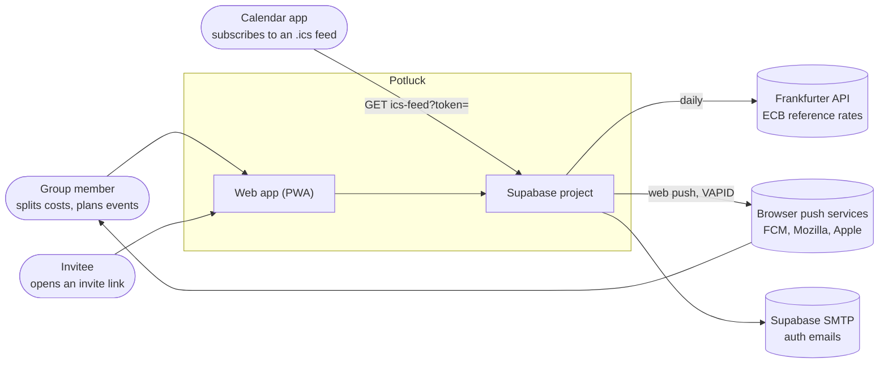
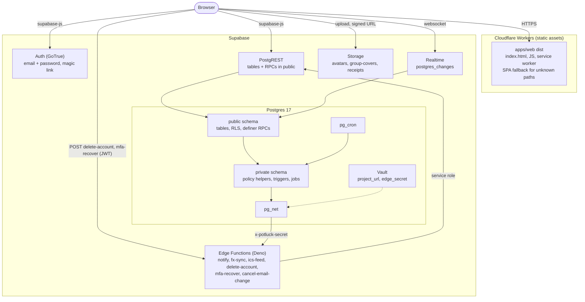
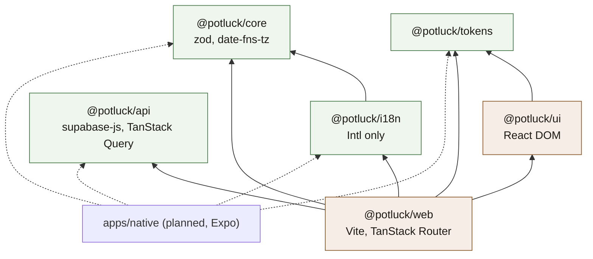
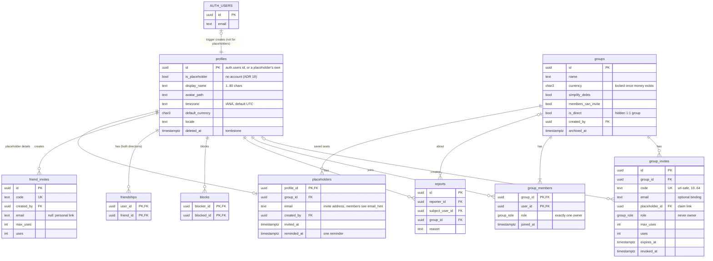
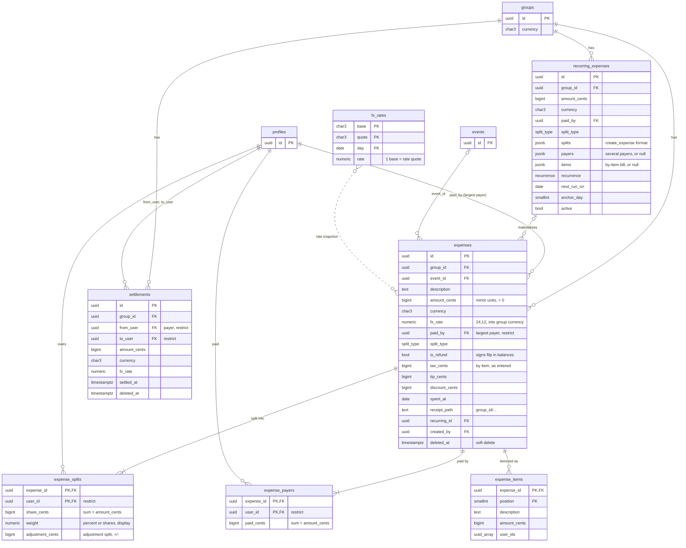
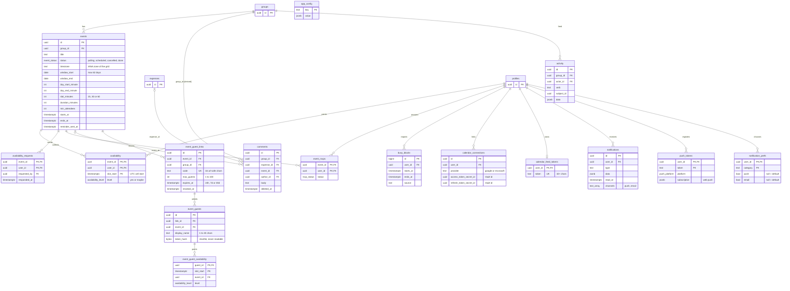

# Architecture

Potluck is a static web app (installable PWA) backed entirely by Supabase. There is no application server: the client talks to Supabase directly and Postgres Row Level Security is the authorization layer.

## System context

Who talks to Potluck and what Potluck talks to.

## Containers

There is no application server. The browser loads static files from Cloudflare and then talks to Supabase directly with the publishable key and the user's JWT.

## Packages

A native app (Expo) is planned. Everything below the screens is shared:

| Package           | Purpose                                                                                                                    | Platform     |
| ----------------- | -------------------------------------------------------------------------------------------------------------------------- | ------------ |
| `packages/core`   | split math, rounding, debt simplification, slot ranking and heat levels, recurrence dates, role checks, validation schemas | any (no DOM) |
| `packages/api`    | typed Supabase client, generated DB types, TanStack Query options                                                          | any (no DOM) |
| `packages/tokens` | design tokens as TS                                                                                                        | any          |
| `packages/i18n`   | strings, money/date formatting via `Intl`                                                                                  | any          |
| `packages/ui`     | web React components                                                                                                       | web          |
| `apps/web`        | web screens and routing                                                                                                    | web          |

### Package dependencies

Arrows point from a package to what it imports. Shared packages never import `@potluck/ui`, `@potluck/web` or `react-dom`; ESLint (`no-restricted-imports`, `no-restricted-globals` for `window`, `document`, `localStorage`) and a DOM-free `lib` in their tsconfig enforce it.

`packages/api` does not depend on `core`: it only knows the database types. Packages export TypeScript source (`"exports": { ".": "./src/index.ts" }`), so there is no build step between them; Vite and Vitest compile them on the fly.

## Ground rules

- Money is stored as integer minor units (`bigint` cents). Never floats.
- Every multi-row write (expense + splits, settle up, accept invite, lock event) goes through a `security definer` RPC that re-checks membership, so it is atomic and the same for every client.
- Timestamps are `timestamptz` (UTC). Clients render in the viewer's timezone (`profiles.timezone`).
- Migrations are additive. Native clients lag behind, so an RPC that needs a breaking change gets a `_v2` name instead.
- RLS is on for every table in `public`. Every policy has pgTAP coverage in `supabase/tests/`.
- Views use `security_invoker = true`.
- Helper functions used inside policies are `security definer`, `stable`, `set search_path = ''`, and live in a `private` schema so they are not exposed over the API.

## Schema (public)

The ER diagrams below are drawn from the migrations and split in three so they stay readable. Columns are trimmed to keys and the ones that matter for behavior; the lists after the diagrams have the rest. `profiles` and `groups` appear in more than one diagram.

### Diagram: identity, social and groups

### Diagram: money

The `group_balances` view (`security_invoker`) sums `expenses`, `expense_payers`, `expense_splits` and `settlements` into `(group_id, user_id, net_cents)`.

### Diagram: plans, feed and platform

### Enums

- `group_role`: `owner`, `admin`, `member`
- `split_type`: `equal`, `exact`, `percent`, `shares`, `adjustment`, `itemized`
- `event_status`: `polling`, `scheduled`, `cancelled`, `done`
- `availability_level`: `yes`, `maybe`
- `rsvp_status`: `going`, `maybe`, `declined`
- `push_platform`: `web`, `ios`, `android`
- `recurrence`: `weekly`, `biweekly` (every 2 weeks), `monthly`, `yearly`

### Identity and social

- `profiles`: `id uuid pk` (the `auth.users` id), `is_placeholder bool default false`, `display_name text not null`, `avatar_path text`, `timezone text default 'UTC'`, `default_currency char(3) default 'USD'`, `locale text default 'en'`, `deleted_at timestamptz`, timestamps. Created by trigger on `auth.users` insert. A placeholder ([ADR 19](adr/0019-placeholder-members-and-claiming.md)) is a profile with no auth user, made by `add_placeholder_member`; since it cannot have a foreign key to `auth.users`, two triggers stand in for one: a real profile needs an auth user (`profile_without_account`), and deleting an auth user deletes its profile.
- `placeholders`: `profile_id pk → profiles`, `group_id → groups` (cascade), `email text?` (lower case; members read only the generated `email_hint`, `s***@example.com`), `created_by`, `created_at`, `invited_at`, `invites_sent`, `reminded_at`. One row per placeholder, for the one group it belongs to. A group delete takes its placeholders' profiles along (deferred trigger).
- `friend_invites`: `id`, `code text unique`, `created_by`, `email text?` (bound, single use, 30 days) or null with `max_uses` null (the personal link), `uses`, `expires_at`, `revoked_at`. Read and revoked by their creator only; written by `my_friend_link` and `create_friend_invite`.
- `friendships`: `(user_id, friend_id)` pk, `created_at`. Stored both directions. Created when two users share a group or by accepting a friend invite.
- `blocks`: `(blocker_id, blocked_id)` pk.
- `reports`: `id`, `reporter_id`, `subject_user_id?`, `group_id?`, `reason text`, `created_at`.

### Groups

- `groups`: `id`, `name text not null`, `emoji text`, `color text`, `cover_path text`, `currency char(3) not null default 'USD'`, `simplify_debts bool default true`, `members_can_invite bool default true`, `is_direct bool default false` (a hidden 2-person group used for 1:1 expenses between friends), `created_by`, timestamps, `archived_at`, `default_split jsonb` (where new expenses start, `{split_type: equal | percent | shares, splits: [{user_id, weight}]}`; written only by `set_default_split`).
- `group_members`: `(group_id, user_id)` pk, `role group_role not null default 'member'`, `joined_at`. Exactly one `owner` per group (partial unique index).
- `group_invites`: `id`, `group_id`, `code text unique` (url-safe, 10+ chars), `email text?`, `role group_role default 'member'` (cannot be owner), `max_uses int?`, `uses int default 0`, `expires_at timestamptz?`, `created_by`, `revoked_at`, `placeholder_id uuid?` (a claim link: accepting it hands that placeholder to the account, single use, bound to the placeholder's email when it has one).

### Money

- `expenses`: `id`, `group_id not null`, `event_id?`, `description text not null`, `amount_cents bigint > 0`, `currency char(3)`, `fx_rate numeric(24,12) default 1` (rate into the group currency, snapshotted at creation), `paid_by uuid` (whoever paid the most, ties to the smaller id; kept for older clients), `split_type`, `category text`, `notes text`, `spent_at date default current_date`, `receipt_path text`, `recurring_id?`, `created_by`, timestamps, `deleted_at` (soft delete, restorable), `is_refund bool default false` (money coming back: the payers received it), `tax_cents`, `tip_cents`, `discount_cents` (by-item expenses, as entered).
- `expense_splits`: `(expense_id, user_id)` pk, `share_cents bigint not null`, `weight numeric` (percent or share count, for display), `adjustment_cents bigint` (adjustment splits). Constraint (deferred, via trigger): splits sum to `amount_cents`.
- `expense_payers`: `(expense_id, user_id)` pk, `paid_cents bigint > 0`, in the expense currency. Every expense has at least one row (backfilled from `paid_by`; a trigger keeps a single payer in step with `paid_by` and `amount_cents`, so writers that only know `paid_by` stay correct). Constraint (deferred, via trigger): payers sum to `amount_cents` (`payers_sum_mismatch`). Members read; writes only through the expense RPCs.
- `expense_items`: `(expense_id, position)` pk, `description`, `amount_cents`, `user_ids uuid[]`. A by-item bill as entered, so editing reopens it; the shares stay in `expense_splits`. Members read; written and dropped by `save_expense` together with the split.
- `recurring_expenses`: template rows (`group_id`, `description`, `amount_cents`, `currency`, `paid_by`, `payers jsonb` (null when one person pays), `split_type`, `splits jsonb`, `items jsonb` with `tax_cents`, `tip_cents`, `discount_cents` (a by-item bill as entered, null otherwise; `splits` then holds the shares worked out from it), `recurrence`, `next_run_on date`, `anchor_day smallint` (day of month monthly and yearly ones repeat on; null falls back to the first posted expense's day), `active bool`, `notes` (copied to every posted expense)). `private.recurring_heads_ups (recurring_id, posts_on, user_id)` records who heard about which occurrence. A `pg_cron` job materializes due rows into `expenses` daily; changing a template only changes the copies still to come ([ADR 14](adr/0014-editable-recurring-templates.md)).
- `settlements`: `id`, `group_id`, `from_user`, `to_user`, `amount_cents > 0`, `currency`, `fx_rate`, `note`, `settled_at`, `created_by`, `deleted_at` (soft delete, restorable). A payment with a picked day is stored at noon of that day in the recorder's time zone (their profile) and keeps that day's rate.
- `payment_methods`: `(user_id, kind)` pk, `kind` (`paypal`, `venmo`, `cashapp`, `revolut`, `monzo`, `upi`, `interac`, `bank`), `handle` (normalized, checked by `private.valid_payment_handle`, same rules as `isValidHandle` in `packages/core`), timestamps. The owner writes; people who share a group with the owner (and no block between them) read. Cleared when the account closes. See [ADR 15](adr/0015-payment-links-and-cross-group-settle.md).
- `debt_reminders`: `id`, `group_id`, `from_user` (the person owed, who sent it), `to_user` (who owes), `amount_cents`, `currency`, `note` (optional, 280 characters), `sent_on date` (UTC), unique `(from_user, to_user, sent_on)`: one reminder a day per pair, whichever group the debt is in. Written only by `remind_debt`; the two people read.
- `fx_rates`: `(base, quote, day)` pk, `rate numeric(24,12)`, index on `(quote, day desc)` for the currency picker. Filled by the `fx-sync` edge function (Frankfurter API, free, no key), which stores cross rates with 12 decimals so weak currencies (IDR, KRW) keep at least 8 significant digits.
- View `group_balances` (`security_invoker`): `group_id`, `user_id`, `net_cents` (positive = is owed), in group currency.
- View `expense_ledger` (`security_invoker`): one row per live expense and person, `group_id`, `expense_id`, `user_id`, `spent_at`, `category`, `currency` (the group's), `total_cents`, `paid_cents`, `share_cents`, all in group currency by the same convert-once and largest-remainder rules as `group_balances`. Summing `paid_cents - share_cents` over a group gives the expense part of each balance. Payers come from `expense_payers` (spread by what each paid) and a refund flips `total_cents`, `paid_cents` and `share_cents`, as in `group_balances`. Totals and charts read it.

### Plans

- `events`: `id`, `group_id`, `title`, `description`, `location`, `emoji`, `status event_status default 'polling'`, `window_start date`, `window_end date`, `day_start_minute int default 480`, `day_end_minute int default 1320`, `slot_minutes int default 30`, `duration_minutes int default 120`, `min_attendees int default 2`, `starts_at timestamptz?`, `ends_at timestamptz?`, `rsvp_deadline timestamptz?`, `created_by`, timestamps.
- `availability`: `(event_id, user_id, slot_start)` pk, `level availability_level`.
- `availability_requests`: `(event_id, user_id)` pk, `requested_by`, `requested_at`, `responded_at`.
- `event_rsvps`: `(event_id, user_id)` pk, `status rsvp_status`, `updated_at`.
- `calendar_connections`: `user_id`, `provider ('google'|'microsoft')`, encrypted tokens in Vault, `last_synced_at`. Feature-flagged off until OAuth credentials exist.
- `busy_blocks`: `(user_id, starts_at, ends_at, source)`; imported busy time, shown as hatched cells on the availability grid.
- `event_guest_links`: `id`, `event_id`, `group_id`, `code text unique` (16 url-safe chars), `created_by`, `max_guests int` (1 to 100), `expires_at`, `revoked_at`, `created_at`. Shareable links that let people without an account answer one polling plan ([ADR 16](adr/0016-guest-availability-links.md)).
- `event_guests`: `id`, `link_id`, `event_id`, `group_id`, `display_name` (1 to 40 characters after `private.clean_guest_name` drops invisible characters and collapses whitespace), `token_hash bytea` (sha256 of the token the guest's browser keeps; unique per link, never readable by clients), `saves` and `saves_window_start` (rate limit), `removed_at` (the organizer removed the answer; members no longer see the row and the token is refused), timestamps.
- `event_guest_availability`: `(guest_id, slot_start)` pk, `event_id`, `level`. Same shape as `availability`.

### Feed, notifications, platform

- `activity`: `id`, `group_id`, `actor_id`, `verb text` (`expense.created`, `settlement.created`, `member.joined`, `event.scheduled`, ...), `subject_id uuid`, `data jsonb`, `created_at`. Written by triggers.
- `comments`: `id`, `expense_id?`, `event_id?`, `settlement_id?` (exactly one of the three), `author_id`, `body`, `created_at`, `deleted_at`.
- `notifications`: `id`, `user_id`, `type text`, `data jsonb`, `read_at`, `created_at`, `channels text[]` (where it went besides the inbox: `push`, `email`; set by a trigger).
- `notification_prefs`: `(user_id, category)` pk, `push bool?`, `email bool?` (null = the category default), `updated_at`. Only settings someone changed; categories and their defaults live in `private.notification_categories`, the type to category map in `private.notification_types` ([ADR 11](adr/0011-notification-prefs-and-email.md)).
- `push_tokens`: `(user_id, token)` pk, `platform push_platform`, `subscription jsonb` (web push), `last_seen_at`.
- `app_config`: `key text pk`, `value jsonb` (feature flags, `min_client_version` per platform). Readable by everyone.
- `calendar_feed_tokens`: `user_id pk`, `token text unique` (32+ chars), `created_at`. The only credential for the `ics-feed` URL. Owners can read their row; nobody writes it directly.

## Roles

| Permission                                          | Owner | Admin                          | Member                                         |
| --------------------------------------------------- | ----- | ------------------------------ | ---------------------------------------------- |
| Add/edit own expenses, availability, RSVP, comments | yes   | yes                            | yes                                            |
| Create events, request availability                 | yes   | yes                            | yes                                            |
| Lock / cancel an event                              | yes   | yes                            | creator only                                   |
| Create guest links                                  | yes   | yes                            | yes                                            |
| Turn off a guest link                               | yes   | yes                            | link or plan creator                           |
| Remove a guest's answer                             | yes   | yes                            | plan creator only                              |
| Edit/delete others' expenses                        | yes   | yes                            | no                                             |
| Record a payment between two other members          | yes   | yes                            | no                                             |
| Edit/delete/restore a payment you were not part of  | yes   | yes                            | no                                             |
| Create invites                                      | yes   | yes                            | if `members_can_invite`                        |
| Create admin invites                                | yes   | no                             | no                                             |
| Remove members, change roles                        | yes   | admins can manage members only | no                                             |
| Edit group settings                                 | yes   | yes                            | no                                             |
| Delete group, transfer ownership                    | yes   | no                             | no                                             |
| Add someone not on Potluck yet                      | yes   | yes                            | if `members_can_invite`                        |
| Remind them (once)                                  | yes   | yes                            | yes                                            |
| Rename them                                         | yes   | yes                            | if `members_can_invite`, or whoever added them |
| Change their email                                  | yes   | yes                            | whoever added them                             |
| Remove them (balance zero)                          | yes   | yes                            | whoever added them                             |

A placeholder is always a plain member and can never be made admin or owner (`placeholder_member`). A member cannot leave or be removed while their `net_cents` in that group is non-zero. "Own" expenses are the ones you created or paid (any part of). Any member may save the group's default split.

`create_invite` is the source of truth for admin invites: only the owner can mint them, and `can()` in `packages/core/src/roles` applies the same rule.

## RPCs

| Function                                                                                                                                            | Notes                                                                                                                                                                                                                   |
| --------------------------------------------------------------------------------------------------------------------------------------------------- | ----------------------------------------------------------------------------------------------------------------------------------------------------------------------------------------------------------------------- |
| `create_group(name, emoji, color, currency)`                                                                                                        | creator becomes owner                                                                                                                                                                                                   |
| `create_invite(group_id, role, max_uses, expires_at, email)` → invite                                                                               |                                                                                                                                                                                                                         |
| `invite_preview(code)` → group name, emoji, member count, first names                                                                               | callable by `anon`, for the join page                                                                                                                                                                                   |
| `invite_preview_v2(code)` → `invite_preview` plus `placeholder_name`, `email_hint`                                                                  | callable by `anon`; what the join page reads now. Members opening a used link get `valid`; counts and names skip placeholders                                                                                           |
| `add_placeholder_member(group_id, display_name, email?)` → profile id                                                                               | someone not on Potluck yet; makes their claim link and, with an email, the invite email ([ADR 19](adr/0019-placeholder-members-and-claiming.md))                                                                        |
| `update_placeholder(user_id, display_name?, email?)` / `remind_placeholder(user_id)` / `remove_placeholder(user_id)`                                | rename or re-address (fresh link and invite); the one reminder; remove when settled                                                                                                                                     |
| `my_friend_link(rotate)` → code / `create_friend_invite(email)` → invite                                                                            | the personal friend link; a single-use link bound to an email                                                                                                                                                           |
| `friend_invite_preview(code)` → inviter first name, avatar, status                                                                                  | callable by `anon`, for `/friend/<code>`                                                                                                                                                                                |
| `accept_friend_invite(code)` → friend id / `add_friend(user_id)` / `remove_friend(friend_id)`                                                       | friendships both ways; adding needs a shared group; removing needs a settled 1:1 tab                                                                                                                                    |
| `block_user(user_id)` / `my_blocks()`                                                                                                               | block someone you know and drop the friendship both ways; the blocked list with names. Unblock is a direct delete on `blocks`                                                                                           |
| `accept_invite(code)` → group_id                                                                                                                    | validates expiry/uses/revoked, adds member, creates friendships                                                                                                                                                         |
| `set_member_role(group_id, user_id, role)` / `remove_member` / `leave_group` / `transfer_ownership`                                                 | role checks per table above                                                                                                                                                                                             |
| `get_or_create_direct_group(friend_id)` → group_id                                                                                                  | 1:1 expenses                                                                                                                                                                                                            |
| `create_expense(payload jsonb)` / `update_expense(id, payload jsonb)`                                                                               | validates splits sum, membership, fx snapshot; ignores the v2 keys                                                                                                                                                      |
| `create_expense_v2(payload jsonb)` / `update_expense_v2(id, payload jsonb)`                                                                         | v1 plus `payers`, `is_refund`, `items` with `tax_cents` / `tip_cents` / `discount_cents` ([ADR 12](adr/0012-several-payers-refunds-and-stored-items.md))                                                                |
| `set_default_split(group_id, split jsonb)` → jsonb                                                                                                  | any member, from the expense form or group settings; `null` clears; logged as `group.default_split`                                                                                                                     |
| `delete_expense(id)` / `restore_expense(id)`                                                                                                        | soft delete                                                                                                                                                                                                             |
| `update_recurring_expense(id, payload jsonb)` → template                                                                                            | an admin or anyone it involves (creator, payer, someone in the split); the `create_expense_v2` payload plus `recurrence`, `next_run_on`; only future copies change ([ADR 14](adr/0014-editable-recurring-templates.md)) |
| `skip_recurring_expense(id)` → template                                                                                                             | an admin or anyone it involves; moves `next_run_on` one period on; logged as `recurring.skipped`                                                                                                                        |
| `make_expense_recurring(expense_id, recurrence)` → template                                                                                         | whoever may edit the expense; first copy one period after its date, or the next date still to come                                                                                                                      |
| `settle_up(group_id, to_user, amount_cents, currency, note)`                                                                                        |                                                                                                                                                                                                                         |
| `settle_up_v2(group_id, from_user, to_user, amount_cents, currency, note, settled_on)`                                                              | either direction; between two others for owners and admins; a picked day uses that day's rate                                                                                                                           |
| `update_settlement(id, payload jsonb)` / `restore_settlement(id)`                                                                                   | edit the keys sent; undo `delete_settlement`                                                                                                                                                                            |
| `settle_all(group_id, settled_on, note)` → settlements                                                                                              | records every debt involving the caller in one group                                                                                                                                                                    |
| `friend_balances()` → `(friend_id, group_id, currency, net_cents, archived)`                                                                        | what the caller and each person they share a group with owe each other, per group                                                                                                                                       |
| `settle_with_friend(friend_id, settled_on, note, amounts)` → settlements                                                                            | one payment per picked shared open group (all by default), groups locked in id order                                                                                                                                    |
| `remind_debt(group_id, user_id, note)` → reminder                                                                                                   | once a day per pair; notifies `debt.reminder`                                                                                                                                                                           |
| `simplified_debts(group_id)` → rows `(from_user, to_user, amount_cents)`                                                                            | greedy max-creditor/max-debtor, tie-break by user id                                                                                                                                                                    |
| `set_availability(event_id, slots jsonb)`                                                                                                           | replaces caller's rows for that event, marks request responded                                                                                                                                                          |
| `request_availability(event_id, user_ids uuid[])`                                                                                                   | creates notifications                                                                                                                                                                                                   |
| `best_slots(event_id, limit int default 5)` → `starts_at, ends_at, yes_count, maybe_count, score, missing uuid[]`                                   | score = yes + 0.5 * maybe, a person counts only if available for every slot in the duration, filtered by `min_attendees`, ordered by score desc then earliest                                                           |
| `schedule_event(event_id, starts_at)` / `cancel_event(event_id)`                                                                                    |                                                                                                                                                                                                                         |
| `my_timeline(from, to)`                                                                                                                             | upcoming events across all my groups with my RSVP and request state                                                                                                                                                     |
| `delete_my_account()`                                                                                                                               | anonymizes profile (tombstone name), removes PII, deletes auth user via edge function                                                                                                                                   |
| `create_guest_link(event_id, ttl, max_guests default 10)` → link                                                                                    | `ttl` is `24h`, `7d` or `30d`; any member, polling plans only                                                                                                                                                           |
| `revoke_guest_link(link_id)` → link                                                                                                                 | link creator, plan creator, admins                                                                                                                                                                                      |
| `remove_guest_answer(guest_id)`                                                                                                                     | plan creator or admins; the guest's slots go, their token is blocked, their seat frees up                                                                                                                               |
| `guest_link_preview(code, token default null)` → status, plan window, aggregated heat, the guest's own answer                                       | callable by `anon`, for `/a/<code>`                                                                                                                                                                                     |
| `set_guest_availability(code, name, token, slots)` → `guest_token, saved`                                                                           | callable by `anon`; adds or edits a guest's answer                                                                                                                                                                      |
| `search_money(query, in_group, person, from_day, to_day, categories, kinds, before_day, before_at, before_id, max_rows)` → expense and payment rows | live items across the viewer's groups (or one), newest first, keyset paged; see below                                                                                                                                   |
| `deleted_items(in_group, before_at, before_id, max_rows)` → deleted expenses and payments                                                           | most recently deleted first, with `deleted_by` from the feed                                                                                                                                                            |
| `friend_activity(friend, before_at, before_id, max_rows)` → feed rows                                                                               | entries that involve both the viewer and the friend                                                                                                                                                                     |
| `spending_summary(in_group, from_day, to_day, in_currency)` → rows per group, month and category                                                    | the viewer's totals in group currency, or converted into one currency; see below                                                                                                                                        |
| `calendar_feed_token(rotate bool default false)` → text                                                                                             | returns (and creates on first call) the caller's `.ics` feed token; `rotate` issues a new one and breaks old subscriptions                                                                                              |
| `my_notification_prefs()` → rows `(category, push, email, push_allowed, email_allowed)`                                                             | every notification setting with the caller's effective value, in display order                                                                                                                                          |
| `set_notification_pref(category, push?, email?)`                                                                                                    | changes one setting; a null channel is left as it is                                                                                                                                                                    |
| `email_unsubscribe(token, action default 'unsubscribe')` → `{ category, email, subscribed, restored }`                                              | callable by `anon`: the signed token from an email is the credential. `preview` changes nothing, `unsubscribe`, `undo` restores what the unsubscribe changed; `email` is masked                                         |
| `email_outbox_report(batch, delivered, error?, rejected?)`                                                                                          | service role only: `notify` reports each email batch (sent, or back to pending with backoff, failed after 5 attempts)                                                                                                   |
| `create_mfa_recovery_codes()` → setof text                                                                                                          | aal2 only: replaces the caller's two-step recovery codes with ten new ones (`ABCDE-23456`), stored as SHA-256 in `private.mfa_recovery_codes`                                                                           |
| `mfa_recovery_codes_left()` → int                                                                                                                   | how many of the caller's recovery codes are unused                                                                                                                                                                      |
| `mfa_recovery_code_matches(target, code)` → bool / `forget_mfa_recovery_codes(target)`                                                              | service role only, for the `mfa-recover` edge function                                                                                                                                                                  |
| `record_mfa_recover_attempt(target)` → bool                                                                                                         | service role only: records a recovery try, false after five in fifteen minutes per account                                                                                                                              |
| `clear_mfa_recovery_codes()` → int                                                                                                                  | drops the caller's recovery codes once no verified factor is left (after turning two-step sign in off)                                                                                                                  |
| `notify_mfa_recovered(target)`                                                                                                                      | service role only: files an `account.mfa_removed` notice (category `security`: inbox, push, email) after a recovery                                                                                                     |

## Database implementation notes

The schema lives in `supabase/migrations`, pgTAP tests in `supabase/tests` (`pnpm db:test`), demo data in `supabase/seed.sql`. This section records what the migrations do beyond (or differently from) the tables above.

Functions are redefined by later migrations (`settle_up` has three versions). The live definition of every table, policy and function is in [`supabase/schema/current.sql`](../supabase/schema/current.sql), generated by `pnpm gen:schema` and checked in CI; [`agent-map.json`](agent-map.json) lists each RPC with its arguments, grants, error codes and the newest migration that defines it (`definedIn`).

### Errors

Every RPC raises `message = <stable snake_case code>`, `detail = <readable English>`, `errcode = <sqlstate>`. PostgREST returns the code as `message` and the English text as `details`; clients translate the code.

SQLSTATEs:

- `42501`: not signed in, or not allowed.
- `PT404`: not found. PostgREST answers 404. Migrations before `20261105200000_not_found_as_404.sql` show `P0002` (HTTP 500); that migration rewrote every body, so never copy `P0002` from an old file. pgTAP (`01_schema.test.sql`) and `apps/web/src/lib/server-codes.test.ts` fail on it.
- `22023`: invalid input.
- `23514`: business rule.

Where the wording lives (`errorMessage` in `apps/web/src/lib/errors.ts`): the screen's scope first (`expenses.errors.<code>` in `packages/i18n/src/en/money.ts`, `events.errors.<code>` in `en/plans.ts`), then the auth codes, then `errors.codes.<code>` in `en/shell.ts`, then the generic message. `server-codes.test.ts` fails when a code raised in any migration has no wording on any screen or is missing from this list. `docs/agent-map.json` (`errorCodes`) shows, per code, its SQLSTATEs, the functions that raise it and the keys that translate it.

Codes:

- Session and membership: `not_authenticated`, `account_deleted`, `not_a_member`, `not_allowed`, `blocked` (claiming internally; a block is never announced to the person blocked: joining a group or taking a seat across it raises `invite_revoked`, and a 1:1 tab or adding a friend raises `not_a_friend`), `mfa_required` (any request from a session that has not finished two-step sign in, see [Two-step sign in](#two-step-sign-in)).
- Groups and roles: `group_name_required`, `invalid_currency`, `group_currency_locked`, `group_owner_required`, `group_archived` (any write into an archived group: expenses, recurring expenses, payments, plans, availability, comments, RSVPs), `group_has_balances` (deleting a group while anyone, former members included, has a non-zero balance), `member_not_found`, `member_has_balance`, `owner_must_transfer`, `already_owner`, `cannot_change_owner`, `cannot_remove_owner`, `use_transfer_ownership`, `use_leave_group`.
- 1:1 tabs and friends: `invalid_friend`, `not_a_friend`, `friend_has_balance` (removing a friend with an open 1:1 balance), `person_not_found` (blocking someone you do not know).
- People not on Potluck yet: `already_member` (adding an email that is already in the group), `profile_without_account`, `placeholder_member` (a placeholder as admin, owner, or in another group), `placeholder_not_found`, `placeholder_claim_conflict` (the account is or was already in the group), `placeholder_exists` (same email waiting in the group), `placeholder_no_email`, `placeholder_already_reminded`, `invalid_name`, `invalid_email`, `too_many_invites` (20 emailed invites a day, 3 addresses per placeholder), `email_not_verified` (claiming, or an email-bound friend link, needs a confirmed email).
- Invites: `direct_group`, `invalid_role`, `invalid_max_uses`, `invalid_expiry`, `invite_not_found`, `invite_expired`, `invite_used_up`, `invite_revoked`, `invite_wrong_email`.
- Expenses: `invalid_payload`, `group_required`, `description_required`, `invalid_amount`, `invalid_receipt_path`, `payer_not_in_group`, `fx_rate_unavailable`, `expense_not_found`, `expense_deleted`, `event_not_in_group` (linking an expense to a plan in another group), `split_member_not_in_group` (moving money of someone who left), `invalid_payers`, `payers_sum_mismatch` (what each person paid does not add up to the amount, also from the deferred check).
- Splits: `invalid_splits`, `splits_required`, `splits_sum_mismatch`, `split_amount_required`, `percent_sum`, `invalid_weight`, `zero_shares`, `duplicate_user`, `adjustments_exceed_total`, `negative_share`, `items_required`, `invalid_items`.
- Repeating expenses: `recurring_not_found`, `already_recurring` (the expense is already part of a series), `invalid_next_run` (a next date in the past).
- Payments: `invalid_recipient`, `invalid_parties` (payer and payee must differ), `not_a_party` (a member recording a payment between two others), `note_too_long`, `settlement_not_found`, `settlement_deleted` (editing a deleted payment), `member_not_in_group` (moving the balance of someone who has left), `nothing_owed` and `already_reminded` (reminders, picked groups), `invalid_payment_handle` (payment methods).
- Notifications: `invalid_notification_category`, `invalid_unsubscribe_link`, `notification_setting_required` (changing a required category, i.e. security notices).
- Search and totals: `invalid_date_range` (a `from_day` after `to_day`), `invalid_query` (over 200 characters), `invalid_cursor` (a page cursor missing its day, time or id).
- Plans: `event_not_found`, `event_not_polling`, `event_not_schedulable`, `event_done`, `starts_at_required`, `invalid_slot`, `invalid_slots`, `duplicate_slot`, `rsvp_closed` (RSVP after the event's `rsvp_deadline`).
- Guest links: `invalid_guest_link_ttl`, `invalid_guest_limit`, `guest_link_limit` (20 open links per plan), `guest_removed` (a token whose answer the organizer removed), `guest_link_not_found`, `guest_link_revoked`, `guest_link_expired`, `guest_link_full`, `invalid_guest_name`, `guest_slots_required` (a new guest with no times), `guest_rate_limited`, `guest_not_found`.

### RPC details and deviations

- `create_group(name, emoji?, color?, currency?)` returns the `groups` row. Currency defaults to the caller's `default_currency`.
- `create_invite(group_id, role = 'member', max_uses?, expires_at?, email?)` returns the invite row. Members can invite only when `members_can_invite`; only the owner can create `admin` invites; direct and archived groups cannot have invites.
- `invite_preview(code)` returns `group_id, name, emoji, color, cover_path, member_count, first_names text[] (owner first, max 5), status ('valid' | 'expired' | 'revoked' | 'used_up' | 'archived'), is_member`. A signed in visitor who is not a member and has a block, in either direction, with someone in the group sees `revoked`, like a dead link. Seats are neither counted nor named. Unknown codes raise `invite_not_found`. `invite_preview_v2` adds `placeholder_name`, `email_hint` (only while the claim link works) and `email_matches` (signed in on a link bound to an email: whether it is this account's).
- `accept_invite(code)`: already being a member returns the group id without using up the invite. Email-bound invites compare against the auth email, case-insensitive. Archived groups raise `group_archived`; a block between the joiner and anyone in the group raises `invite_revoked`, so the blocked person cannot tell. A claim link (`placeholder_id`) also needs a confirmed email (`email_not_verified`) and then runs `private.claim_placeholder`, archived groups included.
- Claiming (`private.claim_placeholder(placeholder, account, announce)`, [ADR 19](adr/0019-placeholder-members-and-claiming.md)): runs from `accept_invite` and from the `on_auth_user_verified` trigger when an account confirms an email that matches a waiting placeholder (errors there are swallowed, so sign up never fails). Locks the group row `for no key update`, refuses an account that is or was in the group (`placeholder_claim_conflict`) or is blocked there, then, with `potluck.claiming` on, rewrites every column with a foreign key to `profiles` (from the catalog), the ids inside `activity.data`, notification payloads, `groups.default_split`, recurring `splits` / `payers` and `expense_items.user_ids`, befriends the group, deletes the placeholder, logs `member.claimed` and tells the owner, admins and whoever added them (`member.joined`). Amounts never change.
- Placeholders never get push or an inbox: a before insert trigger on `notifications` drops every row for one except `member.added`, which is their invite email, sent to `placeholders.email` with the claim link (`claim_code`). They are skipped by `request_availability`, `best_slots` (`missing`), friendships, `leave_group` (an owner left with only placeholders closes the group) and `delete_my_account` (never an heir).
- `add_placeholder_member(group_id, display_name, email?)`: an email already in the group raises `already_member`; an email of a confirmed, open account that is not in the group adds that account directly (`member.added` to them, logged as added by the caller) instead of a seat, unless a block stands between them and the group, which silently makes a seat. Seat emails are plain ASCII and compared after lower casing A to Z only (`private.ascii_lower`, `private.is_plain_email`; core `asciiLower`, `isPlainEmail`).
- `update_placeholder`: any member who may add people renames a seat; only whoever added it or an admin changes its email (`not_allowed`), never to the address of someone already in the group (`already_member`). The new invite counts toward the daily limit of whoever made the change. A new address revokes the old link, makes a new one, sends a fresh invite, logs `member.invite_changed` and tells whoever added the seat when someone else changed it. A removed seat that the history still names loses its email.
- Payments with a seat: the usual `private.check_payment` rule (a member records only payments they are part of; owners and admins any), so "Sam paid you" is recorded by you and the seat removed once settled. The balances tab offers "Record payment" on a seat's line to whoever it involves and to admins.
- Daily limit: `private.spend_invite_budget` logs every invite email a person sets off (a seat with an email, a seat's new address, an account added by email, a reminder) in `private.invite_sends` and refuses the 21st in a day (`too_many_invites`). The log names no seat and no group it depends on, so removing a seat or deleting a group gives nothing back; the `purge-invite-sends` job drops rows older than a week.
- A seat's invite and reminder are dropped (the reminder still counts as sent) when its email belongs to an account with a block, either way, with whoever sent them (`private.seat_email_blocked`).
- Blocks mute ([ADR 19](adr/0019-placeholder-members-and-claiming.md)): the before insert trigger on `notifications` drops any row whose `actor_id` the recipient has blocked, so nothing the blocked person does reaches the blocker, in shared groups too. Shared groups keep working: their expenses and payments still count. The blocked person cannot join the blocker's groups, take a seat there, open a 1:1 tab, accept a friend link or add them back, and is told only what a dead link or a stranger gets. In a 1:1 tab that already exists, `private.freeze_blocked_direct_money` (before triggers on `expenses`, `settlements`, `recurring_expenses`) refuses the blocked person's money writes, and comments there, with `not_a_friend`; the blocker's still work, and turning a repeating expense off always does.
- `set_member_role`: admins may change roles of plain members only (including promoting to admin); nobody can grant `owner` here.
- Lock order (deadlock-free only if every function follows it):
  - `remove_member` / `leave_group` lock the group row before reading balances.
  - Every RPC that moves a balance (`create_expense`, `update_expense`, their `_v2` versions, `delete_expense`, `restore_expense`, `settle_up`, `settle_up_v2`, `update_settlement`, `delete_settlement`, `restore_settlement`) takes a share lock on the group row first, so nobody leaves between a balance check and a new expense. `set_default_split` moves nothing and takes no lock. The repeating expense RPCs (`update_recurring_expense`, `skip_recurring_expense`, `make_expense_recurring`) move nothing either, but take the same group share lock first so a membership check cannot race a member leaving.
  - `settle_all` and `settle_with_friend` read debts and then pay them, so they lock the group row `for no key update` (every shared group row, in id order, for `settle_with_friend`) before reading any balance. That waits for every share lock above and for another bulk settle, so the debts are read after those commit and the same debt is never paid twice.
  - Always the group row first, then the expense or payment row.
  - `delete_my_account` locks the rows of every group the account is in, in id order, before handing over ownership and removing zero-balance memberships.
  - The recurring expenses job share locks the group rows of every due template, in id order, before touching any template.
- `leave_group`: the owner must transfer first, unless nobody else active is left (they are alone, or only closed accounts remain, which cannot take ownership). Then leaving deletes the group, provided no active person (former members included) has an open balance there (`member_has_balance`); anything left is between the owner and closed accounts.
- `delete_group(group_id)`: owner only. Locks the group row, then refuses with `group_has_balances` unless every balance in `group_balances` (former members included, direct groups too) is zero. Clients cannot delete `groups` rows directly; a `before delete` trigger on `groups` also refuses any other delete of a group with open balances (only `delete_my_account` may remove a group nobody active is left in).
- `get_or_create_direct_group(friend_id)`: the friend must be a friend or share a group, and neither may have blocked the other; a block, a closed account and a placeholder all raise `not_a_friend`. Creates a group named `Direct` (caller owner, friend admin, `members_can_invite = false`).
- `create_expense(payload)` / `update_expense(id, payload)` / `delete_expense(id)` / `restore_expense(id)` return the `expenses` row.
  - Payload keys: read `private.save_expense` in `supabase/schema/current.sql` (the live version; the comment at the top of the first expenses migration is older).
  - Extra payload key `recurrence` (`weekly` | `biweekly` | `monthly` | `yearly`, create only) also creates a `recurring_expenses` template whose first run is one period after `spent_at` (`private.recurring_step`); a backdated one catches up. A by-item bill's items, tax, tip and discount are stored on the template too.
  - `receipt_path` must start with `<group_id>/`.
  - Members edit expenses they created or paid (any part of); admins and the owner edit any.
- `create_expense_v2(payload)` / `update_expense_v2(id, payload)` ([ADR 12](adr/0012-several-payers-refunds-and-stored-items.md)) take everything v1 does, plus:
  - `payers`: `[{user_id, paid_cents}]`, whole minor units, zero dropped, one row per person, summing to `amount_cents`; `paid_by` becomes whoever paid the most (ties: smaller id). Without `payers`, `paid_by` alone means one payer; on an expense several people paid, the same `paid_by` and amount keep the stored payers, a new amount refuses with `payers_sum_mismatch`. Only a new payer must be a member.
  - `is_refund`: the payers received the money; balances flip both signs. A refund cannot repeat.
  - `items` with `tax_cents`, `tip_cents`, `discount_cents` (by item only): stored as entered, and the server works out the shares from them (`private.itemized_splits`, same rule as core `splitItemized`), ignoring any `splits`. Rewriting the split any other way drops the stored items.
  - `split_type = 'adjustment'` with `splits: [{user_id, adjustment_cents}]` (`private.compute_split_rows`, same rule as core `splitAdjustment`).
  - v1 strips these keys, so an old client cannot set them; it still edits a several-payer expense's details.
- Repeating expenses ([ADR 14](adr/0014-editable-recurring-templates.md)):
  - `update_recurring_expense(id, payload)` merges the payload with the stored template like `update_expense_v2` does with an expense (same payers, split and items checks); `next_run_on` may not move before the caller's own today (`invalid_next_run`, `private.local_today` from `profiles.timezone`); a new date sets `anchor_day`, an interval change alone keeps it (unless it was weekly). Notes are copied to every posted expense. An admin or anyone it involves (`private.recurring_involves`: creator, payer, someone in the split) may edit or skip, as for expenses. A currency with no rate today raises `fx_rate_unavailable`. Logged as `recurring.updated` with `from_amount_cents`.
  - A template naming someone who left (or closed their account): its details stay editable; changing its amount, currency, payers or split raises `payer_not_in_group` / `split_member_not_in_group` unless the change takes them out; resuming it raises `split_member_not_in_group` (trigger `recurring_expenses_require_members`). It pauses when that person leaves, is removed or closes their account (trigger `group_members_pause_recurring`, `delete_my_account`), logged as `recurring.paused` and notified; the job pauses any it still finds.
  - `make_expense_recurring(expense_id, recurrence)` copies amount, currency, payers, split (as the create payload: people, weights, adjustments or exact shares) and items; refuses refunds (`invalid_payload`), deleted expenses (`expense_deleted`), expenses already in a series (`already_recurring`) and expenses naming someone who left (`split_member_not_in_group`). The first copy is `private.recurring_next_from(spent_at, recurrence, day, local_today(caller))`: missed periods are not charged. Logged as `recurring.created` with `expense_id`.
  - All three refuse archived groups (`group_archived`).
- Departed members: nothing may move a former member's balance.
  - Restoring fails if anyone in the expense has left.
  - Deleting fails if the payer or anyone with a share has left.
  - Editing the amount, currency, payers, refund flag or split of such an expense fails (`split_member_not_in_group`); its details stay editable. Every payer counts, not only `paid_by`.
  - `update_expense` keeps the stored splits when the payload leaves out `splits` (and amount and split type are unchanged), and checks the payer's membership only when the payer changes.
- Archived groups raise `group_archived` from every expense RPC, and from `settle_up`, `settle_up_v2`, `update_settlement`, `delete_settlement`, `restore_settlement`, `settle_all`, `remind_debt`, `set_availability`, `request_availability`, `schedule_event` and `cancel_event`. Money RPCs check with `private.require_unarchived(group_id)`, the others with `private.require_group_open(group_id)`; both do the same thing.
- Splits: `exact` and `itemized` need `share_cents` for every person, used as given (must sum to the amount). `equal`, `percent` (weights sum to exactly 100) and `shares` are always derived on the server with 6-decimal fixed-point weights and largest remainder, ties by user id, same as `packages/core`; any `share_cents` sent for them is ignored.
- `settle_up(group_id, to_user, amount_cents, currency?, note?)` returns the settlement. The payer is always the caller and `settled_at` is now. Kept for older clients; new clients call `settle_up_v2`.
- `settle_up_v2(group_id, from_user, to_user, amount_cents, currency?, note?, settled_on?)` returns the settlement. Members record payments they are part of (either direction); owners and admins also between two others (`not_a_party`). Both people must be current members (`member_not_in_group`). `settled_on` is a calendar day in the caller's time zone (from their profile): the payment is stored at noon of that day there, so it never lands on a neighbouring day, and its rate comes from that day. No day means now. Checks shared with `update_settlement` live in `private.check_payment`, mirrored by `paymentProblem` in `packages/core`.
- `update_settlement(id, payload)`: keys `from_user`, `to_user`, `amount_cents`, `currency`, `note` (null clears), `settled_on`. Same people as delete. A deleted payment raises `settlement_deleted`. The rate is kept unless the currency or the day changes. Changing people, amount, currency or rate of a payment with someone who left raises `member_not_in_group`; the note, and a day that keeps the rate, stay editable.
- `delete_settlement(id)`: soft delete by payer, recipient, recorder or admin. Refused with `member_not_in_group` when either side has left the group. `restore_settlement(id)` undoes it, same people, same refusal.
- `settle_all(group_id, settled_on?, note?)` and `settle_with_friend(friend_id, settled_on?, note?, amounts?)` record payments in the group currency (rate 1) for the debts `private.group_debts` reports: `simplified_debts` when the group simplifies, `private.pairwise_debts` otherwise. `private.pairwise_debts` mirrors `pairwiseDebts` in core: each expense's effect per person as in `group_balances` (payers credited, refunds flipped), and inside an expense the people behind pay the people ahead, each debtor spread over the creditors by what they are still owed. `settle_with_friend` skips archived groups and groups either person has left; `amounts` (`{group_id: cents}`) picks groups and pays part (`invalid_amount` above what is owed, `nothing_owed` for a group with nothing to settle). Both return the payments made.
- `friend_balances()` returns one row per group and person the caller has a debt with, using the same `private.group_debts`, while both are still members of that group (a departed member's debts cannot move); archived groups are flagged.
- `remind_debt(group_id, user_id, note?)`: the caller must be owed by `user_id` in that group (`nothing_owed`); one per UTC day per pair, whichever group (`already_reminded`). Uses `require_group_open`. Sends `debt.reminder` with the note.
- `simplified_debts(group_id)`: greedy largest creditor vs largest debtor, ties by user id. Always simplifies, whatever `groups.simplify_debts` says (the client decides what to show).
- `set_availability(event_id, slots)` returns the number of slots saved. `slots` is an array of `{slot_start, level}` objects; `level` defaults to yes. Every slot must be a grid cell: inside the date window and `[day_start_minute, day_end_minute)` in `events.timezone`, aligned to `slot_minutes`. Only while the event is `polling`. Replaces are serialized per event and caller with a transaction advisory lock, so a save still in flight and the flush sent as the page is left apply one after the other.
- `request_availability(event_id, user_ids?)` returns how many people were asked. `null` or empty means every member (except the caller) who has not answered.
- `best_slots(event_id, limit = 5)`: candidates are the distinct `slot_start`s in current members' and the plan's guests' availability (guests count exactly like members, toward `min_attendees` too, and their guest ids can appear in `missing`); durations round up to whole cells; yes needs yes on every covered cell, maybe needs yes or maybe on all of them; `missing` lists members who cannot make the whole duration, sorted by id; `min_attendees` counts yes + maybe; capped at 100 rows. Same rules as `rankSlots` in `packages/core`. Past candidates are not filtered out.
- Guest links ([ADR 16](adr/0016-guest-availability-links.md)):
  - `create_guest_link(event_id, ttl, max_guests = 10)` returns the link row. Any member, while the plan is `polling` and the group open; at most 20 open links per plan. It takes a `no key update` lock on the event row, so it serializes with `schedule_event` and `cancel_event`.
  - `guest_link_preview(code, token?)` returns `status`: `revoked`, `archived`, `removed` (the token's answer was removed), `scheduled` (the plan has a time; only for a guest who answered through this link, with the title, emojis, host, `my_name` and `starts_at`, `ends_at`), `expired`, `closed` (cancelled, or scheduled for anyone who did not answer), `full` or `open`. `open` and `full` carry the title, emoji, group emoji, the link creator's first name, the grid fields, `expires_at`, `max_guests` and `guest_count` (removed guests not counted). Only `open` carries `respondents`, `heat` (`[{slot_start, yes, maybe}]` from members and guests not removed, never names or ids) and, when `token` matches a guest of this link, `my_name` and `my_slots`. A guest who already answered sees `open` on a full link. Unknown codes raise `guest_link_not_found`.
  - `set_guest_availability(code, name, token, slots)` locks the link row, checks revoked, expired, archived and polling in that order, cleans the name with `private.clean_guest_name` (1 to 40 characters after invisible and zero width characters are dropped and whitespace collapsed; `cleanGuestName` in core is the same rule) and checks the slots like `set_availability`. A token whose answer was removed raises `guest_removed`. A token that matches a guest on this link edits that guest (60 saves per hour). Anything else is a new guest, who needs at least one slot, a free seat (`guest_link_full`) and the link under 20 new guests in 10 minutes, and gets a fresh 24 byte token back. The table keeps `sha256(token)` only.
  - `remove_guest_answer(guest_id)` locks the link row first (link before event, as in `set_guest_availability`, so no save lands after the removal), then deletes the guest's slots and marks them removed: their seat frees up, members stop seeing them, and their token can no longer answer or see the plan.
- `schedule_event(event_id, starts_at)` also reschedules an already scheduled event and sets `ends_at = starts_at + duration`. `reminder_sent_at` is cleared only when the start time actually changes, so locking in the same time again does not send a second reminder. `cancel_event` is idempotent. Owner, admins or the event creator.
- `my_timeline(from = now(), to = now() + 60 days)` returns `event_id, group_id, group_name, group_emoji, group_color, title, emoji, location, status, timezone, starts_at, ends_at, window_start, window_end, rsvp_deadline, my_rsvp, going_count, availability_requested, availability_submitted` for scheduled events in range and open polls overlapping it.
- `search_money(...)`: every argument is optional. Matches `query` (case-insensitive substring, wildcards taken literally) against the description, the notes, live comments on the expense, the payer's or anyone in the split's display name, and an amount (`12`, `12.50`, `$12.50`, `12.50 EUR`, in the expense's own currency; three digits after the separator also read as thousands, and a reading with more decimals than the currency has is ignored, so `1,000` finds 1,000.00 USD and 1000 JPY but not 1.00 USD); payments match on their note, live comments on the payment, either person's name and the amount. Filters: one group (`not_a_member` if the caller is not in it), a person who paid or is in the split (either side of a payment), inclusive `from_day` / `to_day` (`spent_at`, or the payment's day in the caller's time zone), `categories` (an expense without one is `other`; a category filter leaves payments out), `kinds` (`expense`, `payment`). Rows carry `kind`, `id`, `group_id`, `day`, `at` (`created_at` or `settled_at`), `description` (or the payment note), `category`, `amount_cents`, `currency`, `group_currency`, `group_amount_cents`, `paid_by` (or the sender), `to_user`, `created_by`, `my_paid_cents` and `my_share_cents` (from `expense_ledger`, null when the caller is not in it), `deleted_at`, `matched` (`description`, `notes`, `comment`, `person`, `amount`) and `snippet` (the comment or name that matched). The payment's day is in the caller's zone (`private.user_time_zone`, UTC when the profile's zone is unknown), as in `spending_summary` and `deleted_items`. Order `(day, at, id)` descending; pass the last row's three as `before_*` for the next page. `max_rows` is clamped to 1..100. Trigram indexes (`pg_trgm`) on `expenses.description`, `expenses.notes`, `settlements.note` and live comments on expenses and on payments keep the text match off sequential scans; perf01 in `supabase/snippets/perf_volume.sql` (12 groups, about 2,400 expenses) searches in 15 to 35 ms.
- `spending_summary(in_group?, from_day?, to_day?, in_currency?)`: rows `group_id, currency, month, category, expense_count, spend_cents, paid_cents, share_cents, payments_made_cents, payments_received_cents, unconverted_count`. Expense rows group by month (`spent_at`) and category (`other` when empty); each month with payments to or from the caller has one more row with a null category (month in the caller's time zone). `spend_cents` is the whole group's spending, the rest are the caller's. Over all time `paid - share + made - received` is the caller's balance. Without `in_group`, every group the caller is in, each in its own currency. With `in_currency`, every amount (spend, paid, share, each payment), already in its group's currency, is converted once more with `private.insights_fx_rate(group currency, in_currency, day)` and `private.convert_minor` at the expense's date (a payment's day): `private.fx_rate`'s lookup, plus a step through USD, then EUR, when the two currencies have no rate between them (only this view triangulates; expenses and balances never do). Anything with no rate even then is left out and counted in `unconverted_count`, and `expense_count` counts converted expenses only; a malformed code raises `invalid_currency`. Same rules as `spendingSummary` in `packages/core/src/insights` (`inCurrency`, `rateOn`), tested with the same case in `supabase/tests/25_search_insights.test.sql`. Ordered by month, group, category, so clients page past the row cap with `range`.
- `deleted_items(in_group, before_at?, before_id?, max_rows = 50)`: members only (`not_a_member`). Rows `kind, id, group_id, day, description, category, amount_cents, currency, paid_by, to_user, created_by, deleted_at, deleted_by`, ordered `(deleted_at, id)` descending and paged on both. `deleted_by` is the actor of the latest `expense.deleted` or `settlement.deleted` feed entry for the row (index `activity_subject_id_idx`). Restoring uses `restore_expense` for expenses and `restore_settlement` for payments.
- `friend_activity(friend, before_at?, before_id?, max_rows = 30)`: feed rows (with `actor_info` and `group_info` as jsonb) from the caller's groups where both people paid for or share in the expense (expense entries, and comments on such an expense), the payment is between the two of them, or the entry is in their one-to-one group (except its member and group bookkeeping). Not the friend's other actions. `invalid_friend` for yourself, `invalid_cursor` for half a cursor.
- `delete_my_account()` returns void. It:
  - tombstones the profile (`Former member`, avatar cleared, timezone and locale reset, `deleted_at` set);
  - hands owned groups to the longest-standing admin (else member), or deletes groups with nobody else;
  - removes zero-balance memberships (open balances stay);
  - deletes push tokens, calendar links, busy blocks, notifications, availability, RSVPs, friendships and blocks, and revokes the open invites it made (seat claim links stay open).
  - Closed accounts then get `account_deleted` from every RPC.
  - Money tables reference `profiles` with `on delete restrict`, so the `delete-account` edge function must soft delete the auth user (`auth.admin.deleteUser(id, true)`); a hard delete would cascade into the profile and is refused.
  - The edge function also removes the avatar files under `<uid>/` in the `avatars` bucket, and a trigger on `profiles.deleted_at` drops the `calendar_feed_tokens` row so old feed URLs stop working.

### Seats

People not on Potluck yet. Notes for changing anything that touches seats, claims or blocks ([ADR 19](adr/0019-placeholder-members-and-claiming.md)).

- A placeholder (seat) is a `profiles` row with `is_placeholder` and no auth user; `profiles` has no foreign key to `auth.users` (`profiles_need_account` and `on_auth_user_deleted` keep that rule for real people).
- `private.claim_placeholder` rewrites every foreign key to `profiles(id)` it finds in the catalog, private tables included. A new column that holds a person: make it a foreign key to `profiles`, or add it (jsonb, arrays) to `claim_placeholder`.
- Triggers on tables with user ids return early when `private.claiming()` if they log, notify, bump `updated_at`, guard archived groups or freeze a 1:1 tab.
- `notifications_skip_placeholders` lets a seat get only `member.added`, never across a block with the sender (held back on the seat as `held_by`, sent once when that block is lifted, `private.release_held_invites`), and drops any row whose `data.actor_id` the recipient blocked: put `actor_id` in new notification data.
- Leave seats out of anything that asks someone to act (availability, RSVPs, `best_slots` missing lists, heirs). Repeating expenses treat a seat like any member: one that names it keeps running after a claim, and removing a seat pauses them like anyone leaving.
- Seat emails are looked up through `private.account_emails` (every account email, lower cased A to Z, indexed, kept by a trigger on `auth.users`), never by lower casing `auth.users` row by row.
- Core mirrors: roles `placeholder.add`, `placeholder.edit`, `placeholder.remove`; `placeholderSchema` and `isPlainEmail` (`private.placeholder_email`, `private.is_plain_email`); `asciiLower` (`private.ascii_lower`).
- Web: a member or person with `is_placeholder` is a saved seat (dashed row, "Not on Potluck yet" badge), split with like anyone, never offered roles, friendship, blocking or a 1:1 tab (`features/groups/placeholders.tsx`, rules in `placeholder-helpers.ts`). The friend page reads the same `friend_balances` as the Friends list. API: `packages/api/src/people.ts`.
- Tests: `27_placeholder_members`, e2e `people.spec.ts`.

### Schema additions

- `events.timezone` (IANA zone the window is expressed in, default `UTC`) and `events.reminder_sent_at` (set by the reminder job).
- `comments.group_id`, filled from the expense, event or payment by a trigger and used by RLS.
- `calendar_connections`: `id`, `account_email`, `access_token_secret_id`, `refresh_token_secret_id` (Vault ids, not readable by clients), unique `(user_id, provider)`.
- `busy_blocks.id` (identity) with unique `(user_id, starts_at, ends_at, source)`.
- `recurring_expenses.category`, `created_by`, timestamps. `push_tokens.created_at`, `app_config.updated_at`.
- A group's currency cannot change once it has expenses or settlements.
- Exactly one owner per group is enforced by the partial unique index plus a deferred constraint trigger. Splits summing to the amount is a deferred constraint trigger.

### Money math

`group_balances` matches `computeBalances` in `packages/core`:

- Each expense is converted once (`round(amount * fx_rate)`, half away from zero, adjusted for currencies whose minor unit is not 2 digits).
- The converted total is spread over the payers in proportion to `paid_cents`, and over the splits in proportion to `share_cents`, both by largest remainder (ties by user id), so every expense nets to exactly zero. Payers are credited, the split debited; a refund flips both (`expenseEffect` in core).
- Settlements are converted the same way.
- `fx_rate` is snapshotted on write from the latest `fx_rates` row on or before the expense date (inverse pair as fallback, `round(1 / rate, 12)`); clients cannot supply their own rate.

### Access

Clients write directly (RLS-checked) only to these tables. Everything else goes through RPCs.

- `profiles`: own display fields.
- `groups`: admins edit settings; deleting goes through `delete_group`.
- `group_invites`: revoke or delete, admins or creator.
- `events`: members insert polls; creator or admins edit details and delete.
- `event_rsvps`: own, until `rsvp_deadline`, withdrawing included.
- `comments`: insert own, author edits, author or admin soft deletes.
- For `events`, `event_rsvps` and `comments`, every write is refused in archived groups: inserts and updates raise `group_archived` from a trigger, with the same check in the policies; deletes, and withdrawing an RSVP after the deadline, match no row.
- `notifications`: own `read_at`, delete.
- `notification_prefs`: read own; writes only through `set_notification_pref` and `email_unsubscribe`.
- `push_tokens`, `blocks`, `reports`, `busy_blocks`, `payment_methods`: own rows.
- `friendships`: delete, either side (the friends page uses `remove_friend`, which removes both directions at once).
- `blocks`: insert and delete own (`block_user` also ends the friendship; unblocking is a direct delete).
- `reports`: insert own.
- `friend_invites`: read and revoke own.
- `placeholders`: read only (members of its group, every column but `email`); written by the placeholder RPCs.
- `recurring_expenses`: an admin or anyone it involves (`private.recurring_involves`: creator, payer, someone in the split) may change `active` (pause, resume) or delete; every other change goes through `update_recurring_expense`. Archived groups raise `group_archived` from a trigger. Turning `active` back on moves a past `next_run_on` to the next occurrence on or after today, so paused periods are never charged, and is refused while the template names someone who left.
- `event_guest_links`, `event_guests`, `event_guest_availability`: no direct writes at all; members read them (`event_guests` without `token_hash`, `saves`, `saves_window_start`).

Who can read what:

- Profiles are visible to yourself, people you share a group with (placeholders included, since they are members), friends, and anyone who has left (or closed their account in) one of your groups, so old expenses, payments and activity keep their names. A placeholder is never `auth.uid()`, so `my_group_ids()` and every own-row policy need no change for them.
- Former members are tracked in `private.former_members` by a trigger on `group_members`, only while something in the group (an expense, payment, comment, or a feed entry for something they did there, not their joining or leaving) still names them. Rejoining removes the row.
- Busy blocks are private. `app_config` is readable by `anon`.
- Guests are not users and read nothing directly: `anon` has no grants on the guest tables, only the two guest RPCs, which show one link's plan window and aggregated counts.

### Activity and notifications

Activity verbs: `group.created`, `group.updated`, `group.default_split`, `member.joined`, `member.added` (someone put a placeholder, or an account by its email, in the group; the actor is who added them), `member.claimed` (a placeholder was taken over by an account; `data.name` is the seat's name), `member.invite_changed` (a seat's invite email changed; the row never holds an address), `member.left`, `member.removed`, `member.role_changed`, `expense.created`, `expense.updated`, `expense.deleted`, `expense.restored`, `settlement.created`, `settlement.updated`, `settlement.deleted`, `settlement.restored`, `event.created`, `event.scheduled` (also on reschedule), `event.cancelled`, `availability.requested`, `comment.created`, `recurring.created`, `recurring.updated`, `recurring.skipped`, `recurring.paused` (subject: the template; paused when someone in it left, with `user_ids`, no actor). Every `expense.updated` row carries `changes`: `{field: {from, to}}` for each field the edit changed (`description`, `amount_cents`, `currency`, `spent_at`, `category`, `notes`, `is_refund`, `receipt`, `event_id`, `tax_cents`, `tip_cents`, `discount_cents`, `items` (the bill's lines as entered), plus `payers` and `split` as `{type, shares}` when those changed beyond rescaling to a new amount; `private.expense_row_changes` builds the row part). `private.save_expense` writes that row itself, once per edit, so payer and split changes are in it; it sets `potluck.expense_logged` for the update so the `expenses_activity` trigger stays out of the way, and the trigger still logs (with row `changes`) any other update. An edit that only changes the split or who paid is also notified as `expense.updated` from `save_expense`, since the notification triggers only compare expense columns; people dropped from the split or the payers are notified too. Every payer hears about a new expense, like the people in the split. The expense page reads its history (`expense.*` rows for that subject) from `activity` and renders every change, old value to new.

Notification types: `expense.created` (split members, with their `share_cents`), `expense.updated`, `expense.deleted`, `expense.restored` (everyone in the expense), `settlement.created` (both people in the payment), `settlement.updated`, `settlement.deleted`, `settlement.restored` (both people in the payment, old and new; an edit counts when it changes people, amount, currency or day), `debt.reminder` (the person reminded, with the note), `member.added` (someone else put you in a group, not 1:1 tabs: a placeholder's invite email and its one reminder (`reminder: true`), an account added by its email, and the inbox note an account gets when signing up claims a seat), `member.invite_changed` (whoever added a seat, when someone else changes its email), `friend.added` (someone accepted your friend link), `summary.monthly` (monthly job, everyone with a non-zero balance), `member.joined` (owner and admins, not for direct groups), `event.created`, `event.scheduled`, `event.cancelled`, `availability.requested`, `comment.created`, `event.reminder` (going or maybe), `rsvp.reminder` (no answer yet), `recurring.upcoming` (at 09:00 on each person's local day before a repeating expense posts, or as soon as possible if that passed, never after it posts, inbox only when that is late and at night (`data.quiet`); to its payers and everyone with a share, each with their own `share_cents`, `paid_cents`, the `posts_on` date, the `deadline` (00:10 UTC that day) and their `timezone`; Reminders setting), `recurring.paused` (one was paused because someone in it left; to whoever set it up, else the owner and admins; edits and deletions setting). The actor and closed accounts are never notified. `data` carries `group_id`, the subject id and `actor_id`.

Every notification lands in the inbox. `notifications_route` (before insert) fills `channels` from `private.notification_channels(user, type)`: the type's category in `private.notification_types`, the person's `notification_prefs` row or the category default, and for email also `app_config.email_notifications` and a confirmed address. A type with no category row is pushed and never emailed. New type: one insert into `private.notification_types` (see `supabase/AGENTS.md`). Categories and defaults: new expenses, edits and deletions, payments, comments, groups, reminders push and email; plans push only; the monthly summary emails only.

### Storage, realtime, cron

- Buckets: `avatars` (public, `<user_id>/...`, owner writes), `group-covers` (public, `<group_id>/...`, owner and admins write), `receipts` (private, `<group_id>/...`, members read and upload, uploader or admins replace and delete).
- `supabase_realtime` publishes `availability`, `event_guest_availability`, `expenses`, `expense_splits`, `settlements`, `activity`, `notifications`, `event_rsvps`, `events`, `group_members`.
- pg_cron: `materialize-recurring-expenses` daily at 00:10 UTC (catches up at most 12 periods per template per run; deactivates templates whose people left or closed their account; retries when an FX rate is missing), `recurring-heads-up` at :05 and :35 every hour (`recurring.upcoming` at 09:00 local the day before; a late one between 22:00 and 07:00 local is inbox only), `event-reminders` hourly at :05 (reminders once per event starting within 24h, then marks ended events `done`) and `fx-sync` daily at 16:30 UTC (calls the `fx-sync` edge function through `private.invoke_edge_function`).
- Database to edge function hooks (`20261105160000_edge_function_hooks.sql`): `private.invoke_edge_function(fn, body)` posts through `pg_net` with the `x-potluck-secret` header. It reads `project_url` and `edge_secret` from Vault and does nothing when either is missing, so the local stack and CI never call out. The `notifications_push` trigger calls `notify` for every new notification routed to push.
- Email: `notifications_queue_email` puts rows routed to email in `private.email_outbox` (`pending`, `folded`, `sending`, `sent`, `failed`, `dropped`); the `email-notifications` job hands them to `notify` in batches and `notify` reports each batch through `email_outbox_report` (see Scheduled jobs). Unsubscribe tokens are HMACs keyed by `private.signing_keys`, made by `private.unsubscribe_token(uid, category)`; `private.email_unsubscribe_undo` keeps what an unsubscribe changed so undo restores exactly that.

### Local demo data

`supabase/seed.sql` creates `ava`, `ben`, `cleo`, `dev`, `eli` and `fay` at `@potluck.test` (password `potluck-demo`), the groups Hike crew, Roommates and Dim sum club, a 1:1 between Ava and Fay, about 30 expenses (all split types, one in EUR), settlements, a polling hike with availability from five people and an open request, a scheduled taco night with RSVPs, comments, and an invite code `hikecrew-demo`.

## Security model

The browser is untrusted. It holds the publishable key and, once signed in, a short-lived JWT (`jwt_expiry = 3600`, refresh tokens rotate). Everything it can do is decided inside Postgres.

### Layers

1. **Grants.** Every table starts with `revoke all ... from anon, authenticated`, then each migration grants back only the columns a client may touch. For example `profiles` grants `update (display_name, avatar_path, timezone, default_currency, locale)`, so a client cannot set `deleted_at` even on its own row. In the database, `anon` gets `select` on `app_config` and `execute` on `invite_preview`, `invite_preview_v2`, `friend_invite_preview` (the link code is the credential) and `email_unsubscribe` (which needs a signed token), and nothing else. The public `avatars` and `group-covers` buckets are readable without signing in.
1. **Grants.** Every table starts with `revoke all ... from anon, authenticated`, then each migration grants back only the columns a client may touch. For example `profiles` grants `update (display_name, avatar_path, timezone, default_currency, locale)`, so a client cannot set `deleted_at` even on its own row. In the database, `anon` gets `select` on `app_config` and `execute` on `invite_preview`, `email_unsubscribe` (which needs a signed token), `guest_link_preview` and `set_guest_availability` (which need a guest link code), and nothing else. The public `avatars` and `group-covers` buckets are readable without signing in.
1. **Row Level Security.** Enabled on every table in `public`. Policies answer "which rows" using helpers from the `private` schema. Policies use `(select auth.uid())` and `group_id = any (array(select private.my_group_ids()))` so Postgres evaluates them once per statement instead of once per row, and can read only the caller's rows through the `group_id` indexes.
1. **Security definer RPCs.** Multi-row writes (expense plus splits, settle up, joining, role changes, scheduling) have no insert or update policy at all. They go through `public.*` functions that run as the owner, start with `private.require_user()` (signed in, account not closed) and `private.require_member(group_id)`, then check the role rules themselves. All of them set `search_path = ''` and schema-qualify every name.
1. **Triggers and constraints** hold invariants no client can skip: exactly one owner per group, splits sum to the amount, group currency locked once money exists, `comments.group_id` copied from the parent, only the author edits a comment body.

### The private schema

`private` is not in `[api].schemas`, so PostgREST never exposes it. `revoke all on schema private from public` plus `alter default privileges ... revoke execute on functions from public` means a new function is callable by nobody until a migration grants it. API roles get `usage` on the schema and `execute` only on the policy helpers (`is_group_member`, `group_role`, `is_group_admin`, `my_group_ids`, `my_event_ids`, `shares_group_with`, `my_contact_ids`, `can_manage_event`) and a few pure functions (`try_uuid`, `minor_units`, `convert_minor`, `is_time_zone`). The helpers are `security definer` so they can read `group_members` without recursing into its own policy, and they only ever answer questions about `auth.uid()`.

Trigger functions, cron jobs, `require_user`, `require_member`, `member_balance`, `compute_splits`, `invoke_edge_function`, `notify`, `notification_channels` and `unsubscribe_token` are not executable by `anon` or `authenticated`. Private tables (`former_members`, `invite_sends`, `notification_categories`, `notification_types`, `email_outbox`, `signing_keys`) are not readable by them either. `mfa_satisfied` and `check_request` are executable by every API role because PostgREST and the realtime policies call them as the caller. `private.mfa_recovery_codes` and `private.mfa_recover_attempts` are readable by nobody but their owner.

### Two-step sign in

Accounts can add an authenticator app (Supabase Auth TOTP). Supabase hands out an `aal1` token after the password, magic link or OAuth step and an `aal2` token once a code is verified; the database decides what an `aal1` token of such an account may do ([ADR 13](adr/0013-two-step-sign-in-enforced-in-the-database.md)).

- `private.mfa_satisfied()` is true unless the caller has a verified factor and an `aal1` token.
- PostgREST runs `private.check_request()` before every request (`pgrst.db_pre_request` on the `authenticator` role, set in `20261113100257_two_factor_enforcement.sql`). It raises `mfa_required` (42501), so tables and RPCs alike are closed to a half finished sign in.
- Realtime does not go through PostgREST, so each published table has a restrictive `select` policy, "two-step sign in done", on the same check.
- The app sends such a session to `/two-factor` (`needsSecondFactor()` in `apps/web/src/lib/auth.ts`, checked by the `_app` and `/welcome` routes). Turning two-step sign in off takes a fresh code; Supabase refuses to remove a verified factor from an `aal1` session.
- Storage: a restrictive policy on `storage.objects` ("two-step sign in done", every command, every bucket) applies the same check.
- Recovery: the caller's `aal1` token plus one recovery code, posted to the `mfa-recover` edge function, removes every factor (admin API) and then every code. Five tries per account per fifteen minutes (`record_mfa_recover_attempt`). The app refreshes the session, which no longer needs a second step. Turning two-step sign in off from Me clears the codes (`clear_mfa_recovery_codes`).
- Auth settings that back this up: TOTP on, `secure_password_change` (an emailed code for password changes from sessions older than a day), and security emails for password, email and authenticator changes (`supabase/config.toml`).

### Storage

Paths start with an owning id, and policies parse it with `storage.foldername(name)[1]`. `private.try_uuid` turns a malformed folder into `null` instead of an error, so a bad path is denied.

| Bucket         | Public read | Path prefix  | Write                                                                                   | Limits                     |
| -------------- | ----------- | ------------ | --------------------------------------------------------------------------------------- | -------------------------- |
| `avatars`      | yes         | `<user_id>`  | the user                                                                                | 5 MB, png/jpeg/webp/gif    |
| `group-covers` | yes         | `<group_id>` | owner and admins                                                                        | 10 MB, png/jpeg/webp       |
| `receipts`     | no          | `<group_id>` | members upload; the uploader (`owner_id`) or an admin replaces or deletes; members read | 10 MB, images, heic or pdf |

`create_expense` also refuses a `receipt_path` that does not start with `<group_id>/`, so an expense cannot point at another group's receipt.

### Edge function auth

Each function uses one of three schemes. `verify_jwt` is set per function in `supabase/config.toml`.

| Function              | `verify_jwt` | Credential                                       | Checked by                                                                                                                                                                                                              |
| --------------------- | ------------ | ------------------------------------------------ | ----------------------------------------------------------------------------------------------------------------------------------------------------------------------------------------------------------------------- |
| `delete-account`      | true         | the user's JWT                                   | the gateway, then `auth.getUser()`; the RPC runs as the caller so its own checks apply                                                                                                                                  |
| `notify`              | false        | `x-potluck-secret` header equal to `EDGE_SECRET` | `hasEdgeSecret()`, constant-time compare; only `private.invoke_edge_function` knows the secret (from Vault)                                                                                                             |
| `fx-sync`             | false        | same shared secret                               | same                                                                                                                                                                                                                    |
| `ics-feed`            | false        | `?token=` from `calendar_feed_tokens`            | lookup with the service role; unknown or short tokens get a plain 404. Calendar apps cannot send headers, hence the query string                                                                                        |
| `unsubscribe`         | false        | `?token=` signed unsubscribe token               | no privilege of its own: a POST (RFC 8058 one-click) calls the anon `email_unsubscribe` RPC with the publishable key; Postgres checks the HMAC. GET only redirects to the web page, which asks before changing anything |
| `mfa-recover`         | true         | the user's JWT (`aal1` is enough) and a code     | the gateway, then `auth.getUser()`; the code is checked by `mfa_recovery_code_matches` with the service role                                                                                                            |
| `cancel-email-change` | true         | the user's JWT                                   | the gateway, then `auth.getUser()`; refuses an unfinished two-step sign in by its `aal` claim                                                                                                                           |

The service-role client (`_shared/admin.ts`) bypasses RLS, so each function authorizes the caller before touching it.

## Realtime

The `supabase_realtime` publication carries `availability`, `event_guest_availability`, `expenses`, `expense_splits`, `settlements`, `activity`, `notifications`, `event_rsvps`, `events` and `group_members`. Realtime applies the subscriber's RLS `select` policies before it delivers a change, so a client only hears about rows it could read anyway. Each of these tables also has a restrictive policy that sends nothing to a session that still owes its two-step code.

Clients do not patch their cache from the payload. A change invalidates the matching TanStack Query keys and the query refetches through the normal RLS path. Each screen owns one channel, mounted while it is open; `notifications-<userId>` lives in the app layout and is the only one open on every screen. Channels opened through `useRealtime` (`apps/web/src/lib/realtime.ts`) get a `:<n>` mount counter suffix so a remount never joins the topic the previous mount is still leaving.

| Channel                  | Mounted by                                                                       | Tables (filter)                                                                                                                   | Refetches                                                                                                                      |
| ------------------------ | -------------------------------------------------------------------------------- | --------------------------------------------------------------------------------------------------------------------------------- | ------------------------------------------------------------------------------------------------------------------------------ |
| `notifications-<userId>` | app layout                                                                       | `notifications` (`user_id=eq.<userId>`)                                                                                           | the notification list and the unread badge                                                                                     |
| `groups-live`            | the Groups tab                                                                   | `group_members`, `expenses`, `settlements` (`group_id=in.(<my groups>)`), own joins                                               | every `groups` key: list, detail, invites, friends                                                                             |
| `groups-live-<groupId>`  | the group layout                                                                 | same three tables (`group_id=eq.<groupId>`)                                                                                       | same                                                                                                                           |
| `friends-live`           | the Friends page                                                                 | `expenses`, `settlements`, `group_members` (`group_id=in.(<my groups>)`), own joins                                               | the friends list with its net balances                                                                                         |
| `money:<groupId>`        | the Expenses, Balances and Totals tabs, Recently deleted, an expense detail page | `expenses`, `settlements`, `activity` inserts (`group_id=eq.<groupId>`)                                                           | group money queries, the changed expense, the activity feed, comments on a commented expense                                   |
| `payment:<paymentId>`    | a payment detail page                                                            | `settlements` (`id=eq.<paymentId>`), `activity` inserts (`group_id=eq.<groupId>`)                                                 | the payment, its comments                                                                                                      |
| `activity-feed`          | the Activity tab                                                                 | `activity` inserts (`group_id=in.(<my groups>)`), own joins                                                                       | the activity feed                                                                                                              |
| `insights-live`          | the Spending screen                                                              | `expenses`, `settlements` (`group_id=in.(<my groups>)`), own joins                                                                | the cross-group totals                                                                                                         |
| `group-plans:<groupId>`  | the group's Plans tab                                                            | `events` (`group_id=eq.<groupId>`)                                                                                                | the group's event list and the timeline                                                                                        |
| `plan:<eventId>`         | an event page                                                                    | `availability`, `event_guest_availability`, `event_rsvps` (`event_id=eq`), `events` (`id=eq`), `activity` inserts (`group_id=eq`) | heatmap, `best_slots`, requests; guests, their slots and link usage; the event, timeline and group event list; RSVPs; comments |

The cross-group channels (`groups-live`, `friends-live`, `activity-feed`, `insights-live`) go through `useMyGroupsRealtime` (`apps/web/src/features/groups/use-groups.ts`): they wait for the group list, filter every table to `group_id=in.(...)` over the viewer's group ids so the server does not fan every change in the database out to the socket for RLS to sift, and also listen for `group_members` inserts with `user_id=eq.<viewer>`. A join refreshes the group list, which resubscribes with the new id. Realtime caps an `in` filter at 100 values; past that the channel falls back to unfiltered and relies on RLS. Realtime cannot filter delete events, so the channels that watch `group_members` keep an unfiltered listener for its deletes (leaving, removals); any of those also refreshes the group list.

Channels batch invalidations for 300 ms (`useBatchedInvalidate` in `apps/web/src/lib/realtime.ts`) so a friend dragging across twenty cells, or the several change events one expense save emits, cause one refetch, not twenty. The notifications channel invalidates per event; it fires rarely enough that batching would not matter.

## Scheduled jobs

All jobs are `pg_cron` entries created by migrations, so every environment gets the same schedule. `cron.schedule` with an existing name updates the job, which keeps the migrations rerunnable. Times are UTC.

| Job                              | Schedule       | Runs                                                                 | Does                                                                                                                                                                                                                                                                                                                                                                                                                                                                                                                                                                                                               |
| -------------------------------- | -------------- | -------------------------------------------------------------------- | ------------------------------------------------------------------------------------------------------------------------------------------------------------------------------------------------------------------------------------------------------------------------------------------------------------------------------------------------------------------------------------------------------------------------------------------------------------------------------------------------------------------------------------------------------------------------------------------------------------------ |
| `materialize-recurring-expenses` | `10 0 * * *`   | `private.materialize_recurring_expenses()`                           | Writes due recurring templates as real expenses, catching up at most 12 periods per template. Deactivates templates whose payer or people left or closed their account, logging `recurring.paused` and telling whoever set it up (a backstop: leaving, removal and `delete_my_account` already pause them right away, except in archived groups, where nothing runs anyway). Leaves a template due when no FX rate exists yet                                                                                                                                                                                      |
| `recurring-heads-up`             | `5,35 * * * *` | `private.send_recurring_heads_ups()`                                 | `recurring.upcoming` to everyone a template names (payers and people with a share), with their own share, at 09:00 on their local day before it posts (`profiles.timezone`, UTC when Postgres does not know it), or on the next run if that passed, never at or after 00:10 UTC on the posting date; a late one landing between 22:00 and 07:00 local is marked quiet and stays in the inbox (no push, no email). Once per person and occurrence (`private.recurring_heads_ups`). Skips paused templates, archived groups and templates naming someone who left; each person opts out with their Reminders setting |
| `event-reminders`                | `5 * * * *`    | `private.send_event_reminders()` then `private.finish_past_events()` | `event.reminder` to going and maybe, `rsvp.reminder` to members who have not answered, once per event starting in the next 24 hours. Then flips ended scheduled events to `done`                                                                                                                                                                                                                                                                                                                                                                                                                                   |
| `fx-sync`                        | `30 16 * * *`  | `private.invoke_edge_function('fx-sync')`                            | Asks the edge function to pull the day's ECB rates. The ECB publishes around 16:00 CET                                                                                                                                                                                                                                                                                                                                                                                                                                                                                                                             |
| `email-notifications`            | `* * * * *`    | `private.send_email_notifications()`                                 | Does nothing while `app_config.email_notifications` is off. Otherwise hands `notify` the outbox rows whose subject has been quiet for 60 seconds, one email per expense (nothing if it was added and deleted inside the hold), re-checking settings, in batches of 50 per call. Re-sends batches with no report after 10 minutes (same batch id, the provider's idempotency key, when exactly the same rows go again; otherwise a new one), retries reported failures with backoff up to 5 attempts, drops rows older than a day                                                                                   |
| `monthly-summary`                | `0 15 1 * *`   | `private.send_monthly_summaries()`                                   | One `summary.monthly` notification (inbox card, email when on, never push) for everyone with a non-zero balance, about the month that just ended                                                                                                                                                                                                                                                                                                                                                                                                                                                                   |
| `purge-invite-sends`             | `20 3 * * *`   | `delete from private.invite_sends`                                   | Drops invite log rows older than a week; the daily invite limit only reads the last day                                                                                                                                                                                                                                                                                                                                                                                                                                                                                                                            |

Each recurring template (in both recurring jobs) runs inside its own `begin ... exception` block, so one bad template logs a warning and the rest still run.

## Money conventions

- **Integer minor units.** Every amount is a `bigint` in the currency's minor unit: cents for USD, yen for JPY, fils for KWD. `private.minor_units()` and `minorUnits()` in `packages/core/src/currency` share the same ISO 4217 table (0, 2 or 3 digits). No floats anywhere, in SQL or TypeScript. Core uses `BigInt` for intermediate products.
- **Rounding is half away from zero.** Postgres `round(numeric)` does this; `convert()` in core reproduces it, so a client preview equals the stored value.
- **Largest remainder, uuid tie-break.** Splitting an amount by weights gives everyone `floor(amount * w / sum)`. The leftover units go one each to the largest fractional remainders. Ties go to the smaller user id compared as plain code points, which matches Postgres `uuid` ordering. `allocate()` in core, `private.compute_splits()` and the `group_balances` view all use this rule, so the same input gives the same cents on every client and on the server.
- **Fixed-point weights.** Percent and shares weights are scaled to 6 decimals before splitting. Percent weights must sum to exactly 100.
- **FX snapshot.** `fx_rate` is written once, when the expense or settlement is saved: the latest `fx_rates` row on or before `spent_at` (settlements: the day they were paid, today unless one was picked), with the inverse pair as a fallback. Clients cannot send a rate. Editing an expense keeps its rate unless the currency changes. A missing rate raises `fx_rate_unavailable`.
- **Rates travel as text.** `fx_rate` is `numeric(24,12)`, up to 24 digits; a JS number keeps about 16. `packages/api` selects `fx_rate::text` and `rate::text`, and `convert()` / `invertRate()` in core work on the decimal text, so a client total matches `group_balances` to the minor unit even for rates like 16000.123456789012.
- **Convert once per expense.** Balances convert the expense total into group currency once, spread that converted total over the payers (by what each paid) and over the splits (by share), both by largest remainder. Each expense nets to exactly zero in group currency. A refund flips the signs.
- **Spending totals have twins.** `expense_ledger` and `spending_summary` match `ledgerLines` and `spendingSummary` in `packages/core/src/insights` (same cases in `25_search_insights.test.sql`); a change to how a balance is computed changes `group_balances`, `expense_ledger` and core together ([ADR 17](adr/0017-search-and-spending-totals-in-sql.md)). The web search, filters, Totals and Recently deleted live in `apps/web/src/features/insights/`.

## Time zones

- Instants are `timestamptz` and travel as UTC ISO strings. Calendar dates (`spent_at`, `window_start`, `window_end`, `next_run_on`) are `date` with no zone; `packages/i18n` renders them pinned to UTC so June 12 stays June 12 for everyone.
- `profiles.timezone` (IANA) is the viewer's zone, UTC included; the device zone stands in only while the profile loads or when it has none (`resolveTimeZone` in `apps/web/src/lib/locale.ts`, used by every screen). `formatDate` and friends in `packages/i18n` require a `timeZone` argument and never fall back to the host zone.
- `events.timezone` is the zone the availability grid is drawn in. A cell is a wall-clock time in that zone, stored as its UTC instant in `availability.slot_start`. `buildSlots()` in core skips wall times that do not exist (spring forward) and uses the first of a repeated hour (fall back), so "8 pm" stays 8 pm across a DST change. `set_availability` checks every slot against the same grid with `at time zone`. The web grid keeps rows and columns on that event-zone grid and labels them in the viewer's zone: each row takes the viewer time most of its slots share, and a day the viewer's clock moved against (a DST switch inside the window) shows how far its cells sit off the row labels ("+1 h"). Every viewer hour gets an axis label, so an hourly poll seen from a half hour zone reads "3:30 AM", "4:30 AM".
- Cron runs in UTC. `materialize-recurring-expenses` uses `current_date` in UTC.

## Edge functions

- `notify`: fans a notification out to web push (VAPID), and sends outbox batches (`{ batch, emails }`) through the sender in `notify/sender.ts` (Resend's batch endpoint; off until `RESEND_API_KEY` and `EMAIL_FROM` are set). It answers at once, sends in the background (`EdgeRuntime.waitUntil`) with backoff on rate limits, and reports each batch with `email_outbox_report`. Expo push tokens are skipped until the native app ships.
- `unsubscribe`: one-click unsubscribe target (RFC 8058) for the `List-Unsubscribe` header.
- `ics-feed`: per-user `.ics` subscription URL (token in query string).
- `fx-sync`: daily FX rates from Frankfurter.
- `delete-account`: runs `delete_my_account()` as the caller, then soft deletes the auth user with the service role.
- `mfa-recover`: trades a two-step recovery code for removing the caller's authenticator factors (logic in `recover.ts`, tested under Node).
- `cancel-email-change`: calls off a pending email change by setting the address back to the current one with the admin API.
- `notify` writes push copy in the recipient's `profiles.locale` (`notify/copy.ts`, English fallback).

There is no `og-invite` function yet. Invite links render the SPA, so link previews show the generic app title.

## Hosting

- Web: Cloudflare Workers static assets, worker `potluck` (`apps/web/wrangler.jsonc`), https://potluck.fermulate.com (custom domain, [ADR 10](adr/0010-custom-domains.md)); https://potluck.potluck-web.workers.dev still serves the same worker. PR previews are worker versions with a `pr-<number>` alias. User guide: https://docs.potluck.fermulate.com (repo `Fermulate/potluck-docs`).
- Backend: Supabase project `mzotlkpghnrwbezcazld`.
- Email: auth email uses Supabase built-in SMTP for now (rate-limited); swap to Resend with a sender on `fermulate.com`. Notification email is built and off until the same provider is configured ([launch checklist](launch-checklist.md#3-email)).
