# Sequences

How the main flows move through the system, drawn from the migrations, edge functions and workflows. Function and table names match the code, so you can grep for anything you see here.

Participants used throughout:

- **Web**: `apps/web` in the browser, using `supabase-js` from `@potluck/api`.
- **Auth**, **PostgREST**, **Realtime**, **Storage**: Supabase services.
- **DB**: Postgres. RPCs live in `public`, helpers and triggers in `private`.
- **Edge**: Supabase Edge Functions in `supabase/functions`.

## Contents

- [Sign up and profile creation](#sign-up-and-profile-creation)
- [Create a group and invite people](#create-a-group-and-invite-people)
- [Join through an invite link](#join-through-an-invite-link)
- [Add an expense](#add-an-expense)
- [Settle up](#settle-up)
- [Simplified debts](#simplified-debts)
- [Plan an event](#plan-an-event)
- [Request availability](#request-availability)
- [Paint availability and the live heatmap](#paint-availability-and-the-live-heatmap)
- [Best slots and scheduling](#best-slots-and-scheduling)
- [Recurring expenses](#recurring-expenses)
- [Daily FX sync](#daily-fx-sync)
- [Delete an account](#delete-an-account)
- [Deploy pipeline](#deploy-pipeline)

## Sign up and profile creation

Nobody writes to `profiles` on sign up. The `on_auth_user_created` trigger does it in the same transaction as the auth user, so a profile always exists for a signed-in user.

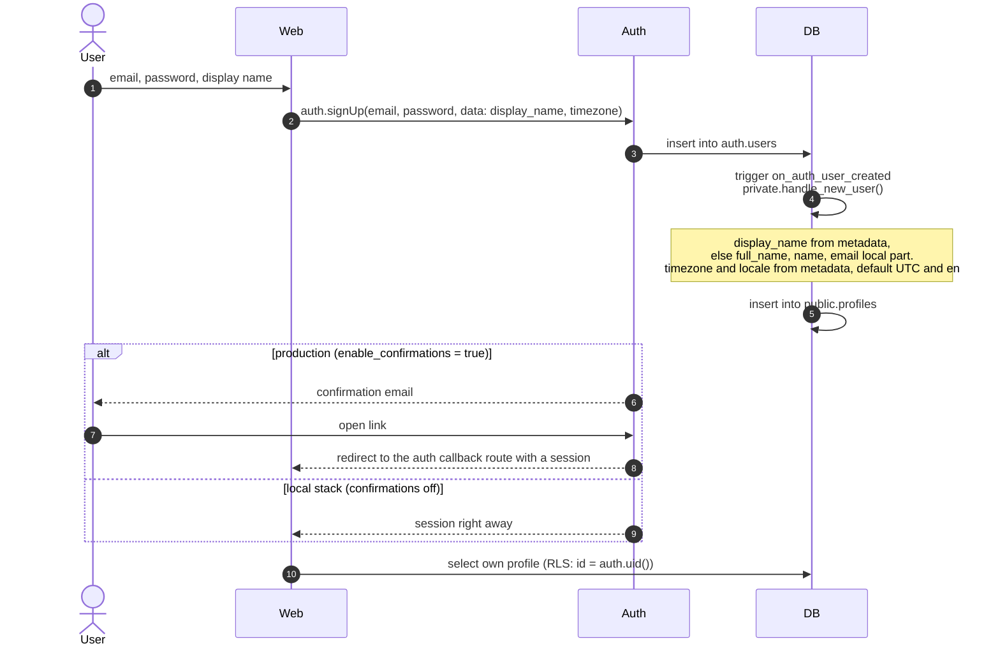

## Create a group and invite people

`create_group` and `create_invite` are security definer RPCs because groups have no insert policy. The deferred `group_members_owner_check` trigger checks at commit that the new group has exactly one owner.

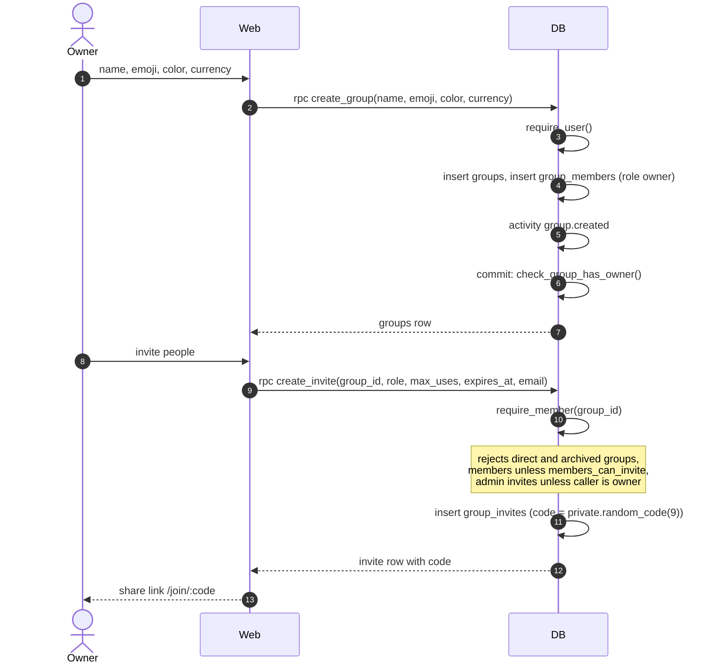

## Join through an invite link

The join page works before sign in. `invite_preview` is the one RPC `anon` may execute, and it only returns what the join page needs: group name, look, member count and up to five first names.

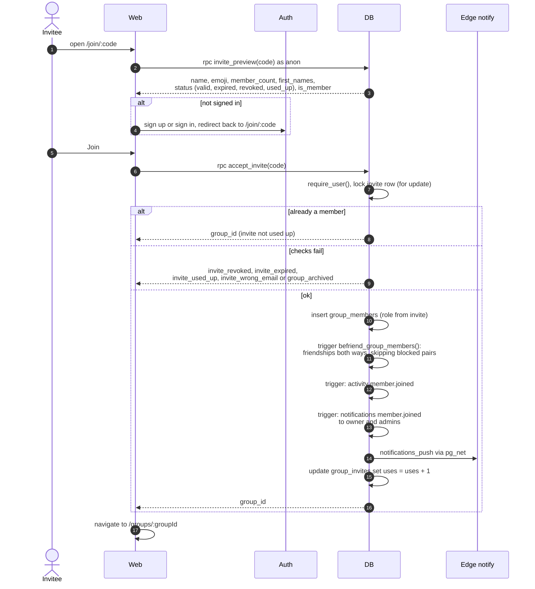

## Add an expense

The client previews the split with `@potluck/core` so people see exact cents while typing. The server does not trust that preview. For `equal`, `percent` and `shares` it recomputes the splits from the people and weights. Only `exact` and `itemized` use the client's `share_cents`, and those must add up to the amount.

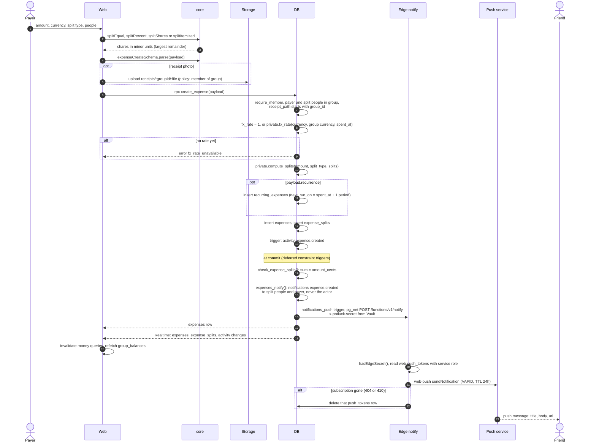

Delivery to the screen depends on the service worker handling the `push` event. The PWA is built with `vite-plugin-pwa` in `generateSW` mode and has no `push` handler yet, so the last hop is not wired up.

## Settle up

The payer is always the caller, and `settled_at` is now. When the payment is in another currency the server snapshots today's FX rate.

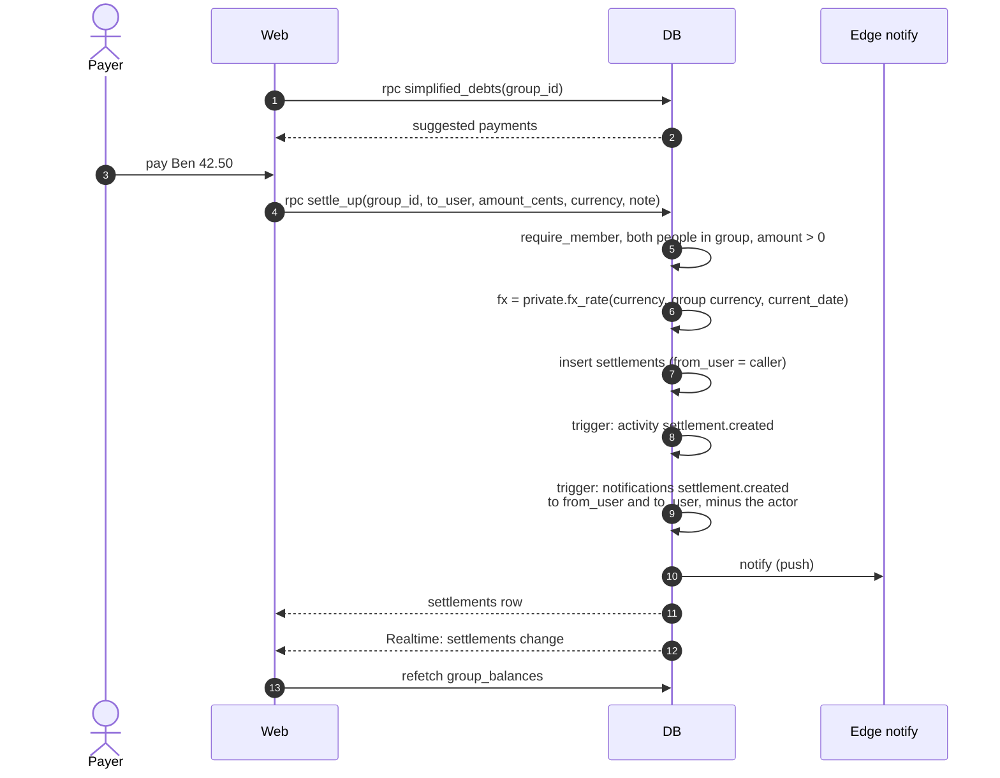

To undo a mistaken payment, call `delete_settlement(id)`. It is a soft delete open to the payer, the recipient, whoever recorded it, or an admin.

## Simplified debts

`simplified_debts` always simplifies. The client reads `groups.simplify_debts` to decide whether to show the simplified list or plain pairwise balances. `simplifyDebts()` in core runs the same greedy algorithm, so the client can preview without a round trip and tests can compare both.

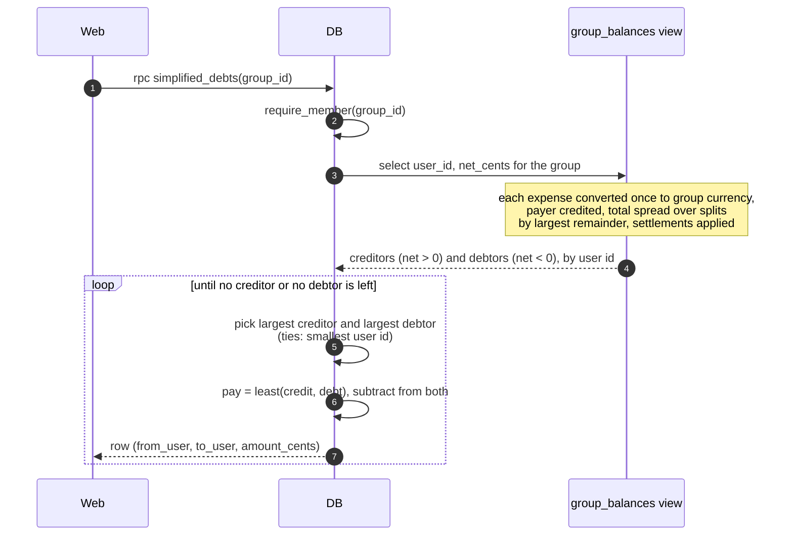

For n people with a non-zero balance the result has at most n - 1 payments.

## Plan an event

Creating a poll is a plain insert, checked by RLS (`events: members create` requires membership, `created_by = auth.uid()` and `status = 'polling'`). Everything that changes `status` goes through an RPC.

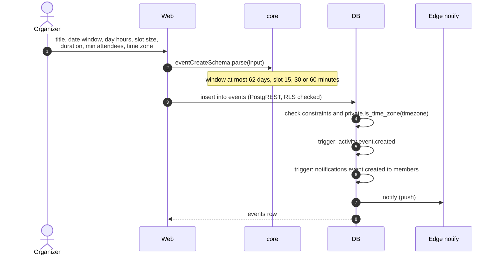

## Request availability

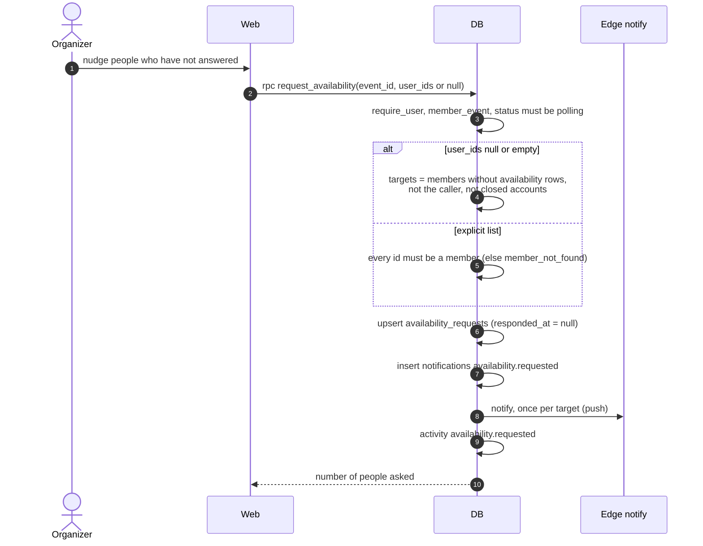

## Paint availability and the live heatmap

Each person sends their whole set of cells for the event in one call. The server replaces that person's rows, so the client never has to diff.

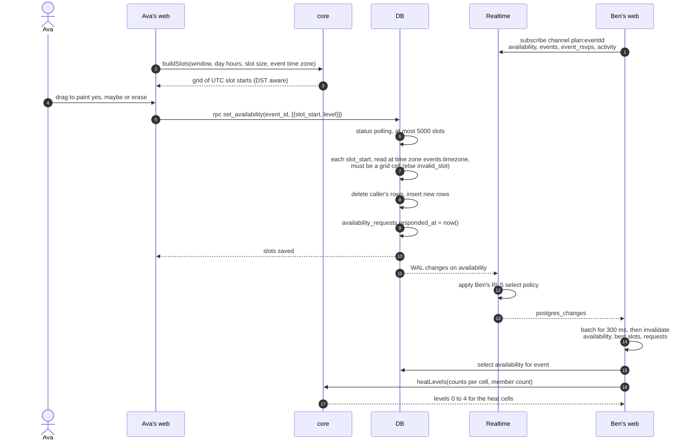

## Best slots and scheduling

`best_slots` ranks start times with the same rules as `rankSlots()` in core: a duration covers `ceil(duration / slot)` cells, a person counts as yes only if they marked yes on every cell, as maybe if every cell is yes or maybe, and `score = yes + 0.5 * maybe`.

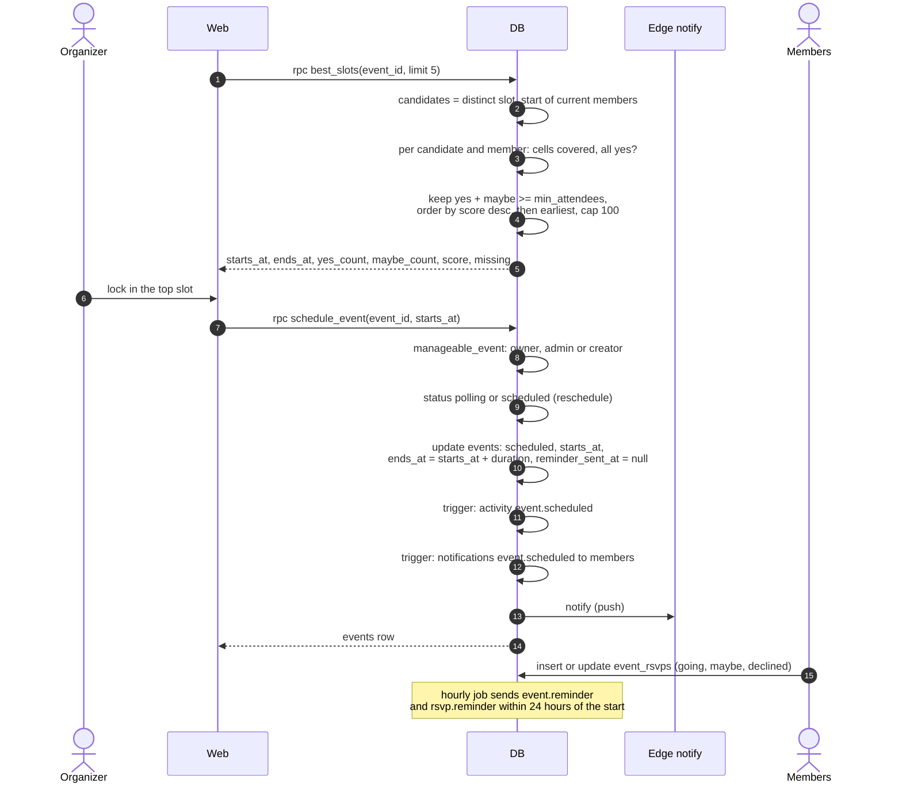

## Recurring expenses

Adding `recurrence` to a `create_expense` payload writes the first expense and a `recurring_expenses` template whose `next_run_on` is one period after `spent_at`. From then on pg_cron does the work.

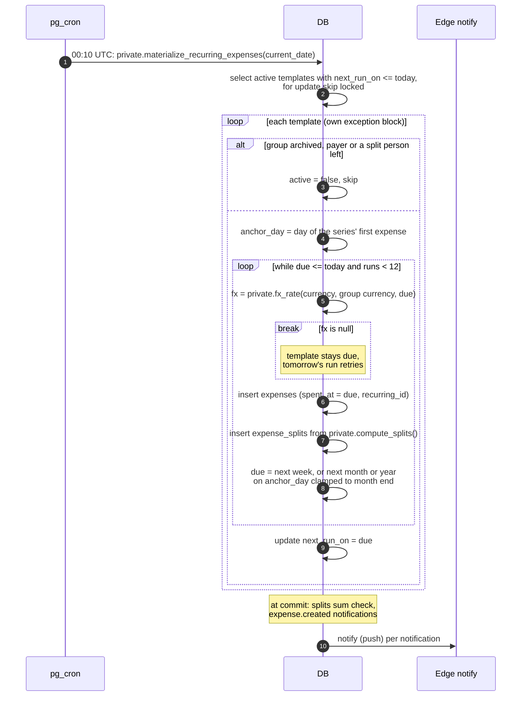

`nextOccurrence()` in core computes the same dates (Jan 31, Feb 28, Mar 31), so the UI can show when a series runs next.

## Daily FX sync

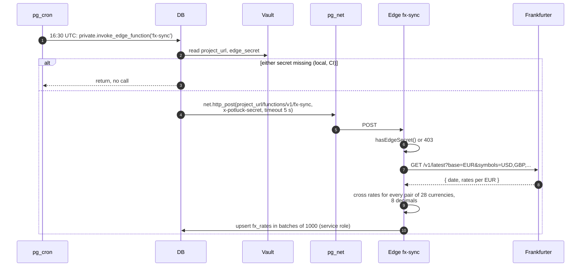

To backfill, call the function with `?from=YYYY-MM-DD` and the secret header. It fetches the range from Frankfurter and upserts every day in it.

## Delete an account

The profile is never deleted. Other people's balances still reference it, and the money tables use `on delete restrict`, so the account becomes a tombstone named "Former member".

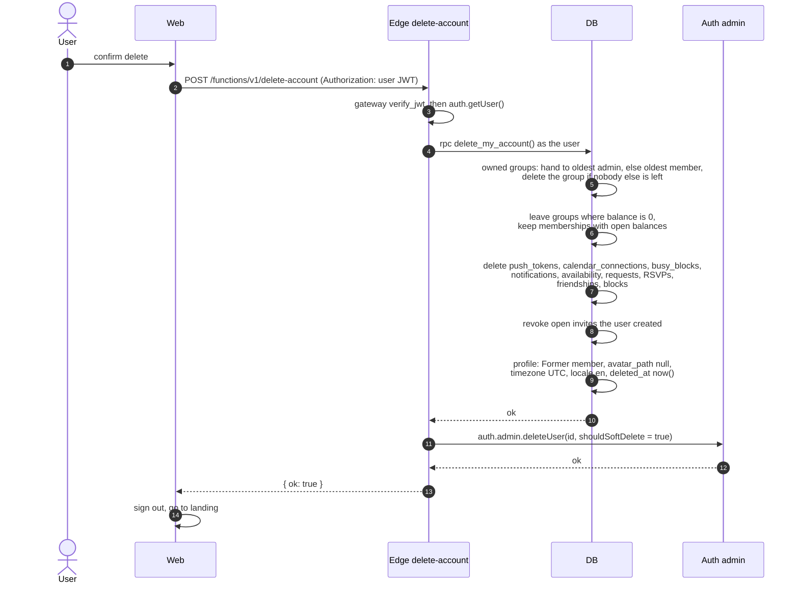

After this every RPC answers `account_deleted` for that id, and closed accounts never receive notifications. The edge function also deletes the avatar files, and a trigger drops the calendar feed token.

## Deploy pipeline

`deploy.yml` runs on pull requests, pushes to `main` and manual dispatch. `ci.yml` and `codeql.yml` run alongside it, and CI has to pass before a PR merges (see [CONTRIBUTING.md](../CONTRIBUTING.md)).

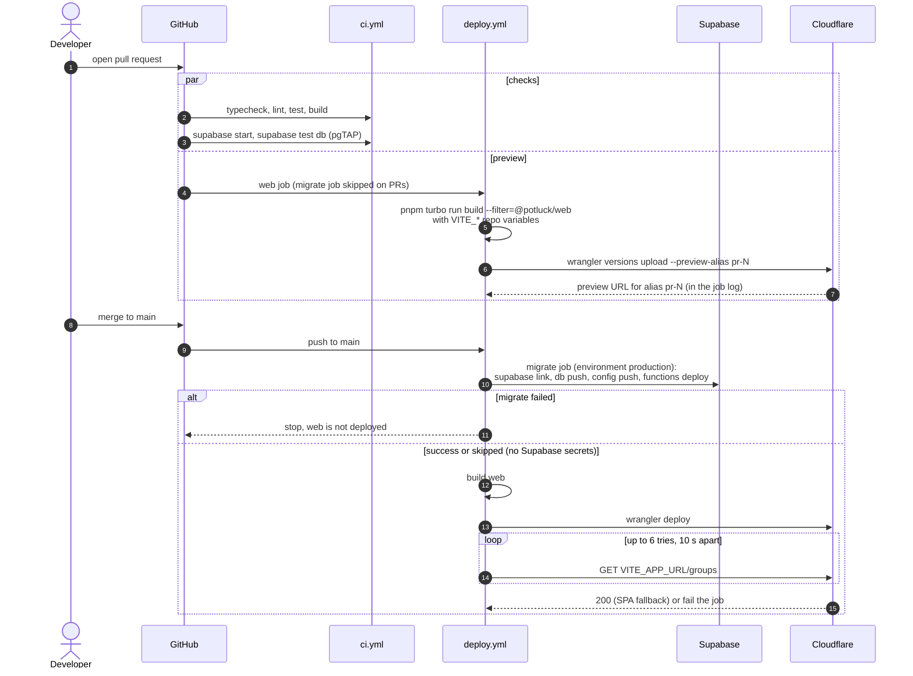

The migrations run before the new web build goes out, so the database is never older than the client that talks to it. Additive migrations keep the old client working during the gap.
