# Sequences

How the main flows move through the system, drawn from the migrations, edge functions and workflows. Function and table names match the code, so you can grep for anything you see here.

Participants used throughout:

- **Web**: `apps/web` in the browser, using `supabase-js` from `@potluck/api`.
- **Auth**, **PostgREST**, **Realtime**, **Storage**: Supabase services.
- **DB**: Postgres. RPCs live in `public`, helpers and triggers in `private`.
- **Edge**: Supabase Edge Functions in `supabase/functions`.

## Contents

- [Sign up and profile creation](#sign-up-and-profile-creation)
- [Create a group and invite people](#create-a-group-and-invite-people)
- [Join through an invite link](#join-through-an-invite-link)
- [Add someone who is not on Potluck yet, and their claim](#add-someone-who-is-not-on-potluck-yet-and-their-claim)
- [Friend links, removing and blocking](#friend-links-removing-and-blocking)
- [Delete and restore a group](#delete-and-restore-a-group)
- [Group notes](#group-notes)
- [Add an expense](#add-an-expense)
- [Scan a receipt and attach files](#scan-a-receipt-and-attach-files)
- [Settle up](#settle-up)
- [Settle with a friend across groups](#settle-with-a-friend-across-groups)
- [Remind someone who owes you](#remind-someone-who-owes-you)
- [Simplified debts](#simplified-debts)
- [Plan an event](#plan-an-event)
- [Request availability](#request-availability)
- [Paint availability and the live heatmap](#paint-availability-and-the-live-heatmap)
- [Guest availability links](#guest-availability-links)
- [Best slots and scheduling](#best-slots-and-scheduling)
- [Recurring expenses](#recurring-expenses)
- [Import a spreadsheet](#import-a-spreadsheet)
- [Daily FX sync](#daily-fx-sync)
- [Notification settings, email and the monthly summary](#notification-settings-email-and-the-monthly-summary)
- [Delete an account](#delete-an-account)
- [Two-step sign in](#two-step-sign-in)
- [Deploy pipeline](#deploy-pipeline)

## Sign up and profile creation

Nobody writes to `profiles` on sign up. The `on_auth_user_created` trigger does it in the same transaction as the auth user, so a profile always exists for a signed-in user. The web app then sends every new account through `/welcome` (name, avatar, time zone, currency) until the auth user carries `onboarded: true` in its metadata; the `_app` layout and the auth callback both check that flag, so it holds for magic links and OAuth too.

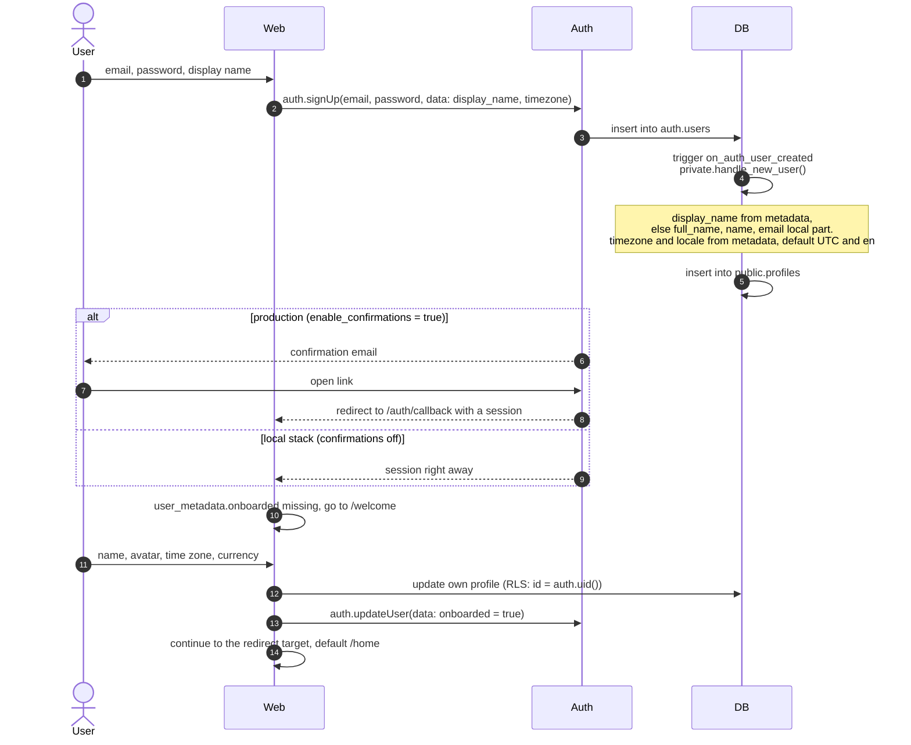

## Create a group and invite people

`create_group_v2` (type and trip dates; `create_group` for older clients) and `create_invite` are security definer RPCs because groups have no insert policy. The deferred `group_members_owner_check` trigger checks at commit that the new group has exactly one owner.

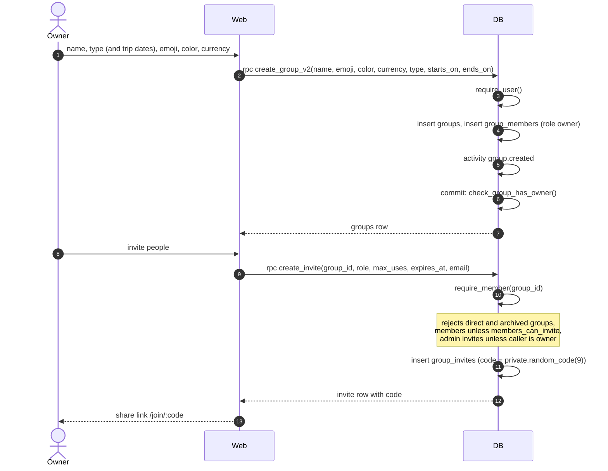

## Join through an invite link

The join page works before sign in. It calls `invite_preview_v2` (anon may execute it, like `invite_preview` before it), which only returns what the join page needs: group name, look, member count and up to five first names, plus the saved seat for a claim link (next section).


## Add someone who is not on Potluck yet, and their claim

Ava adds "Sam (sam@example.com)" to a group. Sam is a placeholder profile with no auth user ([ADR 19](adr/0019-placeholder-members-and-claiming.md)): a plain member who can pay, be in splits and be paid, but never signs in, gets push or an inbox. When Sam confirms that email, or opens his claim link, everything that names the placeholder is moved to his account.

```mermaid
sequenceDiagram
  autonumber
  actor A as Ava
  actor S as Sam
  participant W as Web
  participant Au as Auth
  participant DB as DB
  participant E as Edge notify

  A->>W: Members, Add someone (name, email)
  W->>DB: rpc add_placeholder_member(group_id, 'Sam', email)
  DB->>DB: require_can_add_people (member, open, may invite)<br/>placeholder_exists, too_many_invites
  DB->>DB: insert profiles (is_placeholder), placeholders (email),<br/>group_invites (placeholder_id, email, max_uses 1)
  DB->>DB: insert group_members (role member)<br/>trigger: activity member.added (actor Ava)
  DB->>DB: trigger: notify member.added to Sam<br/>notifications_skip_placeholders keeps only this type<br/>channels: email only (never push)
  DB-->>W: placeholder id
  Note over DB,E: send_email_notifications (cron) sends the invite to placeholders.email<br/>with claim_code; one reminder later via remind_placeholder
  A->>W: add expense split with Sam (ordinary member)
  alt Sam signs up with that email
    S->>Au: sign up, confirm email
    Au->>DB: insert or update auth.users (email_confirmed_at)
    DB->>DB: on_auth_user_created: profiles row for Sam
    DB->>DB: on_auth_user_verified: claim_placeholder(ph, Sam, announce)<br/>for each waiting seat with that email (errors swallowed)
  else Sam opens his claim link
    S->>W: /join/:code (invite_preview_v2 shows "a seat saved for Sam")
    W->>DB: rpc accept_invite(code)
    DB->>DB: email matches the link's, email confirmed,<br/>uses + 1, claim_placeholder(ph, Sam)
  end
  DB->>DB: lock group row for no key update<br/>refuse if Sam is or was in the group, or is blocked there
  DB->>DB: potluck.claiming on: rewrite every FK to profiles,<br/>activity data, notification payloads, default split,<br/>recurring templates, expense_items.user_ids
  DB->>DB: befriend the group, delete the placeholder,<br/>activity member.claimed, member.joined to owner, admins, Ava
  DB-->>W: group_id: Sam sees the group, history and balance
```

## Friend links, removing and blocking

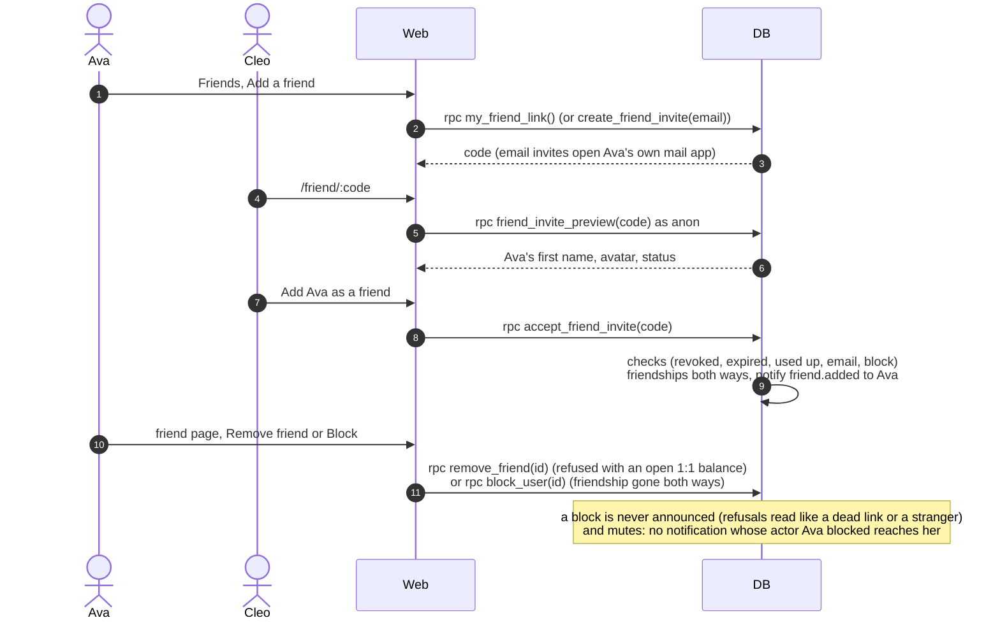

## Delete and restore a group

Deleting stamps the group instead of removing it ([ADR 20](adr/0020-group-types-restorable-deletes-and-shared-notes.md)). The policy helpers leave a stamped group out, so it vanishes from every screen at once; any member can bring it back for 30 days, then the nightly job removes it for good.

```mermaid
sequenceDiagram
  autonumber
  actor O as Owner
  actor M as Member
  participant W as Web
  participant DB as DB
  participant C as pg_cron

  O->>W: Settings, Delete group, confirm
  W->>DB: rpc delete_group(group_id)
  DB->>DB: require_member (owner), lock group row
  Note over DB: direct groups raise direct_group_not_deletable;<br/>group_has_balances while any balance or pairwise debt remains
  DB->>DB: groups.deleted_at = now(), deleted_by
  DB->>DB: open group_invites and event_guest_links revoked_at = same now()
  DB->>DB: activity group.deleted
  DB->>DB: notify other members group.deleted (deleted_group_id, group_name)
  DB-->>W: ok
  W-->>O: toast with Undo, back to Groups
  Note over DB: my_group_ids, is_group_member, is_group_admin,<br/>group_role, require_member skip deleted groups.<br/>Expense and member inserts raise group_deleted,<br/>notifications about it are dropped

  M->>W: Groups, Recently deleted
  W->>DB: rpc my_deleted_groups()
  DB-->>W: rows with deleted_at, deleted_by, purge_after
  M->>W: Restore
  W->>DB: rpc restore_group(group_id)
  DB->>DB: caller is in group_members, lock group row
  Note over DB: group_not_found once deleted 30 days ago or more
  DB->>DB: reopen invites and guest links revoked at deleted_at
  DB->>DB: deleted_at = null, activity group.restored, notify group.restored
  DB-->>W: groups row
  W-->>M: opens the group

  C->>DB: 03:20 UTC private.purge_deleted_groups()
  DB->>DB: delete groups still deleted more than 30 days ago (cascade)
```

## Group notes

The notes are one row per group in `group_whiteboards`, published to realtime. Saves carry the version the editor started from, so two people typing at once never overwrite each other silently.

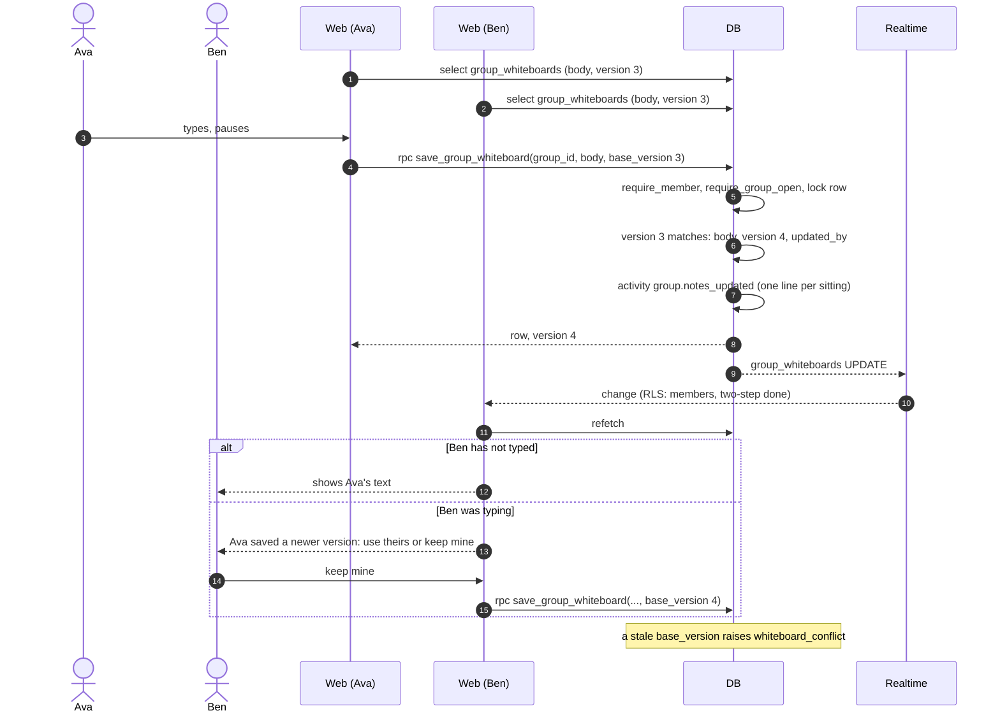

## Add an expense

The client previews the split and checks who paid with `@potluck/core` so people see exact cents while typing. The server does not trust that preview. For `equal`, `percent`, `shares` and `adjustment` it recomputes the splits from the people, weights and adjustments; for a by-item bill sent with `items` it works out the shares from the items. Only `exact` (and `itemized` from older clients) use the client's `share_cents`, and those must add up to the amount. The payers must add up to the amount too ([ADR 12](adr/0012-several-payers-refunds-and-stored-items.md)).

The form starts in the currency the viewer last used in the group (`fetchLastCurrency`) and from the group's default split (`groups.default_split`). Ticking "Use this split for new expenses" calls `set_default_split` after the expense saves.

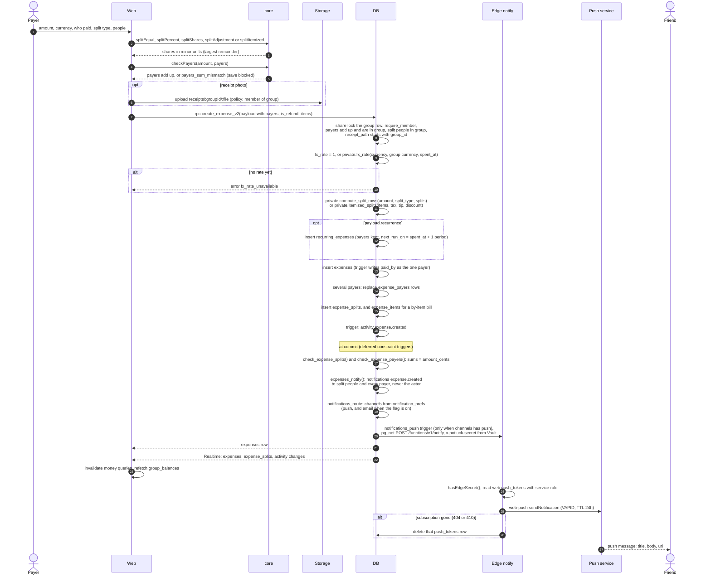

The service worker shows the message. The PWA is built with `vite-plugin-pwa` in `generateSW` mode, and `apps/web/public/push-sw.js` (pulled in through `workbox.importScripts` in `apps/web/vite.config.ts`) handles `push` by showing a notification and `notificationclick` by focusing or opening the app at the payload's `url`, same origin only. The browser subscribes from the Me page, which stores the endpoint in `push_tokens`; sign out drops that row and the subscription first so the next account on the device does not inherit it.

## Scan a receipt and attach files

Scanning happens on the device and only fills the form; the expense is saved by the same `create_expense_v2` call as above ([ADR 21](adr/0021-receipt-scanning-and-attachments.md)).

```mermaid
sequenceDiagram
  actor P as Person
  participant W as Web (expense form)
  participant SW as Service worker
  participant O as OCR worker (tesseract.js)
  participant C as core
  participant S as Storage (receipts)
  participant DB as DB

  P->>W: Scan a receipt, pick or take a photo
  W->>W: preview and OCR from the original photo,<br/>prepareImage (2000 px JPEG) only for upload
  W->>W: import("tesseract.js") (lazy chunk)
  W->>O: createWorker(eng, LSTM only) from /ocr/<version>/
  O->>SW: worker.min.js, core .wasm.js, eng.traineddata.gz
  alt first scan
    SW->>SW: fetch from our origin, keep in cache potluck-ocr
  else later scans, online or not
    SW-->>O: from cache
  end
  O-->>W: text from a lossless grayscale copy (ocrImage pass 1)
  W->>C: parseReceipt(text): itemsMatch?
  opt items do not come to the total
    W->>O: read again from an enlarged copy (pass 2), keep the better reading
  end
  O-->>W: worker terminated
  C-->>W: merchant, date, currency, total, items, tax, tip, discount, itemsMatch
  W->>P: review sheet: the photo, one box per part, editable prices, a warning if off
  P->>W: Fill in the expense
  W->>W: description, date, amount, by-item draft (everyone on every line),<br/>photo added to the attachments (nothing saved)
  P->>W: pick who had what, add more files, Save
  par each new file
    W->>S: upload receipts/:groupId/:file (policy: member, two-step done)
  end
  W->>DB: rpc create_expense_v2(payload, receipt_path = first file)
  DB->>DB: trigger: expense_attachments row 0 = receipt_path
  opt more than one file (or an edit changed them)
    W->>DB: rpc set_expense_attachments(id, paths in order)
    DB->>DB: group share lock, member, own expense or admin,<br/>paths in the group folder and uploaded, five at most
    DB->>DB: rewrite expense_attachments, receipt_path = first,<br/>activity expense.updated {attachments: {from, to}}
    W->>S: remove files that left the list, and unused uploads (uploader or admin only)
  end
  Note over W,S: a failed save keeps its uploads for the retry;<br/>closing the form deletes them
  DB-->>W: Realtime: expenses change
  W->>W: invalidate the expense (its attachments key sits under it)
```

Daily, `receipts-sweep` (pg_cron, then the edge function with the shared secret) deletes files older than a day that no expense or attachment names, through the Storage API.

On the expense page each photo opens full screen through a signed URL (one hour), with pinch, double tap and button zoom and a swipe to the next one. Members of other groups get no rows from `expense_attachments` and no object from the bucket.

## Settle up

A member records a payment they are part of, in either direction ("I paid Ben", "Ben paid me"); owners and admins also between two others. The day defaults to today; a past day keeps that day's FX rate. If the recipient saved payment methods, the payer can open their app first (ADR 15): Potluck builds the link on the client and records nothing until the payer confirms.

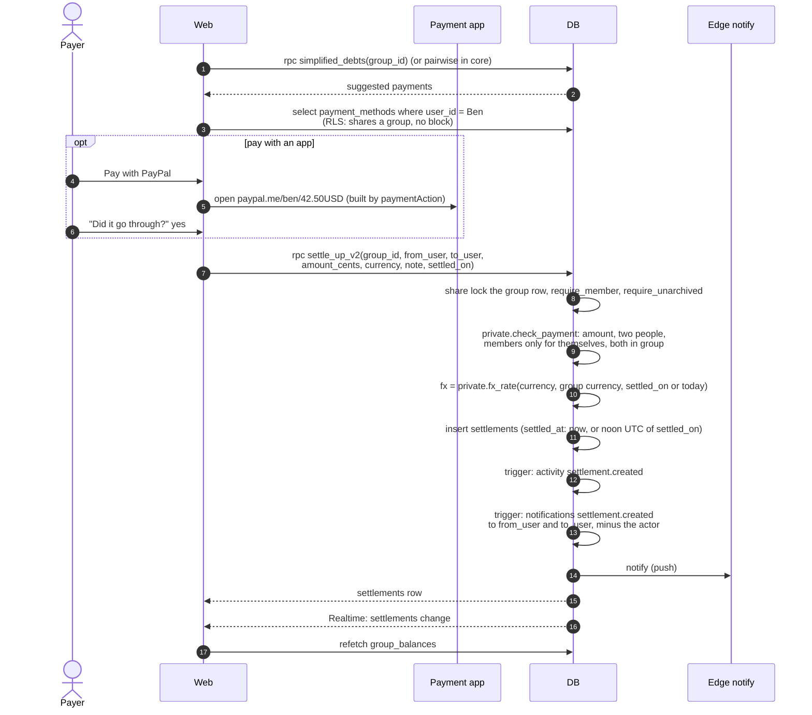

`update_settlement(id, payload)` edits a payment and `delete_settlement(id)` soft deletes it; `restore_settlement(id)` brings it back. All three are open to the payer, the recipient, whoever recorded it, or an admin. Anything that would move the balance of someone who has left is refused (`member_not_in_group`); the note stays editable. Each change logs `settlement.updated`, `settlement.deleted` or `settlement.restored` in the activity feed and notifies the other people in the payment (a note-only edit is logged, not notified).

## Settle with a friend across groups

One tap squares two people in every group they share (ADR 15). Each group keeps its own payment in its own currency, so balances stay per group.

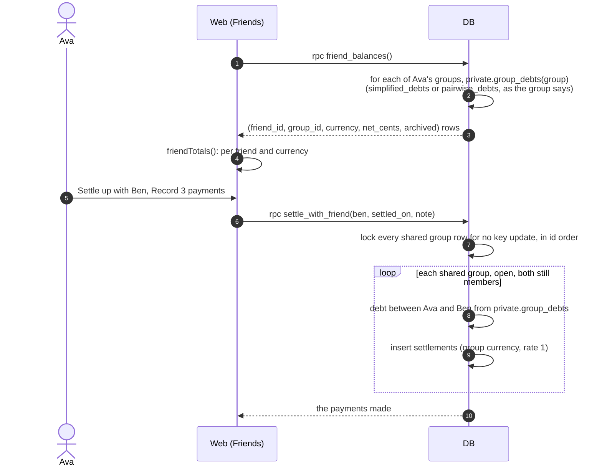

`settle_all(group_id)` does the same inside one group for every debt the caller is in ("Settle everything" on the Balances tab).

## Remind someone who owes you

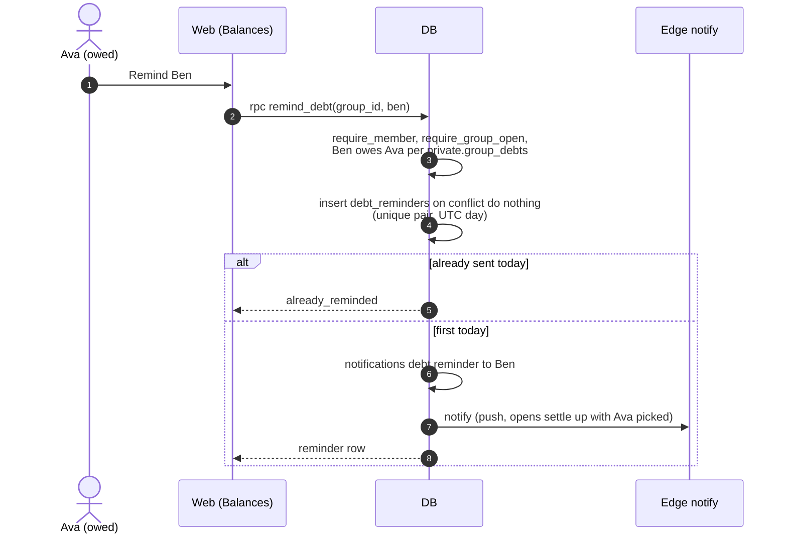

## Simplified debts

`simplified_debts` always simplifies. The client reads `groups.simplify_debts` to decide whether to show the simplified list or plain pairwise balances. `simplifyDebts()` in core runs the same greedy algorithm, so the client can preview without a round trip and tests can compare both.

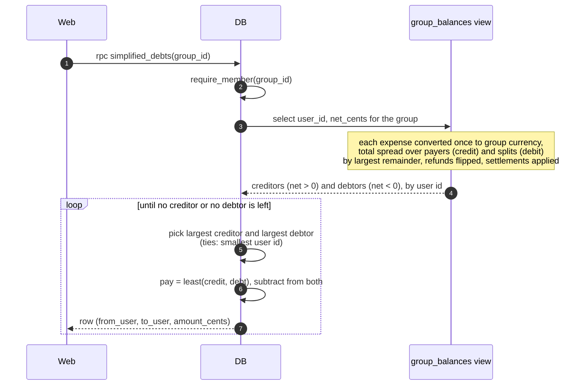

For n people with a non-zero balance the result has at most n - 1 payments.

## Plan an event

Creating a poll is a plain insert, checked by RLS (`events: members create` requires membership, `created_by = auth.uid()` and `status = 'polling'`). Everything that changes `status` goes through an RPC.

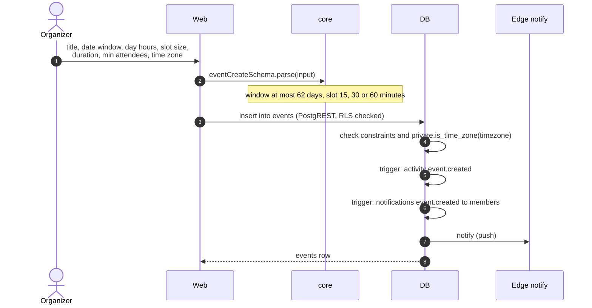

## Request availability

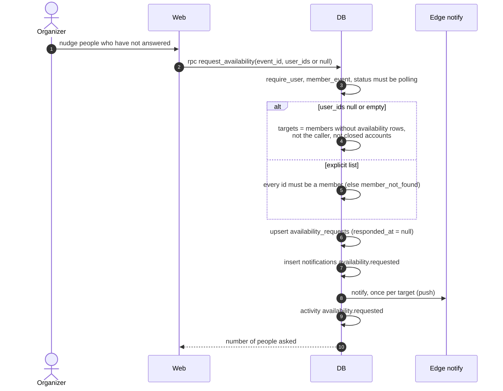

## Paint availability and the live heatmap

Each person sends their whole set of cells for the event in one call. The server replaces that person's rows, so the client never has to diff.

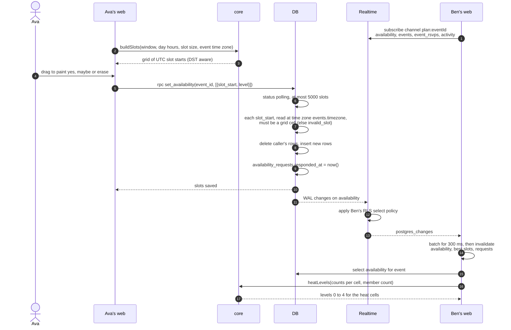

## Guest availability links

A member shares a link; someone without an account opens `/a/<code>`, types a name and paints. Guests never sign in: two `anon` RPCs check the link on every call, and a token kept in the guest's browser (stored as a sha256 on the server) lets them edit their own answer later. See [ADR 16](adr/0016-guest-availability-links.md).

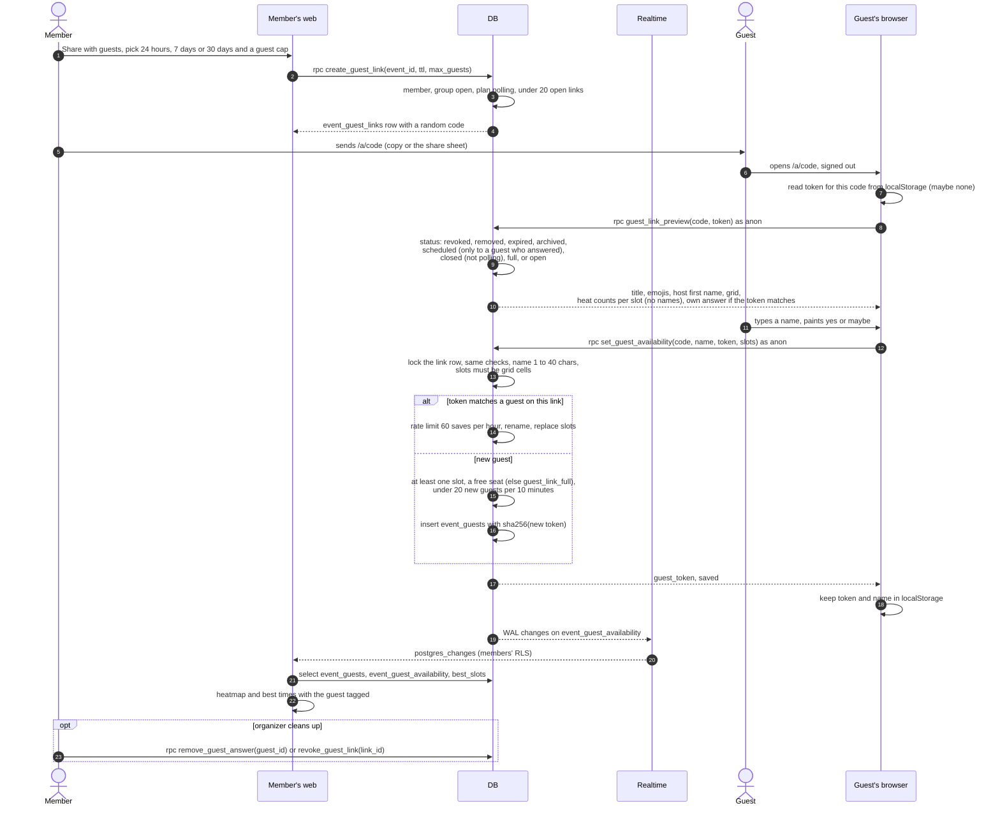

## Best slots and scheduling

`best_slots` ranks start times with the same rules as `rankSlots()` in core: a duration covers `ceil(duration / slot)` cells, a person counts as yes only if they marked yes on every cell, as maybe if every cell is yes or maybe, and `score = yes + 0.5 * maybe`.

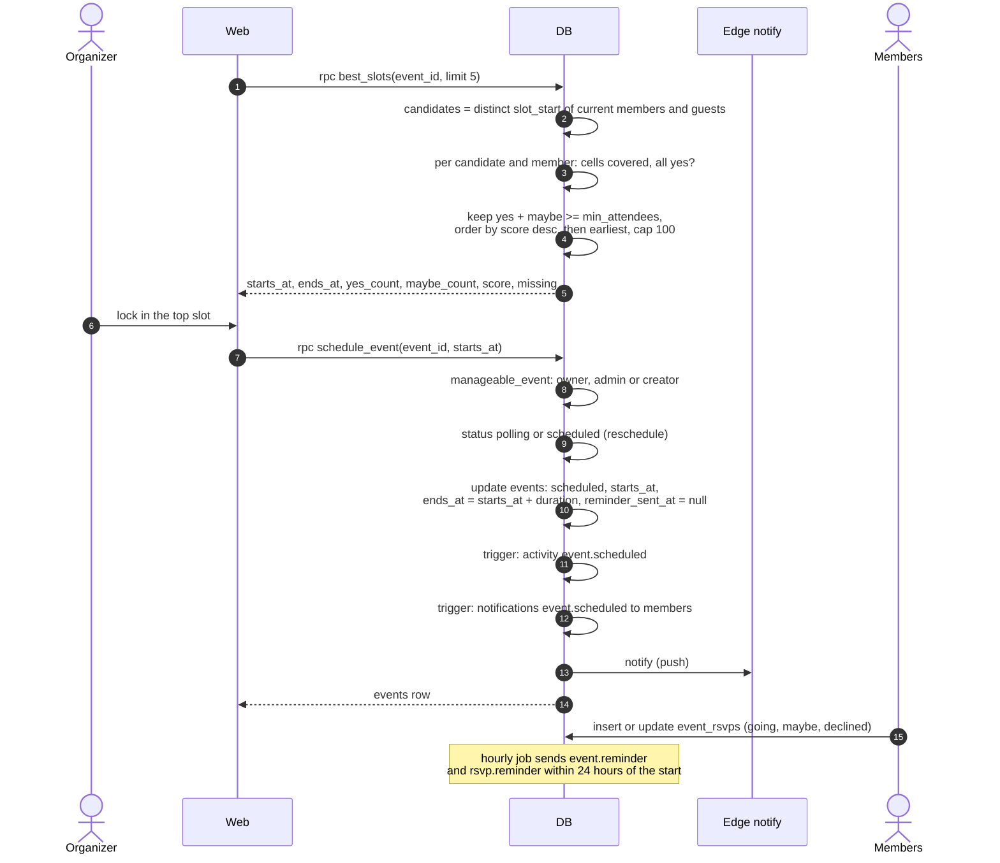

## Recurring expenses

Adding `recurrence` to a `create_expense` payload writes the first expense and a `recurring_expenses` template whose `next_run_on` is one period after `spent_at`. From then on pg_cron does the work.

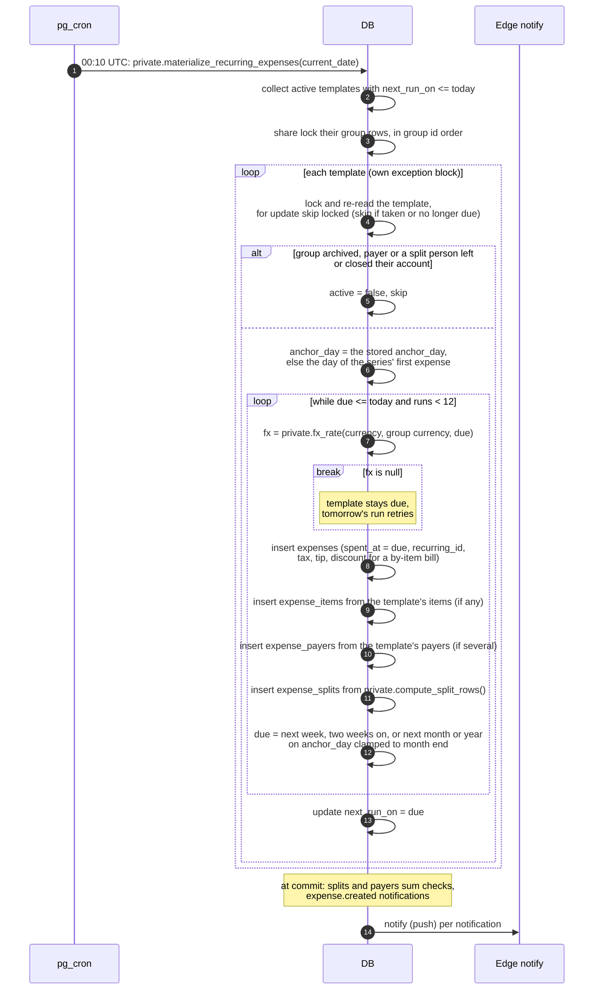

`nextOccurrence()` in core computes the same dates (Jan 31, Feb 28, Mar 31), so the UI can show when a series runs next.

### Changing, skipping and starting a series

A template only shapes the copies still to come ([ADR 14](adr/0014-editable-recurring-templates.md)). The web app opens it at `/recurring/$recurringId` in the expense form; the expense page shows the series a copy belongs to, or "Make it repeat".

```mermaid
sequenceDiagram
  autonumber
  participant U as Web app
  participant DB as DB
  participant CR as pg_cron

  U->>DB: rpc update_recurring_expense(id, payload)
  DB->>DB: share lock group, require member, not archived
  DB->>DB: admin or anyone it involves, else not_allowed
  DB->>DB: merge with the stored template, check payers,<br/>split (compute_split_rows) or items (itemized_splits)
  alt money changed and someone named has left
    DB-->>U: payer_not_in_group / split_member_not_in_group
  else
    DB->>DB: update template (anchor_day follows a new date),<br/>activity recurring.updated
    DB-->>U: template
  end

  U->>DB: rpc skip_recurring_expense(id)
  DB->>DB: next_run_on = recurring_step(next_run_on), activity recurring.skipped

  U->>DB: rpc make_expense_recurring(expense_id, recurrence)
  DB->>DB: refuse refunds, deleted, already repeating, someone left
  DB->>DB: insert template from the expense's payers, split, items
  DB->>DB: next_run_on = recurring_next_from(spent_at, recurrence, day, today)
  DB->>DB: expenses.recurring_id = template, activity recurring.created

  CR->>DB: at :05 and :35: private.send_recurring_heads_ups(now())
  loop templates due within 2 days, active, group open, nobody left
    loop payers and people with a share, not yet told about this date
      alt 09:00 on their local day before has come, and it is before 00:10 UTC on the date
        DB->>DB: notify recurring.upcoming (share, posts_on, deadline, their zone,<br/>quiet if 22:00 to 07:00 there: inbox only); insert private.recurring_heads_ups
      end
    end
  end
  Note over DB: routed by the Reminders setting:<br/>inbox always, push and email per person
```

## Import a spreadsheet

A Splitwise export or a Potluck spreadsheet comes into one group, up to 5,000 rows per transaction ([ADR 18](adr/0018-export-backup-and-import.md)). Everything up to the button press happens in the browser; the server writes every row or none.

```mermaid
sequenceDiagram
  autonumber
  actor U as User
  participant W as Web
  participant K as Worker
  participant DB as DB

  U->>W: choose a CSV (group settings, Import)
  alt large file
    W->>K: text and column names
    K-->>W: readImportFile: people, rows, totals, issues
  else small file
    W->>W: readImportFile
  end
  W->>W: guessMapping(people, members and people who left)
  W->>DB: fx_rates history for each other currency, earlier imports (activity)
  U->>W: confirm or change who is who, type missing rates, leave rows out
  W->>W: planImport: rows with their rates, balances in the group currency,<br/>total line check, rows already in the group, payments paymentProblem refuses
  U->>W: Import N rows
  loop every 5,000 rows (one import each)
    opt more than 2,000 rows
      W->>DB: rpc import_stage(batch_id, group_id, 2,000 rows) until 2,000 or fewer are left
    end
    W->>DB: rpc import_expenses(group_id, rest, source, batch_id, fingerprint)
    DB->>DB: lock group row (share), require_member, require_unarchived
    DB->>DB: read every row into working tables, find the first failing row<br/>(save_expense's checks, check_payment for payments)
    alt a row fails
      DB-->>W: the error code, hint import_row:n (nothing written)
      W-->>U: Row (file line): message, and what earlier imports wrote
    else every row passes
      DB->>DB: set potluck.importing = group id
      DB->>DB: insert expenses, payers, splits, settlements (one statement each)
      Note over DB: activity and notification rows for this group<br/>are dropped by the hold_during_import triggers
      DB->>DB: log_activity expenses.imported {expenses, payments, source, fingerprint}
      DB-->>W: {expenses, payments}
    end
  end
  W->>W: invalidate the group's money, go to its expenses
```

## Daily FX sync

```mermaid
sequenceDiagram
  autonumber
  participant CR as pg_cron
  participant DB as DB
  participant V as Vault
  participant N as pg_net
  participant E as Edge fx-sync
  participant FR as Frankfurter

  CR->>DB: 16:30 UTC: private.invoke_edge_function('fx-sync')
  DB->>V: read project_url, edge_secret
  alt either secret missing (local, CI)
    DB-->>CR: return, no call
  else
    DB->>N: net.http_post(project_url/functions/v1/fx-sync,<br/>x-potluck-secret, timeout 5 s)
    N->>E: POST
    E->>E: hasEdgeSecret() or 403
    E->>FR: GET /v1/latest?base=EUR&symbols=USD,GBP,...
    FR-->>E: { date, rates per EUR }
    E->>E: cross rates for every pair of 28 currencies,<br/>12 decimals
    E->>DB: upsert fx_rates in batches of 1000 (service role)
  end
```

To backfill, call the function with `?from=YYYY-MM-DD` and the secret header. It fetches the range from Frankfurter and upserts every day in it.

## Notification settings, email and the monthly summary

Every notification lands in the inbox. Where else it goes is decided once, when the row is inserted, from the person's settings ([ADR 11](adr/0011-notification-prefs-and-email.md)). Email waits a minute in an outbox so quick fixes fold into one message.

```mermaid
sequenceDiagram
  autonumber
  actor U as Person
  participant W as Web
  participant DB as DB
  participant CR as pg_cron
  participant E as Edge notify
  participant R as Resend
  participant UF as Edge unsubscribe

  U->>W: Me page, "What to hear about": Payments push off
  W->>DB: rpc set_notification_pref('payments', push := false)
  Note over DB: later, someone settles up with U
  DB->>DB: insert notifications settlement.created
  DB->>DB: notifications_route (before insert):<br/>channels = notification_channels(user, type)
  DB->>DB: notifications_push: no push in channels, no call
  DB-->>W: Realtime: notifications insert, inbox shows it
  opt email in channels (app_config.email_notifications on, setting on)
    DB->>DB: notifications_queue_email: private.email_outbox<br/>(subject = expense id for expense types)
    CR->>DB: every minute: send_email_notifications()
    DB->>DB: subjects quiet for 60 s; fold per expense<br/>(added and deleted inside the hold: nothing),<br/>re-check settings, mark sending in batches of 50
    DB->>E: POST notify { batch, emails } per batch (names,<br/>current amounts, signed unsubscribe tokens)
    E-->>DB: 202 at once, keeps sending in the background
    E->>R: POST /emails/batch, Idempotency-Key = batch id,<br/>List-Unsubscribe and List-Unsubscribe-Post headers
    alt 429 or 5xx
      E->>R: retry with backoff (Retry-After), up to 4 tries
    end
    E->>DB: rpc email_outbox_report(batch, delivered)<br/>sent, or pending again with backoff (failed after 5)
    Note over DB: no report in 10 minutes: the next run sends<br/>the same rows under the same batch id (the provider drops<br/>a copy), or any changed set under a new one
  end
  alt mail client one-click
    R-->>UF: POST /functions/v1/unsubscribe?token=...
    UF->>DB: rpc email_unsubscribe(token, 'unsubscribe') as anon
  else footer link
    U->>W: /unsubscribe?token=...
    W->>DB: rpc email_unsubscribe(token, 'preview'): category, masked email
    U->>W: tap Unsubscribe
    W->>DB: rpc email_unsubscribe(token, 'unsubscribe')<br/>("Keep sending them" calls 'undo')
  end
  DB->>DB: check HMAC, snapshot the settings it changes<br/>(only if one was on),<br/>set notification_prefs.email = false
```

On the first of the month at 15:00 UTC the `monthly-summary` job runs `private.send_monthly_summaries()`: everyone with a non-zero balance in a group they are in gets one `summary.monthly` notification whose data is `private.monthly_summary(uid, month)` (each group with a balance or activity that month, balance in group currency). It is an inbox card and never a push; with email on it goes through the same outbox. Running it twice for a month skips people who already have theirs.

## Delete an account

The profile is never deleted. Other people's balances still reference it, and the money tables use `on delete restrict`, so the account becomes a tombstone named "Former member".

```mermaid
sequenceDiagram
  autonumber
  actor U as User
  participant W as Web
  participant E as Edge delete-account
  participant DB as DB
  participant A as Auth admin

  U->>W: confirm delete
  W->>E: POST /functions/v1/delete-account (Authorization: user JWT)
  E->>E: gateway verify_jwt, then auth.getUser()
  E->>DB: rpc delete_my_account() as the user
  DB->>DB: lock the row of every group the user is in, in id order
  DB->>DB: owned groups: hand to oldest active admin, else oldest active member,<br/>delete the group if nobody else active is left
  DB->>DB: pause recurring templates the user pays or shares (open groups)
  DB->>DB: leave groups where balance is 0,<br/>keep memberships with open balances
  DB->>DB: delete push_tokens, calendar_connections, busy_blocks,<br/>notifications, availability, requests, RSVPs,<br/>friendships, blocks
  DB->>DB: revoke open invites the user created<br/>(seat claim links stay open)
  DB->>DB: profile: Former member, avatar_path null,<br/>timezone UTC, locale en, deleted_at now()
  DB-->>E: ok
  E->>A: auth.admin.deleteUser(id, shouldSoftDelete = true)
  A-->>E: ok
  E-->>W: { ok: true }
  W->>W: sign out, go to landing
```

After this every RPC answers `account_deleted` for that id, and closed accounts never receive notifications. The edge function also deletes the avatar files, and a trigger drops the calendar feed token.

## Two-step sign in

Set up from Me (Supabase Auth TOTP), enforced by the database ([ADR 13](adr/0013-two-step-sign-in-enforced-in-the-database.md)). Any first step (password, magic link, Google or Apple) ends in an `aal1` session; only a code makes it `aal2`.

```mermaid
sequenceDiagram
  autonumber
  actor U as User
  participant W as Web
  participant A as Auth
  participant DB as DB
  participant E as Edge mfa-recover

  Note over U,DB: Setup, on Me
  W->>A: mfa.enroll(totp), after dropping any unfinished one
  A-->>W: QR code and secret
  U->>W: first code from the app
  W->>A: mfa.challengeAndVerify(code)
  A-->>W: session upgraded to aal2
  W->>DB: rpc create_mfa_recovery_codes() (aal2 only)
  DB-->>W: ten codes, stored as SHA-256
  Note over U,DB: Signing in later
  U->>W: password (or link, or OAuth)
  A-->>W: aal1 session
  W->>W: _app beforeLoad: needsSecondFactor, go to /two-factor
  W->>DB: any REST or RPC call meanwhile
  DB-->>W: mfa_required (pre-request check)
  alt code from the app
    U->>W: 6-digit code
    W->>A: mfa.challengeAndVerify
    A-->>W: aal2 session, continue to the redirect
  else phone lost
    U->>W: recovery code
    W->>E: POST mfa-recover (aal1 JWT, code)
    E->>DB: mfa_recovery_code_matches (service role)
    E->>A: admin: delete every factor
    E->>DB: forget_mfa_recovery_codes
    W->>A: refreshSession, no factor left, continue
  end
```

Turning it off asks for a fresh code first (`challengeAndVerify`, then `unenroll`); Supabase refuses to remove a verified factor from an `aal1` session anyway.

## Deploy pipeline

`deploy.yml` runs on pull requests, after every completed CI run on `main` (`workflow_run`) and on manual dispatch. Production jobs only run when that CI run succeeded. `codeql.yml` runs alongside, and CI has to pass before a PR merges (see [CONTRIBUTING.md](../CONTRIBUTING.md)).

```mermaid
sequenceDiagram
  autonumber
  actor D as Developer
  participant GH as GitHub
  participant CI as ci.yml
  participant DP as deploy.yml
  participant SB as Supabase
  participant CF as Cloudflare

  D->>GH: open pull request
  par checks
    GH->>CI: typecheck, lint, test, build
    GH->>CI: supabase start, supabase test db (pgTAP)
  and preview
    GH->>DP: web job (migrate job skipped on PRs)
    DP->>DP: pnpm turbo run build --filter=@potluck/web<br/>with VITE_* repo variables
    DP->>CF: wrangler versions upload --preview-alias pr-N
    CF-->>DP: preview URL for alias pr-N (in the job log)
  end
  D->>GH: merge to main
  GH->>CI: push to main: checks, pgTAP, e2e
  alt CI failed
    CI-->>GH: deploy.yml jobs skip, nothing ships
  else CI passed
  GH->>DP: workflow_run (CI completed, success)
  DP->>SB: migrate job (environment production):<br/>supabase link, db push, config push, functions deploy
  alt migrate failed
    DP-->>GH: stop, web is not deployed
  else success (without Supabase secrets the push step is skipped, the job still succeeds)
    DP->>DP: build web
    DP->>CF: wrangler deploy
    loop up to 6 tries, 10 s apart
      DP->>CF: GET VITE_APP_URL/groups
    end
    CF-->>DP: 200 (SPA fallback) or fail the job
  end
  end
```

The migrations run before the new web build goes out, so the database is never older than the client that talks to it. Additive migrations keep the old client working during the gap.
