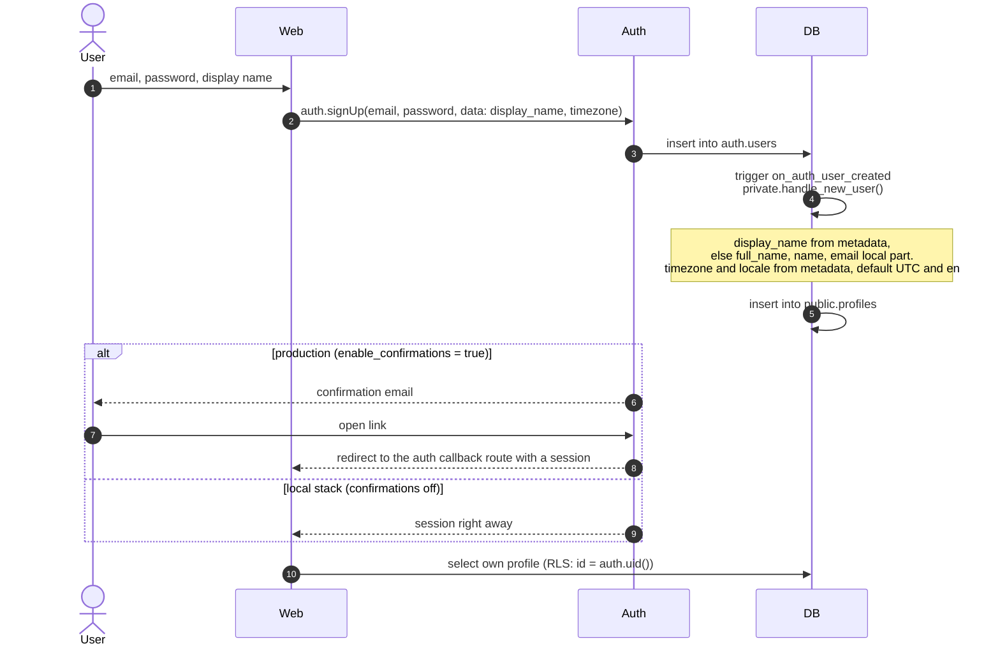
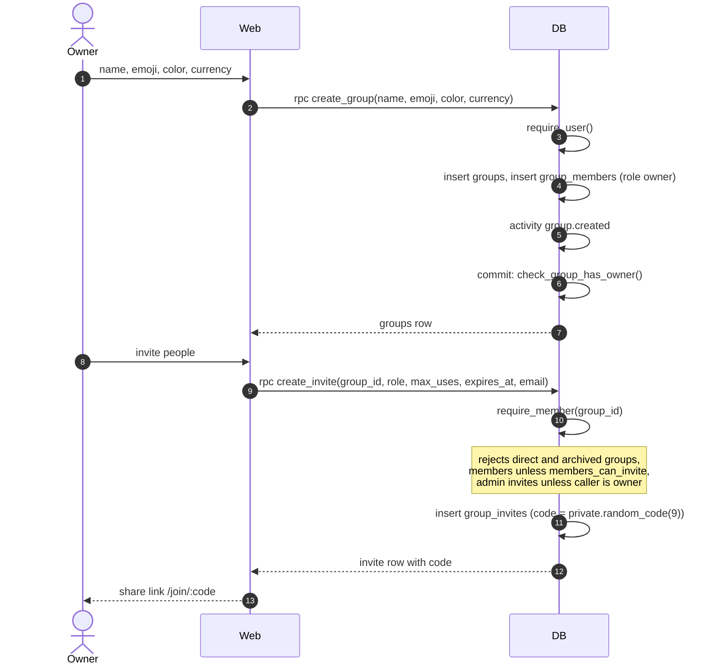
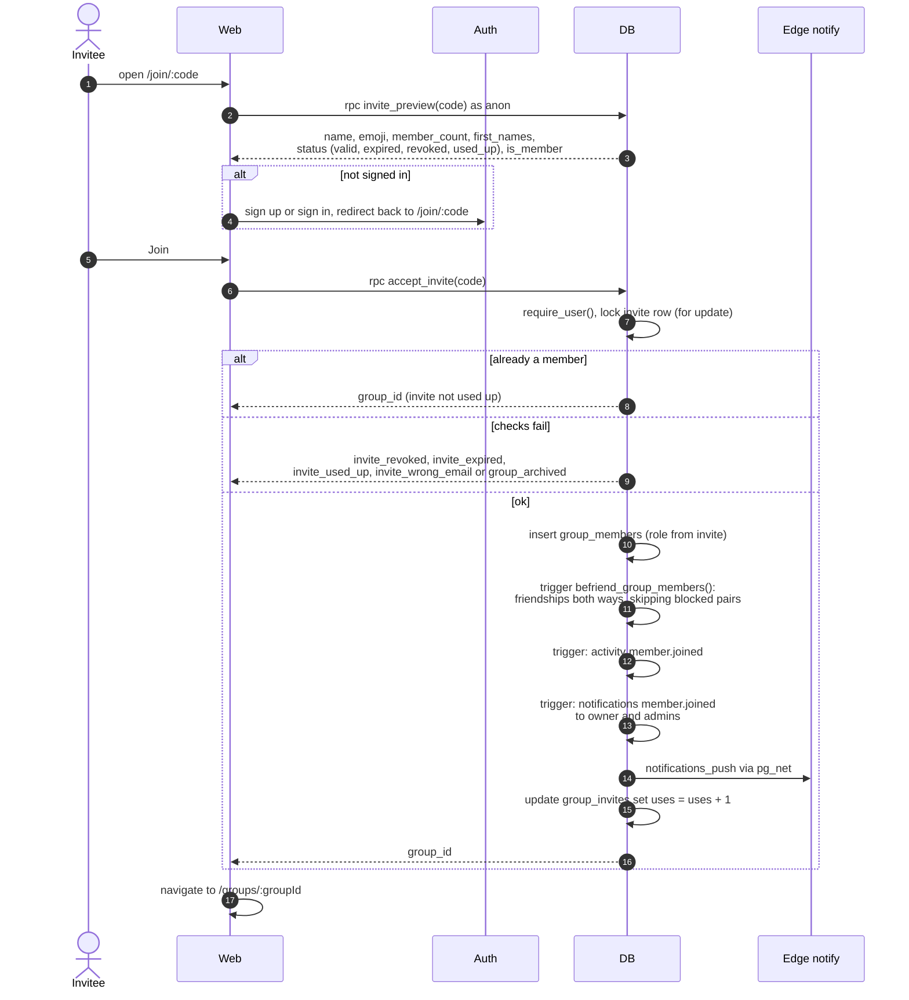

# Sequences

How the main flows move through the system, drawn from the migrations, edge functions and workflows. Function and table names match the code, so you can grep for anything you see here.

Participants used throughout:

- **Web**: `apps/web` in the browser, using `supabase-js` from `@potluck/api`.
- **Auth**, **PostgREST**, **Realtime**, **Storage**: Supabase services.
- **DB**: Postgres. RPCs live in `public`, helpers and triggers in `private`.
- **Edge**: Supabase Edge Functions in `supabase/functions`.

## Contents

- [Sign up and profile creation](#sign-up-and-profile-creation)
- [Create a group and invite people](#create-a-group-and-invite-people)
- [Join through an invite link](#join-through-an-invite-link)

## Sign up and profile creation

Nobody writes to `profiles` on sign up. The `on_auth_user_created` trigger does it in the same transaction as the auth user, so a profile always exists for a signed-in user.

## Create a group and invite people

`create_group` and `create_invite` are security definer RPCs because groups have no insert policy. The deferred `group_members_owner_check` trigger checks at commit that the new group has exactly one owner.

## Join through an invite link

The join page works before sign in. `invite_preview` is the one RPC `anon` may execute, and it only returns what the join page needs: group name, look, member count and up to five first names.

