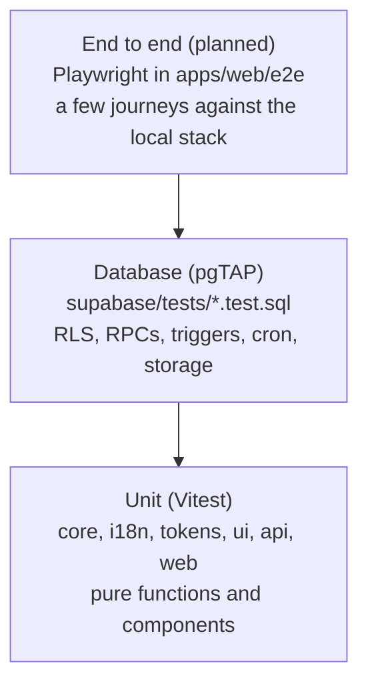

# Testing

Most of Potluck's risk sits in two places: the money math and the database rules that decide who sees what. The test suite is weighted toward those.



| Layer | Tool                         | Where                                                          | Runs in CI         |
| ----- | ---------------------------- | -------------------------------------------------------------- | ------------------ |
| Unit  | Vitest 5                     | `packages/*/src/**/*.test.ts(x)`, `apps/web/src/**/*.test.tsx` | `ci.yml` check job |
| DB    | pgTAP via `supabase test db` | `supabase/tests/*.test.sql`                                    | `ci.yml` db job    |
| E2E   | Playwright (planned)         | `apps/web/e2e`                                                 | not yet            |

## Unit tests

```sh
pnpm test                               # every workspace, through turbo
pnpm --filter @potluck/core test        # one package
cd packages/core && pnpm vitest         # watch mode
```

What each package covers:

- **core**: every split type, `allocate` remainders and tie-breaks, `computeBalances`, `simplifyDebts`, currency parsing and conversion, `buildSlots` across DST changes, `rankSlots`, `heatLevel`, `nextOccurrence` month-end clamping, the `can()` role matrix and the zod schemas. Money code uses property tests with `fast-check` (for example: an equal split always sums to the total, shares differ by at most one cent, and input order does not matter).
- **i18n**: `t()` lookups, plurals and placeholders, `formatMoney`, `formatDate` in an explicit zone. `dictionary.test.ts` checks every string: no em or en dashes, no blanks, well formed placeholders, plural pairs, and a message for every split error, schema error, activity verb and notification type.
- **tokens**: brand hues, WCAG contrast ratios, focus ring visibility and the heat scale steps.
- **ui**: components in jsdom with Testing Library (`button`, `field`, `money-input`, `sheet`, `segmented-control`, ...).
- **web**: screens and hooks in jsdom (`vite.config.ts` sets `environment: 'jsdom'`).

House rules:

- Test behavior through the public interface: call `splitPercent`, render `<MoneyInput>`, and assert on results. No tests that read or snapshot source code.
- Money assertions use exact integers. If a test needs `toBeCloseTo`, the code under test is wrong.
- Rules that exist in both core and SQL (splits, balances, debt simplification, slot ranking, recurrence) need tests on both sides with the same cases, so the two implementations stay in step.

## Coverage

Targets: **90% for `packages/core`**, **70% for `apps/web`**. Nothing enforces them yet: there are no `coverage.thresholds` in the Vitest configs, and only `core` and `i18n` have `@vitest/coverage-v8` and a `test:coverage` script.

```sh
pnpm --filter @potluck/core test:coverage
pnpm --filter @potluck/i18n test:coverage
```

Reports go to each package's `coverage/` folder, which is git-ignored. When the web screens land, add `@vitest/coverage-v8` to `apps/web` and set the thresholds in config so CI fails below target.

## Database tests

```sh
pnpm db:start   # once
pnpm db:test    # supabase test db: every file in supabase/tests, in name order
```

Each file runs in its own transaction and rolls back, so tests do not leak into each other or into your seed data. `000_setup.test.sql` installs helpers in a `tests` schema (`create_user`, `login`, `login_anon`, `group_with`, `people`, ...); see [development.md](development.md#writing-pgtap-tests) for the full list and an example.

| File                               | Covers                                                                                                             |
| ---------------------------------- | ------------------------------------------------------------------------------------------------------------------ |
| `01_schema.test.sql`               | tables, RLS on everywhere, RPC signatures and privileges, indexes, seeded config, buckets, realtime, cron          |
| `02_profiles_social.test.sql`      | profiles, friendships, blocks, reports                                                                             |
| `03_groups_rls.test.sql`           | group, member and invite policies for owner, admin, member, outsider and anon                                      |
| `04_group_rpcs.test.sql`           | create group, roles, remove, leave, transfer, direct groups                                                        |
| `05_invites.test.sql`              | `create_invite`, `invite_preview`, `accept_invite`                                                                 |
| `06_expenses.test.sql`             | expense RPCs, split math, the split sum constraint, expense RLS                                                    |
| `07_balances_settlements.test.sql` | `group_balances`, `settle_up`, `delete_settlement`, `simplified_debts`                                             |
| `08_events_availability.test.sql`  | events RLS, availability RPCs, `best_slots`, scheduling, RSVPs, `my_timeline`                                      |
| `09_platform.test.sql`             | activity, comments, notifications, push tokens, app config, calendar connections, busy blocks, recurring templates |
| `10_storage.test.sql`              | object policies for avatars, group covers and receipts                                                             |
| `11_account.test.sql`              | `delete_my_account`                                                                                                |
| `12_cron.test.sql`                 | recurring materialization, reminders, finishing past events                                                        |
| `13_edge_hooks.test.sql`           | `calendar_feed_token`, push hook is a no-op without Vault config                                                   |

Every table in `public` needs tests for both who can and who cannot read and write it. A new RPC needs tests for each error code it can raise.

CI runs `supabase start` on a fresh runner, which applies all migrations and the seed, then `supabase test db`. A migration that fails to apply fails the job before any test runs.

## End-to-end tests (planned)

Playwright will live in `apps/web/e2e` and run against `pnpm dev` plus the local Supabase stack with seed data. `.gitignore` already ignores `playwright-report/` and `test-results/`. The first journeys to cover:

1. Sign in as `ava@potluck.test`, add an equal expense in Hike crew, see the balance change.
2. Open `/join/hikecrew-demo` signed out, sign up, land in the group.
3. Paint availability in two browsers and watch the heatmap update live.
4. Settle up from the suggested payments.

Keep e2e to a handful of journeys. Anything that can be tested lower in the pyramid should be.

## Before you push

```sh
pnpm typecheck && pnpm lint && pnpm test && pnpm build
pnpm db:test    # if you touched supabase/
```

These are the same checks CI runs.
