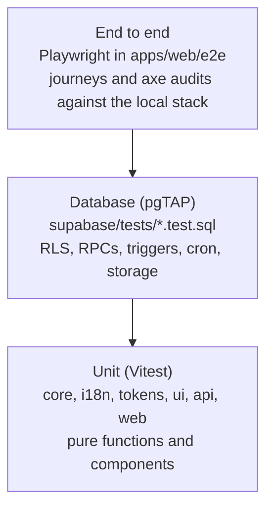

# Testing

Most of Potluck's risk sits in two places: the money math and the database rules that decide who sees what. The test suite is weighted toward those.



| Layer | Tool                                                       | Where                                                                                             | Runs in CI         |
| ----- | ---------------------------------------------------------- | ------------------------------------------------------------------------------------------------- | ------------------ |
| Unit  | Vitest 5; Node's test runner for the edge function helpers | `packages/*/src/**/*.test.ts(x)`, `apps/web/src/**/*.test.tsx`, `supabase/functions/**/*.test.ts` | `ci.yml` check job |
| DB    | pgTAP via `supabase test db`                               | `supabase/tests/*.test.sql`                                                                       | `ci.yml` db job    |
| E2E   | Playwright + axe-core                                      | `apps/web/e2e/*.spec.ts`                                                                          | `ci.yml` e2e job   |

## Unit tests

```sh
pnpm test                               # every workspace, through turbo
pnpm test:functions                     # edge function helpers (Node's test runner)
pnpm --filter @potluck/core test        # one package
cd packages/core && pnpm vitest         # watch mode
```

What each package covers:

- **core**: every split type, `allocate` remainders and tie-breaks, `computeBalances`, `simplifyDebts`, currency parsing and conversion, `buildSlots` across DST changes, `rankSlots`, `heatLevel`, `nextOccurrence` month-end clamping, the `can()` role matrix and the zod schemas. Money code uses property tests with `fast-check` (for example: an equal split always sums to the total, shares differ by at most one cent, and input order does not matter).
- **i18n**: `t()` lookups, plurals and placeholders, `formatMoney`, `formatDate` in an explicit zone. `dictionary.test.ts` checks every string: no em or en dashes, no blanks, well formed placeholders, plural pairs, and a message for every split error, schema error, activity verb and notification type.
- **tokens**: brand hues, WCAG contrast ratios, focus ring visibility and the heat scale steps.
- **ui**: components in jsdom with Testing Library (`button`, `field`, `money-input`, `sheet`, `segmented-control`, ...).
- **web**: screens and hooks in jsdom (`vite.config.ts` sets `environment: 'jsdom'`). `src/lib/server-codes.test.ts` reads the migrations and fails when an error code the database raises has no wording or is missing from the error list in [architecture.md](architecture.md#errors), or when a new migration raises `P0002`.

### Supabase fakes

| Fake                                              | Use it for                                                                                                                                                 |
| ------------------------------------------------- | ---------------------------------------------------------------------------------------------------------------------------------------------------------- |
| `packages/api/src/testing/fake-supabase.ts`       | api tests: an in-memory recorder. Seed `tables`, queue answers with `.respond('rpc:name', ...)`, assert with `queries(table)` and `argsOf(call, method)`   |
| `apps/web/src/test/supabase.ts`                   | screen tests that fetch: `vi.mock('@/lib/supabase', () => import('@/test/supabase'))`. Wraps the api fake and adds `emitChange` to replay realtime changes |
| `apps/web/src/features/expenses/fake-supabase.ts` | components fed from a seeded query cache, with writes mocked at the `@potluck/api` function boundary                                                       |

Fixtures: `apps/web/src/test/fixtures.ts`, `src/test/plan-fixtures.ts` and `src/features/expenses/test-utils.ts`. The hand-built `Expense` rows there must gain any new column (`fx_rate` is decimal text, as the api reads it).

House rules:

- Test behavior through the public interface: call `splitPercent`, render `<MoneyInput>`, and assert on results. No tests that read or snapshot source code.
- Money assertions use exact integers. If a test needs `toBeCloseTo`, the code under test is wrong.
- Rules that exist in both core and SQL (splits, balances, debt simplification, slot ranking, recurrence) need tests on both sides with the same cases, so the two implementations stay in step.

## Coverage

Every package with logic has `@vitest/coverage-v8`, a `test:coverage` script and `coverage.thresholds` in its Vitest config, so the run fails below target. CI runs `pnpm test:coverage` and writes a table per package to the job summary from `coverage/coverage-summary.json`.

| Package         | Statements and lines | Branches | Functions | Config                           |
| --------------- | -------------------- | -------- | --------- | -------------------------------- |
| `packages/core` | 90%                  | 90%      | 90%       | `packages/core/vitest.config.ts` |
| `packages/i18n` | 90%                  | 90%      | 90%       | `packages/i18n/vitest.config.ts` |
| `packages/ui`   | 70%                  | 85%      | 90%       | `packages/ui/vitest.config.ts`   |
| `packages/api`  | 60%                  | 90%      | 90%       | `packages/api/vitest.config.ts`  |
| `apps/web`      | 70%                  | 75%      | 85%       | `apps/web/vite.config.ts`        |

```sh
pnpm test:coverage                          # every package, through turbo
pnpm --filter @potluck/web test:coverage    # one package
```

Reports (`text-summary`, `lcov`, `json-summary`) go to each package's `coverage/` folder, which is git-ignored. Open `coverage/lcov-report/index.html` to see the uncovered lines.

Left out of the numbers, and why:

- `apps/web/src/routes/**`, `routeTree.gen.ts`, `main.tsx`: file routes are thin wrappers around feature screens, and the Playwright journeys cover them.
- `packages/api/src/database.types.ts`: generated by `pnpm db:types`.
- Test helpers (`src/test/**`, `src/testing/**`, `fake-supabase.ts`, `*test-utils.ts`).

If a change drops a package below its threshold, add tests for the new behavior rather than lowering the number.

## Database tests

```sh
pnpm db:start   # once
pnpm db:test    # supabase test db: every file in supabase/tests, in name order
```

Each file runs in its own transaction and rolls back, so tests do not leak into each other or into your seed data. `000_setup.test.sql` installs helpers in a `tests` schema (`create_user`, `login`, `login_anon`, `group_with`, `people`, ...); see [development.md](development.md#writing-pgtap-tests) for the full list and an example.

| File                               | Covers                                                                                                                                                                                                                                                                                                                                                                                                                 |
| ---------------------------------- | ---------------------------------------------------------------------------------------------------------------------------------------------------------------------------------------------------------------------------------------------------------------------------------------------------------------------------------------------------------------------------------------------------------------------- |
| `01_schema.test.sql`               | tables, RLS on everywhere, RPC signatures and privileges, the anon allowlist, no function raising `P0002`, indexes, seeded config, buckets, realtime, cron. Most schema changes update it; its header lists when                                                                                                                                                                                                       |
| `02_profiles_social.test.sql`      | profiles, friendships, blocks, reports                                                                                                                                                                                                                                                                                                                                                                                 |
| `03_groups_rls.test.sql`           | group, member and invite policies for owner, admin, member, outsider and anon                                                                                                                                                                                                                                                                                                                                          |
| `04_group_rpcs.test.sql`           | create group, roles, remove, leave, transfer, direct groups                                                                                                                                                                                                                                                                                                                                                            |
| `05_invites.test.sql`              | `create_invite`, `invite_preview`, `accept_invite`                                                                                                                                                                                                                                                                                                                                                                     |
| `06_expenses.test.sql`             | expense RPCs, split math, the split sum constraint, expense RLS                                                                                                                                                                                                                                                                                                                                                        |
| `07_balances_settlements.test.sql` | `group_balances`, `settle_up`, `delete_settlement`, `simplified_debts`                                                                                                                                                                                                                                                                                                                                                 |
| `08_events_availability.test.sql`  | events RLS, availability RPCs, `best_slots`, scheduling, RSVPs, `my_timeline`                                                                                                                                                                                                                                                                                                                                          |
| `09_platform.test.sql`             | activity, comments, notifications, push tokens, app config, calendar connections, busy blocks, recurring templates                                                                                                                                                                                                                                                                                                     |
| `10_storage.test.sql`              | object policies for avatars, group covers and receipts                                                                                                                                                                                                                                                                                                                                                                 |
| `11_account.test.sql`              | `delete_my_account`                                                                                                                                                                                                                                                                                                                                                                                                    |
| `12_cron.test.sql`                 | recurring materialization, reminders, finishing past events                                                                                                                                                                                                                                                                                                                                                            |
| `13_edge_hooks.test.sql`           | `calendar_feed_token`, push hook is a no-op without Vault config                                                                                                                                                                                                                                                                                                                                                       |
| `14_query_performance.test.sql`    | inlinable money helpers, array form member read policies, balances and debts after the performance migration                                                                                                                                                                                                                                                                                                           |
| `14_review_fixes.test.sql`         | archived groups refuse money, plan, comment, RSVP and recurring template writes, `delete_group` and the open balance guard, resuming a paused recurring template, templates stopping for closed accounts, RSVP deadlines, editing an expense that involves a former member                                                                                                                                             |
| `15_integrity.test.sql`            | blocked joins and invite previews, splits-only edits logging and notifying, edits, deletes, restores and payments involving people who left, former members staying readable, an owner leaving with only closed accounts, rescheduling reminders, closing an account across groups, the recurring job lock order, FX precision                                                                                         |
| `16_availability_lock.test.sql`    | `set_availability` holds a per event and viewer advisory lock around its replace, so two requests from the same viewer (a save in flight and the flush sent as the page is left) apply one after the other                                                                                                                                                                                                             |
| `17_notification_prefs.test.sql`   | notification settings (defaults, one channel at a time, who can read and write), routing to push and email, the email flag, the outbox hold and folding per expense, batches, delivery reports, retries with backoff and the attempt cap, unsubscribe tokens with preview and an undo that restores the exact prior settings, `expense.deleted`, `expense.restored`, `member.added`, settings dropped with the account |
| `18_monthly_summary.test.sql`      | `private.monthly_summary` (balances in group currency, the month's expenses and payments) and the monthly job: who gets one, no duplicates, inbox only while email is off, email opt-out keeps the card, closed accounts                                                                                                                                                                                               |
| `19_expense_entry.test.sql`        | several payers (balances, sum check, v1 keeping them), refunds, the adjustment split, stored items with tax, tip and discount, the default split, RLS on `expense_payers` and `expense_items`, departed members, archived groups, recurring payers; same cases as core                                                                                                                                                 |

Every table in `public` needs tests for both who can and who cannot read and write it. A new RPC needs tests for each error code it can raise.

CI runs `supabase start` on a fresh runner, which applies all migrations and the seed, then `supabase test db`. A migration that fails to apply fails the job before any test runs.

## End-to-end tests

Playwright lives in `apps/web/e2e` and runs against a production build served by `vite preview` on port 4173, talking to the local Supabase stack. CI does the same.

```sh
pnpm db:start                                        # once, if the stack is not running
pnpm --filter @potluck/web exec playwright install chromium webkit   # once
pnpm e2e                                             # build, serve on :4173, run every project
pnpm --filter @potluck/web exec playwright test e2e/expenses.spec.ts --project=desktop-chromium
pnpm --filter @potluck/web exec playwright show-report               # after a failure
```

Locally, a server already listening on :4173 is reused, even if another checkout or worktree started it, so the tests may run another branch's build. If you change app code while one is running, rebuild with `VITE_APP_URL=http://localhost:4173 pnpm --filter @potluck/web build` or stop it first. `E2E_PORT=4174` runs on another port beside it. `E2E_WORKERS` sets the local worker count (default 2).

Projects (`apps/web/playwright.config.ts`):

| Project            | Device                       |
| ------------------ | ---------------------------- |
| `mobile-chromium`  | 390x844, touch, mobile       |
| `desktop-chromium` | 1440x900                     |
| `mobile-webkit`    | iPhone sized WebKit, 390x844 |

Every context runs in UTC with `en-US`, and service workers are blocked so the PWA cache never serves a stale shell. Failures keep a trace and a screenshot (one per signed in page in multi user tests) in `test-results/` and the HTML report in `playwright-report/`, both git-ignored. CI uploads the report as an artifact.

Where the test data comes from:

- `e2e/global-setup.ts` reads the API URL and publishable key from `.env.local` and the service role key from `supabase status -o env` at run time (or `E2E_SERVICE_ROLE_KEY` if set). No key is written to the repository. It also sets today's EUR to USD rate to 1.1 in the local database, which every checkout shares, so manual numbers can change after an e2e run.
- `e2e/support/fixtures.ts` gives each test `newUser()`, which creates a fresh confirmed and onboarded user through the auth admin API, and `openAs(user)`, which opens a new browser context already signed in (the session is placed in local storage, no login form). `openAs(null)` is a signed out visitor.
- `e2e/support/api.ts` sets up groups and expenses through `@potluck/api`, as those users.

Every test creates its own users and groups with unique names, so tests run in parallel and never depend on seed rows or on each other. Selectors are roles and labels built with `t()` from `@potluck/i18n`, never CSS classes: copy changes do not break them, and a missing label does.

| Spec                     | Covers                                                                                                                                                                                                                           |
| ------------------------ | -------------------------------------------------------------------------------------------------------------------------------------------------------------------------------------------------------------------------------- |
| `onboarding.spec.ts`     | landing page, sign up, onboarding (name, time zone, currency), skipping the first group step, home greets you by name                                                                                                            |
| `groups-invites.spec.ts` | create a group, create an invite link, a signed out friend opens `/join/<code>`, signs in and joins, the owner sees them                                                                                                         |
| `expenses.spec.ts`       | equal, exact, percent, shares and itemized splits with each person's share on the detail page, editing the amount, delete with Undo, a EUR expense in a USD group showing the converted amount                                   |
| `expense-entry.spec.ts`  | two payers agree across row, detail, balances and CSV; payers that do not add up are refused; adjustment split and edit history; a refund; the two-person shortcut; by item reopening its items; default split and last currency |
| `balances.spec.ts`       | balances follow an expense, settle up reaches all square ($0.00), activity lists the payment                                                                                                                                     |
| `plans.spec.ts`          | create a plan, a second user paints availability with the keyboard, the host's heatmap updates live (realtime), best slot listed, lock it in, RSVP, download the `.ics`                                                          |
| `members.spec.ts`        | promote to admin, a member who owes money cannot be removed, remove a settled member, admins get no owner actions, members get no member actions and no delete button                                                            |
| `me.spec.ts`             | theme choice survives a reload, calendar feed link shown, deleting the account signs out and the password stops working                                                                                                          |
| `notifications.spec.ts`  | turning Payments push off on the Me page survives a reload; a payment then still lands in the inbox but is not routed to push, while a new expense is                                                                            |
| `a11y.spec.ts`           | axe (WCAG 2.1 A and AA) on landing, home, group expenses, add expense, balances, event page, Me and the unsubscribe page: fails on serious or critical violations and on any sideways page scroll                                |
| `account.spec.ts`        | change password (wrong current refused, other devices signed out, a security email sent), sign out everywhere, two-step setup (codes only close with "I saved them") and sign in with a code (wrong code refused, API and Storage refused at aal1), turning it off clears the codes, a recovery code, five wrong recovery tries then a pause, email change through Mailpit links and calling one off, the language switching live (text and amounts) and following the account to a new device |

The landing audit emulates reduced motion: the hero demo is decorative and loops fade-ins, so the audit checks its settled state.

Keep e2e to journeys. Anything that can be tested lower in the pyramid should be.

## Before you push

```sh
pnpm verify      # everything in the CI check job
pnpm verify:db   # everything in the CI db job; run pnpm db:reset first
pnpm e2e         # if you changed a screen or a journey (or one spec, see above)
```

CI runs the same scripts (`scripts/verify.mjs`), so a green run locally is a green check job:

| Script           | Steps, in order                                                                                                                                                                                        |
| ---------------- | ------------------------------------------------------------------------------------------------------------------------------------------------------------------------------------------------------ |
| `pnpm verify`    | `prettier --check .`, `eslint`, route tree, agent map and skills copy are up to date, `typecheck`, `test:coverage` (thresholds), `test:functions`, production `build` with placeholder `VITE_*` values |
| `pnpm verify:db` | `supabase db lint --fail-on error`, `supabase test db`, `supabase/schema/current.sql` and `packages/api/src/database.types.ts` match a fresh generation from the local database                        |

`--concurrency=1` passes through to turbo on a small machine, `--only=lint,typecheck` runs a subset and `--list` prints the steps. The database checks run against whatever the shared local stack was last reset to (see [development.md](development.md#shared-local-stack)).
